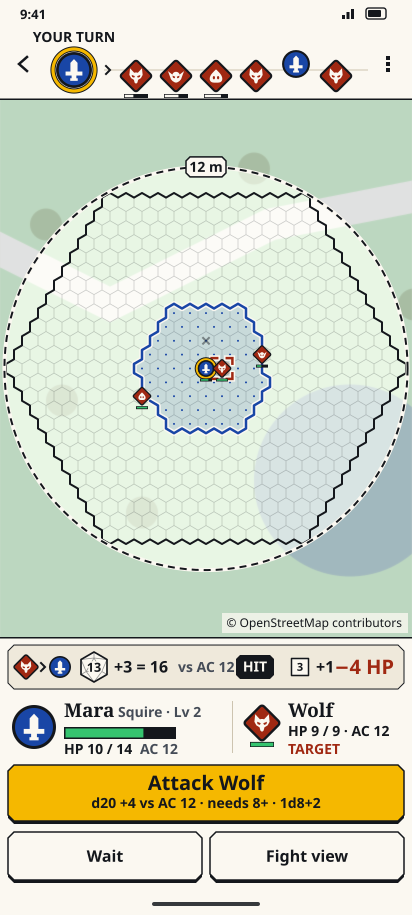
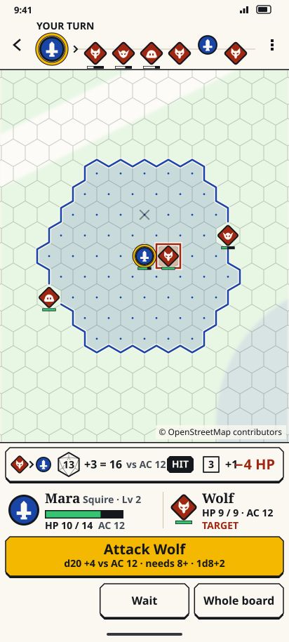
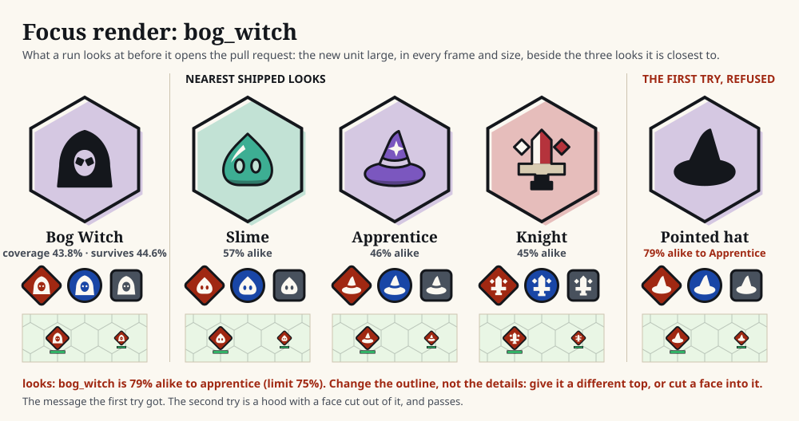

# Esper visuals: Field Mat

How Esper looks, and how a Claude Code run builds and checks it. This document
is the contract for anything drawn on screen: change it here first. The hard
rules a run must not break are also listed in
[`GAME_DESIGN.md`](GAME_DESIGN.md#visuals), because every dispatched run reads
that file.

**Status: proposed on 2026-11-18. It is approved when it is on `main`. Nothing
in it is built.** Nothing here was compiled for Android or run on a phone:
there is no Android SDK on the host that wrote it. What was actually run or
looked up is said where it matters, and everything else is listed in
[§11](#11-unverified-and-risks). The pictures are mockups drawn by a throwaway
generator, not output of the app. Nothing regenerates or verifies them. They
show the six starting units and are frozen: no content pull request edits
them, and each is superseded by the pictures under `app/src/test/snapshots/`
once the step that draws its screen lands.

Where two sources disagree, or one is silent, the order is: this text, then
the constants of §5, then the mockup SVG. The mockups are drawn 1 unit to 1 dp
from those constants, so a size or a position the text does not give may be
read from the SVG source.

Reference phone for every size below: 412 x 915 dp, 2.625 px per dp
(1080 px wide, 420 dpi), so 1 dp is 0.159 mm.

| Picture | Shows |
|---|---|
| [`visuals/scale.svg`](visuals/scale.svg) | A cell today and in the two proposed views, 1:1 |
| [`visuals/fight-view.svg`](visuals/fight-view.svg) | The Encounter screen in the fight view, true scale |
| [`visuals/whole-board.svg`](visuals/whole-board.svg) | The same moment with the whole board on screen |
| [`visuals/fight-view-sun.svg`](visuals/fight-view-sun.svg), [`visuals/fight-view-grey.svg`](visuals/fight-view-grey.svg) | The fight view under a 45% white veil, and with no colour |
| [`visuals/units.svg`](visuals/units.svg) | The six starting looks at every size, frames, states, a job family, the no-look fallback |
| [`visuals/identity.svg`](visuals/identity.svg) | Palette, contrast, colour-vision rows, type, shapes, dice, the board's vocabulary, the Encounter header in both states |
| [`visuals/dice.svg`](visuals/dice.svg) | One attack frame by frame, and its still for animations off |
| [`visuals/map.svg`](visuals/map.svg) | The walking map with the Encounter card |
| [`visuals/sheet.svg`](visuals/sheet.svg) | The character sheet and a bestiary entry |
| [`visuals/add-a-look.svg`](visuals/add-a-look.svg) | The focus render for a unit being added (§8) |

---

## 1. Intent

Esper has no art direction today: stock Material purple, raw OpenStreetMap
tiles, and units drawn as tinted cells 3.3 dp (half a millimetre) wide when a
fight opens.


The visuals exist to make three things readable in a one-second glance,
outdoors, in one hand: where I am on the real map, whose turn it is and what I
can do, and what the dice just decided. The feeling is a tabletop game unrolled
on your own street: a paper battle mat over the map, ink lines, tokens you could
cut out with scissors, dice you can see.

One rule makes it buildable: **text in, pixels out.** Every visual is a path, a
named colour or a number that Claude writes as text, and that a renderer turns
into a PNG Claude can read before it opens the pull request. Anything that loop
cannot render is not in the design.

## 2. Goals, non-goals, anti-goals

**Goals**

- A unit reads as "mine or hostile" and "what it is" at its true size, in
  sunlight, without relying on colour.
- One identity that fifty player-dispatched runs cannot drift away from, because
  it lives in one theme folder, one data field and tests.
- A new monster or job gets its look by adding data to its one JSON file, and is
  playable with no look at all.
- A run with no emulator sees what it built: looks in seconds with `cargo`,
  screens in minutes with a JVM screenshot test.
- No binary art in the repo. The only PNGs are test outputs of fixed fixtures.

**Non-goals**

- Character animation, walk cycles, particles, 3D, sound.
- A dark scheme. Colour names are roles, so one can follow.
- Choosing or styling the self-hosted tile source (roadmap item). This says only
  how the map is treated before and after.
- Any rule change. The mat draws what the rules decide.
- Art for territories, structures, Rituals, guilds. The shape language is meant
  to stretch to them; heraldry for guilds is kept in reserve (§12, question 9).

**Anti-goals** (failure even if it works)

- A look that needs a human artist, an image model, a paid service or a font
  licence to extend.
- Art that reads enlarged in a mockup and turns to mush at 16 dp.
- A pretty battle scene that hides the real map (Pillar 1).
- Effects that vanish in sunlight: soft shadows, glows, thin type, see-through
  tints carrying meaning.
- Colour spent on which monster a unit is instead of whose side it is on.

## 3. Approaches considered

Three directions were designed independently, each was built blind by a fresh
run from its document alone, and three judges scored them (150 points).

| Direction | In short | Score |
|---|---|---|
| **A. Field Mat** (the base) | Paper mat over the map. A unit is a token: frame and colour say the side, a one-path glyph from the unit's own JSON says what it is. Plates with faces at bestiary size. Looks checked with `cargo`, screens with JVM screenshots. | 116 |
| **C. Blazon** | Units as coats of arms composed from four words and a shared library of charges. Nothing is drawn per monster. | 111 |
| **B. Daylight Battle Mat** | Like A, with HP shown as the token draining of colour, real map geometry inked over the tiles, a bottom navigation bar. | 103 |

A won because it is the clearest board at the size a fight is played, the only
one whose loop covers both a unit's look and whole screens, and the one that
keeps the D&D third of the game: creatures with faces, dice on screen. C lost on
the one-second glance: colour said which monster, so hostiles could wear the
player's colours, and many monsters shared one silhouette. B lost on HP as fill
(hurt units fade) and on dropping the Prompts screen.

Taken from B: the camera as its own early pull request; the move range as one
outlined region; target brackets; the 16 dp token floor; the deeper side
colours; the predicted next-to-act strip; the sun-veil render; even-odd glyphs;
stateless `...Content(state)` screens; "a fight never waits on a tile"; "No
walking needed". Taken from C: dice on the map with a still for animations off;
job lineage; the fallback from the id; the focus render; colour-vision rows; the
replay queue and the board as layers; the rule that content never touches a
shared picture; the Visuals section in `GAME_DESIGN.md`.

Dropped early: creatures drawn in Kotlin (a monster would be code), shader
looks (cannot be rendered in CI, wash out in sun), a third-party icon set
(mixed authors, per-asset attribution), sprite grids (144 cells per unit, side
carried only by a base colour).

---

## 4. The look

### 4.1 Identity

Mood: a field table. Pale paper, near-black ink, four signals, hard edges.


**Palette.** These names are the only colours in the app.

| Name | Hex | Use | Contrast |
|---|---|---|---|
| `ink` | `#14171C` | text, every outline | 16.9 on `paper`, 14.8 on `paperDim` |
| `inkSoft` | `#454C57` | secondary text | 8.2 on `paper`, 7.2 on `paperDim` |
| `paper` | `#FBF8F1` | screen ground, cards, glyphs on tokens | |
| `paperDim` | `#EFE9DB` | wells: fields, stat tiles, the track of an XP or job-point bar | |
| `line` | `#CDC4B0` | dividers only, never text | 1.6 on `paper` |
| `ally` | `#1946A6` | your side, where you can go | `paper` on it 8.0 |
| `foe` | `#A02812` | hostile, what you can hit, errors | `paper` on it 7.1 |
| `neutral` | `#48515D` | units in nobody's fight (later) | `paper` on it 7.6 |
| `turn` | `#F5B800` | acting now, and the one primary action of a screen. Nothing else | `ink` on it 10.0 |
| `vital` | `#35C46F` | HP fill, always on an `ink` track | 7.9 on `ink` |
| `vitalInk` | `#0E5A31` | green text ("Mastered") | 7.8 on `paper` |
| `esper` | `#722A8C` | things that grow: XP, job points, Ask Claude | 8.2 on `paper`, 7.2 on `paperDim` |

Plate hues, used only on plates and never for a side: `moss` `#7C9A3C`, `jade`
`#3DAE93`, `slate` `#73808F`, `steel` `#93A1B3`, `violet` `#7B57BF`, `crimson`
`#B5333C`, `ember` `#D9782D`, `bone` `#D8CCB2`. Derived, in code, never
written as hex: `tint(hue)` = hue mixed 70% toward `paper`; `shade(hue)` = hue
mixed 35% toward `ink`; `accent(hue)` = `ember`, or `bone` when the hue is
`ember` or `crimson`. Mixing is per-channel linear interpolation on sRGB
values, each channel rounded to the nearest integer: `tint(moss)` is
`#D5DCBB`, `shade(moss)` `#586C31`, `tint(violet)` `#D5C8E2`. Write the three
lines of arithmetic; Compose's `lerp(Color, Color, Float)` mixes in Oklab and
gives other colours.

Colour rules:

- **On the board, colour says whose side, never which monster.** `ally` and
  `foe` have the same brightness (1.14:1 against each other, the same grey), so
  the frame shape carries the side and colour confirms it.
- **Gold (`turn`) means acting now, and the one primary action.** Not low HP,
  not a natural 20, not a pin on the map. It is always edged in `ink`.
- Coloured text (`ally`, `foe`, `vitalInk`, `esper`) goes on `paper` only. On
  `paperDim` text is `ink` or `inkSoft`.
- One light scheme. Sunlight is the hard case.

**Contrast floors.** These are a test (`ThemeContrastTest`, §7), on plain
colours and again with both colours under the sun veil (45% white over each).
"Mat" means `paper` at 50% over each Fixture Town ground the board covers
(grass, pond, path, tree); the lowest is the pond.

| Pair | Floor | Measured minimum | Floor under the veil | Measured |
|---|---|---|---|---|
| `ink` on `paper` / `paperDim` | 14 | 14.84 | 3.5 | 3.61 |
| `inkSoft` on `paper` / `paperDim` | 7 | 7.16 | 2.4 | 2.46 |
| `ally`, `foe`, `vitalInk`, `esper` as text on `paper` | 7 | 7.05 | 2.6 | 2.70 |
| `paper` glyph on `ally` / `foe` / `neutral` | 7 | 7.05 | 2.5 | 2.58 |
| `esper` bar fill on its `paperDim` track | 7 | 7.15 | 2.5 | 2.61 |
| `ink` on `turn` | 9 | 10.04 | 2.8 | 2.89 |
| `vital` on `ink` | 7 | 7.94 | 2.5 | 2.55 |
| token fill (`ally`, `foe`) on the mat | 5.5 | 5.76 | 2.4 | 2.46 |
| token fill and range lines (`ally`, `foe`) on the move wash | 4.4 | 4.50 | 2.1 | 2.16 |

Contrast is the WCAG ratio. The move wash alone is 1.3:1 against the mat: it
is a bonus, and the outline and dots carry the range. `neutral` has no row on
the mat: a neutral unit is in nobody's fight, so it is drawn on the walking
map only, on its `paper` ring.

**Type.** System families only: nothing bundled, nothing licensed.

| Role | Family | Weight | Sizes (sp) | Used for |
|---|---|---|---|---|
| display | `serif` (Noto Serif on Android) | 700 | 28, 22, 19, 16 | names, screen titles, results |
| body | `sans-serif` (Roboto) | 400, 500 | 16, 14 | sentences |
| HUD | `sans-serif-condensed` | 700, tabular figures (`tnum`) | 24, 20, 16, 14, 12 | numbers, buttons, labels, stamps. 24 is the damage number on the map, 12 a stat tile's label |
| note | `sans-serif` | 500 | 12 | the attribution, footnotes |

Smallest text inside an Encounter: 14 sp, except the attribution (12 sp).
Smallest anywhere: 12 sp. The number on a die is part of the die: it is drawn
in dp, never under 14 dp, and does not follow the font scale.
Material 3 slots: `headlineMedium` display 28/34, `titleLarge` display 22/28,
`titleMedium` display 19/24, `titleSmall` HUD 16/20, `bodyLarge` and
`bodyMedium` body 16/22, `bodySmall` body 14/20, `labelLarge` HUD 16/20,
`labelMedium` HUD 14/18, `labelSmall` note 12/16.

**Shape language.**

- A hexagon is a place: cells, plates, the d20, the app mark (a pointy-top ink
  hexagon with a four-point spark cut out of it).
- The frame of a token says whose side: circle, diamond, rounded square (§4.5).
- A dashed ink ring is the leash, on the map and on the mat.
- A solid line is where you can go. Corner brackets are what you can hit.
  Dashes are a reach.
- Surfaces have cut corners (`CutCornerShape`: cards 8 dp, buttons, chips and
  fields 6 dp, tags and stamps 4 dp), a 1.5 dp `ink` outline and a 3 dp solid
  `ink` foot below instead of a shadow. Pressed: the surface moves down 2 dp
  and turns `paperDim`. Disabled: `paperDim`, `line` outline, `inkSoft` text,
  no foot. Tokens, plates, wells and tags have no foot.
- Strokes: hairline 1 dp, outline 1.5 dp, emphasis 2.5 dp. Emphasis lines on
  the map sit on a 5.5 dp `paper` halo.
- No elevation, no blur, no gradient, no transparency over text.

**Material 3 scheme** (for anything not yet using the Esper components):
`primary` `ink`, `onPrimary` `paper`, `secondary` `ally`, `tertiary` `esper`,
`error` `foe`, `on*` of those `paper`; `background`, `surface` and every
`surfaceContainer*` `paper`; `surfaceVariant` `paperDim`; `onBackground` and
`onSurface` `ink`; `onSurfaceVariant` `inkSoft`; `outline` `ink`;
`outlineVariant` `line`; `surfaceTint` `paper`.

### 4.2 The map

The map is the mat, so it is quietened, never hidden.

**Today, on raster tiles.** Four settings, on both `MapView`s:

1. `setTilesScaledToDpi(true)`. One tile pixel becomes one dp, so tile labels
   are readable and camera numbers are dp. osmdroid keeps the tile size in a
   static (`TileSystem.setTileSize`), so **both map screens must set it**; one
   without it changes the other's scale.
2. `overlayManager.tilesOverlay.setColorFilter(ColorMatrixColorFilter(ColorMatrix().apply { setSaturation(0.6f) }))`.
   Roads and labels calm down, water stays blue, grass stays green.
3. `tilesOverlay.loadingBackgroundColor` and `loadingLineColor` set to `paper`,
   so a missing tile is paper, not a grey checkerboard.
4. In an Encounter: `paper` at 50% inside the leash ring, `ink` at 13% outside
   it. Past zoom 19 the tiles are enlarged about 20 times and are only soft
   colour fields; the wash makes that a deliberate "paper over the map".

**A fight never waits on a tile.** osmdroid downloads nothing above the
source's zoom 19 and only enlarges tiles already in the phone's cache. With
tiles slow, missing or blank, the paper ground, the board and the HUD draw
anyway, because the board is an overlay and needs only the anchor and the scale.

The attribution `© OpenStreetMap contributors` stays at the bottom right of
both maps: note style (12 sp), `ink` on `paper` at 78%, 4 dp inset.

**Later, on our own vector tiles.** The style is ours and uses this palette's
temperature: land `#F3EEE2`, park `#D3E0B8`, water `#A9CBD8`, building
`#E2D8C6`, road `#FFFFFF` cased `#CABFA9`, path `#FDFAF2` cased `#B4A88E`,
labels `inkSoft`. No colour filter, and the wash drops to 30%. Nothing in the
game layer changes: the board needs two facts from the map, where the anchor is
on screen and how many pixels a metre is.

**Survey ink (optional, waits on Levi, §12 question 5).** The app already
receives roads, paths, water and buildings within 40 m for the safety check
(`GET /v1/hazards`) and throws them away. Drawing those shapes in `inkSoft`
over the soft raster would show real geometry at one metre per cell before
vector tiles exist. It means keeping that response in memory for the length of
an Encounter, so "Why the app asks for location" needs a sentence first.

### 4.3 Camera

Camera rules are in **dp per metre**, not zoom levels: pixels per metre at a
zoom level change with latitude. With tiles scaled to the density,

```
zoom = log2(dpPerMetre * 40075016.686 * cos(latitude) / 256)
```

| View | dp per metre | A 1 m cell is | Zoom at 0° / 40° / 60° | For |
|---|---|---|---|---|
| Walking | 6 | 1.0 mm | 19.84 / 19.46 / 18.84 | finding the Encounter. The 24 m leash ring is 144 dp, 35% of the width |
| Whole board | 16 on the reference phone | 2.5 mm | 21.26 / 20.87 / 20.26 | looking |
| Fight view | 34, less if the fight does not fit | 5.4 mm | 22.34 / 21.96 / 21.34 | choosing and acting |

- **Walking.** `zoom = zoomFor(6 dp per metre)` at the leash centre. 6 is the
  largest round scale whose tile zoom (the integer part) stays at 19 or lower at
  every latitude, which is the highest zoom the tile source serves. The map
  screen sets `maxZoomLevel = 19.99` (today it is unset and clamps to 19.0), so
  a pinch never asks for tiles that cannot be downloaded. It is the zoom
  `MapScreen` eases to on the first leash centre, where it uses 19.0 today.
- **Fight view** (how an Encounter opens). Take the box around every living
  unit's cell centre and every cell the acting unit can reach, grown by 1.0 m on
  each side. Centre on the box. Scale is
  `min(34, mapWidthDp / boxWidthM, mapHeightDp / boxHeightM)`, never below the
  whole-board scale. A fresh fight (monsters 4 cells out, Move 4) is a 10 m box
  and gets the full 34.
- **Whole board.** Centre on the anchor. Scale is
  `(min(mapWidthDp, mapHeightDp) - 8) / (2 * (boardRadiusCells + 0.6))`:
  the 12.6 m leash ring with 4 dp to spare, 16.03 on the reference phone.
- The **Whole board / Fight view** button in the pinned row switches mode. The
  mode sticks until switched. In fight mode the camera eases to the fight frame
  (300 ms) at the start of each player-controlled turn; in whole-board mode it
  stays put. A pinch moves the camera freely between the whole-board scale and
  40 dp per metre (`minZoomLevel`, `maxZoomLevel` computed from the anchor's
  latitude) and does not change the mode.
- **A token is never smaller than 16 dp**, at any zoom.



### 4.4 The board



**Layers, bottom to top.** `s` is the scale in dp per metre; a cell is `s`
across its flats.

| # | Layer | Drawn as |
|---|---|---|
| 1 | Ground | `paper`, then the tiles with the colour filter |
| 2 | Off-board scrim | `ink` at 13% over everything outside the leash ring |
| 3 | Mat wash | `paper` at 50% inside the leash ring |
| 4 | Grid | every cell edge once, one path: `ink` at 22%, 1 dp when `s >= 24`, else 0.75 dp; not drawn when `s < 12` |
| 5 | Board edge | outline of the union of all cells: `ink`, 2 dp, round caps |
| 6 | Leash ring | circle of radius `boardRadiusCells + 0.6` m: `paper` 4 dp, then `ink` 2 dp dashed 7 on 5 off. A `12 m` tag (HUD 14 sp on a `paper` tag) on the ring's north point when that point is on screen |
| 7 | Reach, under-line | the `paper` line of a reach outline (§"Ranges" below) |
| 8 | Move range | §"Ranges" |
| 9 | Reach, dashes | the `foe` dashes of the same outline, after the move range: on an edge the two outlines share, the dashes lie on the solid line and both show |
| 10 | Chosen cell, chosen target | §"Ranges" |
| 11 | Defeated marks | an `ink` cross at 45%, arms 0.18 `s`, 2 dp |
| 12 | Brackets | around every unit the acting unit can hit |
| 13 | Move preview | the acting unit's whole token, outline included, at 50% opacity on the chosen cell |
| 14 | Tokens | sorted north to south, then west to east; the acting unit's gold ring under its token |
| 15 | HP bars | all bars after all tokens, so a neighbour never hides one |
| 16 | Feedback | dice, numbers (§4.7) |

**Cells.** Pointy-top, 1 m across flats, exactly the engine's `HexMetrics`:
centre of `(q, r)` is `east = q + r/2`, `north = r * 0.8660`; corner `i` is at
angle `60 * i - 30` degrees, `0.5774` m from the centre. The edge from corner
`i` to corner `i + 1` faces the neighbour
`[(1,0), (0,1), (-1,1), (-1,0), (0,-1), (1,-1)][i]`.

**Outline of a set of cells** (board edge, move range, reach): for each cell in
the set and each edge `i`, draw the edge if that neighbour is not in the set.
For the move range, also skip an edge whose neighbour holds a unit, so a unit
in or at the range never gets a ring of its own. Every edge is its own line
segment; nothing needs to be chained into a loop.

**Ranges.**

| State | Fill | Line and pattern |
|---|---|---|
| Where the acting unit can move | `ally` at 16% on the reachable cells | one outline around reachable cells plus the unit's own cell: `ally` 2.5 dp on a `paper` 5.5 dp halo, round caps; an `ally` dot in every reachable cell, diameter `clamp(0.085 s, 2, 3.2)` dp |
| Chosen cell | `ally` at 30% | the cell's outline, `ally` 2.5 dp on the halo; the move preview token |
| Unit in reach | none | four corner brackets on a square of side `max(s, 1.3 T)` centred on the unit: arms 0.27 of the side, `foe` 2.5 dp on the halo, square caps |
| Chosen target | `foe` at 30% on its cell | the brackets stay |
| Reach of an attack with range over 1 | none | outline of the cells of the board within `attackRangeCells` of the unit (hex distance), its own cell included: `foe` 2 dp dashed 6 on 4 off, butt caps, on a solid `paper` 4 dp line. The dashes restart on every edge. Drawn for the acting unit when its `attackRangeCells > 1`, and for any unit the player is inspecting |

Every state has a shape or a pattern as well as a colour: a line with dots, a
filled cell with a ghost, brackets, dashes.

**Tokens on the board.** Size `T = max(16, 0.76 s)`: 25.8 dp in the fight
view, 16 dp on the whole board. The token is centred on its cell. At the 16 dp
floor a token is as wide as its cell or wider, so the tips of neighbouring
diamonds overlap: by 2.6 dp on the reference phone, and by 4.6 dp on a phone
360 dp wide, where the whole board is 13.97 dp per metre. The draw order makes
that stable. Geometry is in §4.5.

**HP** is a bar under the token: an `ink` track with a `vital` fill, square
ends. Length is the signal. Exact numbers are in the unit card. Width 0.75 `T`,
height `max(3, 0.16 T)`, top edge `0.56 T + 1` dp below the token's centre, fill
inset 0.75 dp, fill width `(width - 1.5) * hp / maxHp` and at least 1.5 dp while
the unit lives. The bar may overhang the lower edges of its cell.

**Acting now.** A gold ring: the token's frame path scaled 1.26 about its
centre, stroked `turn` at `max(2, 0.09 T)` dp over `ink` 2 dp wider. Only the
unit whose turn it is wears it, ally or hostile.

**Choosing.** A tap on the map selects; the gold button commits (§12,
question 10). Candidates are the reachable cells, the units in reach and every
other unit. The tap picks the candidate whose centre is nearest, if it is
within 1.0 m; otherwise it clears the selection. A reachable cell becomes the
chosen cell, a unit in reach the chosen target, any other unit is inspected:
the unit card shows it and its reach is drawn.

**The header and the turn rail** (72 dp, `paper`, 1.5 dp `ink` line below).
On the Encounter route this replaces the scaffold's top bar; the semantic pane
title stays "Encounter".

- Back, 48 dp, left: an `ink` chevron, 2.5 dp. Overflow menu, 48 dp, right
  (three 4 dp `ink` squares): Character, Ask Claude, Settings, the three
  actions the top bar holds today.
- **Acting now:** the acting unit's token with its gold ring, centred at
  x = 74 on the rail line (y = 42). The token is 36 dp, or 30 dp when its frame
  is a diamond, so the ring is at most 47.2 dp high in any frame and clears
  the label above and the rule below.
- **The label:** HUD 14 sp, upper case, one line: `YOUR TURN`, or `WOLF ACTS`
  with the unit's name. Left edge at x = 52, baseline at y = 14. A long name
  runs on above the strip, whose chips start at y = 22, and is cut with an
  ellipsis 4 dp before the overflow button.
- **The rail line:** 1 dp, `line`, from x = 104 to the overflow button, with
  an `ink` chevron (4 x 8 dp, 2 dp, square caps) at x = 106.
- **Next to act:** the coming turns in order as 28 dp tokens, first at
  x = 136, one every 40 dp, as many as fit before the overflow button and at
  most 6. A fast unit appears more often. Party tokens sit 6 dp above the rail
  line, hostiles 6 dp below it, so position also says the side.
- Under the first appearance in the strip of every unit but the acting one:
  its real gauge, a 24 x 4 dp `ink` bar whose top is 24 dp below the rail line,
  with a `paper` fill of `gauge / 100` inset 0.75 dp.
- The strip is a prediction, computed by running the ATB rule forward on a
  copy: subtract 100 from the acting unit; repeat: if any living unit has
  gauge >= 100, the one with the lowest id (plain string order, as the engine
  compares them) acts and loses 100, else every living unit gains its `speed`.
- The strip and the commit button's `needs N+` (below) are arithmetic on the
  rules' state, written in the app. That is a second copy of two rules, which
  ADR-0002 exists to avoid, so it is temporary: when combat moves to the
  server (`SERVER.md` §14 step 2) the server sends the coming order and the
  number needed with its state, and the app only draws them.

Both states of the header are drawn at true size at the foot of the identity
sheet (§4.1).

**The bottom panel** (`paper`, 1.5 dp `ink` line above, 8 dp padding and gaps).

- **Roll tray**, 48 dp, drawn as a secondary button (`paper`, cut 6, the
  outline and the foot) because it is one. Two groups on one line. The roll:
  attacker token 22 dp, a chevron, target token 22 dp, the d20 at 34 dp with
  the natural roll, `+3 = 16` (HUD 16), `vs AC 12` (HUD 14, `inkSoft`). The
  result: a stamp (`HIT`, `CRIT`, `MISS`, `FUMBLE`), then on a hit the damage
  die at 31 dp showing the dice total (`damage - modifier`), `+1`, and `−4 HP`
  (HUD 20, `foe`, right-aligned). When the two groups do not fit on one line
  (a large font scale, a long sum) the result wraps under the roll and the
  tray grows to two lines. It shows the last attack until the next one;
  before the first it says `No rolls yet` (HUD 14, `inkSoft`). A rejected
  action replaces the roll with its sentence (body 14) until the next event.
- **Encounter log.** A tap on the roll tray opens a card over the panel that
  holds what the screen lists today, restyled: every unit (token 28 dp, name,
  `HP 9 / 9`, its gauge as a bar, `acting` or `down` where it applies) and the
  last 8 events as the sentences the app writes today ("Wolf hit Mara for 4
  (HP 10)."). A `Close` button, or Back, returns to the panel.
- **Unit card**, 60 dp. Left: the acting (or inspected) unit: token 44 dp, name
  (display 19), `Squire · Lv 2` (HUD 14, `inkSoft`), an HP bar 112 x 12 dp,
  `HP 10 / 14`, `AC 12`. Right, after a `line` divider at x = 232, the chosen
  target: token 32 dp with its HP bar, name, `HP 9 / 9 · AC 12`, `TARGET`
  (HUD 14, `foe`).
- **Commit button**, 56 dp, full width, the only gold on the panel. It says
  what it will do (HUD 20) and what the dice need (HUD 14):

  | Selection | Label | Second line |
  |---|---|---|
  | none | `Choose a cell or a target` (disabled) | |
  | a cell | `Move here` | `3 m · ends your turn` (hex distance) |
  | a target | `Attack Wolf` | `d20 +4 vs AC 12 · needs 8+ · 1d8+2` |
  | not your turn | `Wolf acts` (disabled) | |

  `needs N+` is `clamp(AC - attackBonus, 2, 20)`: a natural 1 always misses and
  a natural 20 always hits. The screen shows it and never decides with it.
- **Pinned row**, 48 dp buttons that split the width: `Wait`, and
  `Whole board` / `Fight view`. **Flee** has a reserved place, leftmost, and
  appears only once the mechanic exists (it is built in Rust with server
  combat, ADR-0002); then the three split the width. Unlike `Wait`, Flee is
  enabled on every unit's turn and while events replay: the rules let a
  character Flee at any moment.
- With TalkBack on, a second row appears above the pinned row: `Next target`
  and `Next cell` (§4.8).
- The commit button and the rows are pinned. The tray and the card scroll
  above them if a large font scale makes the panel taller than half the
  screen.

**The result.** Victory or defeat is a card over the panel: `Victory` or
`Defeat` (display 28), `XP gained 50 · Job points 2`, the defeated monsters as
28 dp tokens with names, a gold `Back to map`.

### 4.5 Units


A unit is a **token**: a frame, a fill, a glyph. One `look` per job and per
monster, as data in its own content file.

**Frames by allegiance.** Shape and colour together.

| Allegiance | Frame | Fill | Who |
|---|---|---|---|
| ally | circle | `ally` | your character, your party, your pet (at `max(16, 0.82 T)`), your NPC companion |
| hostile | diamond | `foe` | everything fighting you: monsters today, hostile players later |
| neutral | rounded square | `neutral` | units in nobody's fight (later: other players on the walking map) |

A second cue comes free: jobs wear an emblem (a hat, a sword), monsters show a
face or a body seen from the front. An emblem is a person, a face is a
creature.

**Token geometry.** `T` is the token size in dp; everything is centred on the
token's centre. Strokes are centred on the frame path.

| | Circle | Diamond | Rounded square |
|---|---|---|---|
| Frame path | radius `0.5 T - w/2` | square of side `0.82 T`, corner radius `0.09 T`, rotated 45° | square of side `0.86 T`, corner radius `0.14 T` |
| Glyph box (side) | `0.66 T` | `0.60 T` | `0.62 T` |
| Extent | `T` | about `1.16 T` tip to tip | `0.86 T + w` |

- Outline: `ink`, width `w = clamp(0.075 T, 1.25, 3)` dp.
- Glyph: the look's path scaled from its 24-unit box to the glyph box, filled
  `paper`, **even-odd**, so eyes and slits are holes showing the side colour.
- Tokens never draw `details`, never have a foot, and have no halo on the mat.
  On the walking map, where there is no wash, a token gets a `paper` ring
  `w + 3` dp wide behind its outline.
- Hit flash: fill and glyph colours swap (`paper` frame, side-coloured glyph).

| Where | `T` (dp) |
|---|---|
| Board, fight view | 25.8 (`0.76 * 34`) |
| Board, whole board | 16 (the floor) |
| Roll tray | 22 |
| Turn rail, predicted; map card; result card; Encounter marker | 28, 28, 28, 22 |
| Turn rail, acting | 36, or 30 for a diamond |
| Unit card: acting unit, target | 44, 32 |
| Walking map: your character | 28 |

**The look, as data.** Optional on jobs and monsters; `schemaVersion` stays 1.

```json
"look": {
  "glyph": "M12 6 C14.6 6 16.6 7.6 17.2 10 L23.5 5 L20 14.5 C19.2 18 15.6 21 12 21.5 C8.4 21 4.8 18 4 14.5 L0.5 5 L6.8 10 C7.4 7.6 9.4 6 12 6 Z M7 11.4 L10.8 13 L10.2 15.2 L7.6 14.4 Z M17 11.4 L16.4 14.4 L13.8 15.2 L13.2 13 Z",
  "hue": "moss",
  "details": [
    { "tone": "hue", "d": "M0 0 L24 0 L24 24 L0 24 Z" },
    { "tone": "shade", "d": "M0 0 L7 0 L7 14 L0 14 Z" }
  ]
}
```

| Field | Type | Rule |
|---|---|---|
| `glyph` | path string | The stamp, drawn at every size. Even-odd. At most 40 segments and 6 subpaths. Every point outside the four cut corners (below). |
| `mark` | path string | Jobs only, and only a job with no `glyph` of its own and at least one prerequisite. Appended to the glyph inherited from the first prerequisite. At most 12 segments. Same corner rule. |
| `hue` | one of the 8 hue names | The plate's colour. |
| `details` | list of `{ "tone", "d" }`, at most 6 | Plate only. `tone` is `hue`, `shade`, `paper`, `ink` or `accent`. `d` is a path of at most 16 segments, anywhere in the box. |

All four are optional and `"look": {}` is valid. Unknown keys inside `look` are
an error in Rust and ignored by the app. Every rule in this table can be
decided from the one file, and those are the only rules the server enforces.
What depends on a second file (a mark against the glyph it is added to) is
checked on pull requests only (§7).

**Path grammar.** One grammar for `glyph`, `mark` and `d`, small enough that the
Rust and Kotlin parsers cannot disagree:

```
path    = subpath { " " subpath }
subpath = "M" point { " " segment } " Z"
segment = "L" point | "Q" point " " point | "C" point " " point " " point
point   = number " " number
number  = 1 or 2 digits, optionally "." and 1 or 2 digits, value 0 to 24
```

- Absolute commands only, the letter glued to its first number, single spaces,
  no commas, no signs, no exponents, no arcs, no implicit repeats.
- The box is 24 x 24 units, x right, y down.
- A segment is one `L`, `Q` or `C`. `M` and `Z` do not count.
- **Cut corners** (`glyph` and `mark`): for every number pair, control points
  included, `x + y >= 4`, `(24 - x) + y >= 4`, `x + (24 - y) >= 4` and
  `(24 - x) + (24 - y) >= 4`. A curve stays inside its control points, so this
  keeps the whole glyph inside an octagon that fits every frame with room for
  the outline.
- `Q` is drawn as the equal cubic (`C1 = P0 + 2/3 (P1 - P0)`,
  `C2 = P2 + 2/3 (P1 - P2)`), so both renderers need only move, line, cubic,
  close.

**Resolving a look.** For a unit `u`:

1. `glyph`: `u.look.glyph`; else, for a job, the resolved glyph of
   `prerequisites[0]` followed by a space and `u.look.mark` if it has one; else
   none. A mark with no glyph to inherit is ignored, and the job draws its
   monogram.
2. `hue`: `u.look.hue`; else, for a job, the resolved hue of
   `prerequisites[0]`; else `HUES[fnv1a32(id) % 8]` with `HUES` in the order
   listed in §4.1 and FNV-1a over the id's UTF-8 bytes (offset `0x811C9DC5`,
   prime `0x01000193`).
3. `details`: `u.look.details` if not empty; else, for a job, the resolved
   details of `prerequisites[0]`; else none. Tone `hue` is the resolving unit's
   hue, so an inherited plate recolours itself.

**Job lineage.** A job takes its look from its first prerequisite and adds one
mark, so a job line reads as a family and Pillar 4 is visible. `knight.json`
carries only two pips and a hue; on the board a knight is the squire's sword
with a pip on each side.

**One file per unit, and no borrowing.** A look is always inline in its own
file. The one inheritance is a job from its first prerequisite, a link the
rules already validate. A monster may not point at another unit's glyph: on the
board the glyph is the only thing that says which monster it is, so a shared
glyph would make two monsters identical in a fight; and a reference would let
an edit to one file silently change another.

**No look yet.** The unit still draws and plays. Token: its monogram, the first
letter or digit of `displayName` in upper case, HUD, `paper`, size 0.85 of the
glyph box, baseline 0.30 of the glyph box below the centre. Plate: the monogram in display, `ink`, size
`0.40 P`, baseline `0.14 P` below the centre, on the tint of the hue from the
id hash. A stats-only file looks unfinished, not broken.

**Plates.** The same glyph, large, in the bestiary, the character sheet and the
creator. `P` is the plate's height: 56, 104 or 156 dp.

1. Tint cell: a pointy-top hexagon of circumradius `P/2`, filled `tint(hue)`,
   drawn `P/32` right and `P/32` down of the centre. Off-register on purpose.
2. The figure, in a box of side `0.52 P` centred on the plate:
   - the glyph filled `ink`, even-odd: an ink stamp;
   - each detail, in order, filled with its tone and **clipped to the glyph**
     (even-odd);
   - the glyph stroked `ink`, 0.9 box units wide, round joins.
3. Frame: the same hexagon on the centre, no fill, `ink` stroke
   `max(1.5, P/40)` dp.

A glyph with no details is an ink stamp on its tint, with its holes showing
the tint: it looks intended, and it is the baseline every unit gets. Details
are colour printed over the stamp. Because they are clipped and the outline is
struck again on top, a detail never has to follow the glyph's edge: a full-box
rectangle in tone `hue` colours the whole creature. Plates have no ground
shadow and no hatch.

**The six starting looks**, exactly as rollout step 1 puts them into the
content files. From then on the content files are the source and this listing
is not kept up to date:

```json
{
  "goblin":     { "glyph": "M12 6 C14.6 6 16.6 7.6 17.2 10 L23.5 5 L20 14.5 C19.2 18 15.6 21 12 21.5 C8.4 21 4.8 18 4 14.5 L0.5 5 L6.8 10 C7.4 7.6 9.4 6 12 6 Z M7 11.4 L10.8 13 L10.2 15.2 L7.6 14.4 Z M17 11.4 L16.4 14.4 L13.8 15.2 L13.2 13 Z",
                  "hue": "moss",
                  "details": [ { "tone": "hue", "d": "M0 0 L24 0 L24 24 L0 24 Z" },
                               { "tone": "shade", "d": "M0 0 L7 0 L7 14 L0 14 Z" },
                               { "tone": "shade", "d": "M17 0 L24 0 L24 14 L17 14 Z" } ] },
  "slime":      { "glyph": "M12 5.5 C17 5.5 21 9.5 21.5 15 C22.6 16 23 17.4 23 18.6 C23 20.6 21 21.5 18.5 21.5 L5.5 21.5 C3 21.5 1 20.6 1 18.6 C1 17.4 1.4 16 2.5 15 C3 9.5 7 5.5 12 5.5 Z M9 12 C10 12 10.6 13.2 10.6 14.4 C10.6 15.6 10 16.8 9 16.8 C8 16.8 7.4 15.6 7.4 14.4 C7.4 13.2 8 12 9 12 Z M15 12 C16 12 16.6 13.2 16.6 14.4 C16.6 15.6 16 16.8 15 16.8 C14 16.8 13.4 15.6 13.4 14.4 C13.4 13.2 14 12 15 12 Z",
                  "hue": "jade",
                  "details": [ { "tone": "hue", "d": "M0 0 L24 0 L24 24 L0 24 Z" },
                               { "tone": "shade", "d": "M0 18.4 C6 20.4 18 20.4 24 18.4 L24 24 L0 24 Z" },
                               { "tone": "paper", "d": "M9.4 7.6 C7.4 9 5.8 11 5.2 13.6 C6.6 11.6 8.4 10 10.4 9 Z" } ] },
  "wolf":       { "glyph": "M3.5 1 L9.4 7.4 C11.2 6.8 12.8 6.8 14.6 7.4 L20.5 1 L21.5 10.5 L19 15 L15 17.5 L14 21.5 L12 23 L10 21.5 L9 17.5 L5 15 L2.5 10.5 Z M5.8 10.4 L10.4 12.2 L9.4 14.4 L6.4 13.4 Z M18.2 10.4 L17.6 13.4 L14.6 14.4 L13.6 12.2 Z",
                  "hue": "slate",
                  "details": [ { "tone": "hue", "d": "M0 0 L24 0 L24 24 L0 24 Z" },
                               { "tone": "paper", "d": "M12 15 C13.6 15.8 14.6 17 14.8 18.6 L14 24 L10 24 L9.2 18.6 C9.4 17 10.4 15.8 12 15 Z" },
                               { "tone": "ink", "d": "M10.6 20.4 L13.4 20.4 L12 22.4 Z" } ] },
  "apprentice": { "glyph": "M13.5 1.5 L17.6 13.6 C20.8 14.2 23 15.6 23 17.4 C23 20 18 21.8 12 21.8 C6 21.8 1 20 1 17.4 C1 15.6 3.2 14.2 6.4 13.6 L10 5.5 C10.8 3.6 12 2.2 13.5 1.5 Z M7.4 11.4 C10 12.8 14 12.8 16.8 11.4 L17.6 13.8 C14.4 15.4 9.8 15.4 6.4 13.8 Z",
                  "hue": "violet",
                  "details": [ { "tone": "hue", "d": "M0 0 L24 0 L24 24 L0 24 Z" },
                               { "tone": "shade", "d": "M0 18.6 C6 20.6 18 20.6 24 18.6 L24 24 L0 24 Z" },
                               { "tone": "paper", "d": "M12.6 5 L13.4 7.2 L15.6 8 L13.4 8.8 L12.6 11 L11.8 8.8 L9.6 8 L11.8 7.2 Z" } ] },
  "squire":     { "glyph": "M12 1 L15.6 4.8 L15.6 13.6 L20.5 13.6 L20.5 17.6 L14.4 17.6 L14.4 20.4 L15.8 20.4 L15.8 23 L8.2 23 L8.2 20.4 L9.6 20.4 L9.6 17.6 L3.5 17.6 L3.5 13.6 L8.4 13.6 L8.4 4.8 Z",
                  "hue": "steel",
                  "details": [ { "tone": "hue", "d": "M0 0 L24 0 L24 13.6 L0 13.6 Z" },
                               { "tone": "paper", "d": "M0 0 L11.4 0 L11.4 13.6 L0 13.6 Z" },
                               { "tone": "accent", "d": "M0 13.6 L24 13.6 L24 17.6 L0 17.6 Z" } ] },
  "knight":     { "mark": "M4.6 4.6 L7.4 7.4 L4.6 10.2 L1.8 7.4 Z M19.4 4.6 L22.2 7.4 L19.4 10.2 L16.6 7.4 Z",
                  "hue": "crimson" }
}
```

Checked with the pinned rasteriser (tiny-skia 0.12.0, the checks of §7):

| Unit | Segments | Subpaths | Coverage at 16 px | Survives erosion | Nearest other look |
|---|---|---|---|---|---|
| goblin | 14 | 3 | 33.6% | 39.5% | slime 61% |
| slime | 15 | 3 | 40.6% | 46.2% | apprentice 63% |
| wolf | 18 | 3 | 35.9% | 37.0% | goblin 53% |
| apprentice | 10 | 2 | 35.2% | 47.8% | slime 63% |
| squire | 16 | 1 | 35.2% | 53.3% | apprentice 61% |
| knight (squire + mark) | 22 | 3 | 39.8% | 49.0% | apprentice 55% (squire 88%, its own line, exempt) |

### 4.6 Screens

Every screen splits into a part that holds state and a stateless
`...Content(state, callbacks)` part. The stateless part is what a test renders.
Both map screens take the map as a slot (`map: @Composable () -> Unit`): the
app passes the osmdroid view, a test passes Fixture Town.

Navigation gains one route, the bestiary entry. Nothing player-facing is
removed: Prompts stays on the map card, the top bar keeps Character, Ask
Claude and Settings, and the Encounter's list of combatants and its event log
move into the Encounter log behind the roll tray (§4.4). The one text that
goes is the map screen's headline, which is question 11 of §12.

**Top bar** (every route but the Encounter): 64 dp, `paper`, 1.5 dp `ink` line
below, the title in display 22, `ink` icons.

**Map** (first screen).


- The map fills the space between the top bar and the card.
- Leash ring: radius `radiusMetres`, `ally` at 10% inside, the dashed ink ring
  on its `paper` line. The `12 m` tag sits on the ring at the point opposite
  the Encounter (north with none).
- Your character: its job's token at 28 dp at the leash centre, with a name tag
  below (HUD 14 on a `paper` tag). This is a picture, not a position rule: the
  avatar has no cell outside an Encounter. It moves only when the circle
  recentres, never with each location reading. When the avatar gets a place of
  its own inside the radius (Movement: placed by touch), the token is drawn
  there instead.
- The Encounter: a 64 x 34 dp `paper` card with a foot holding up to two of its
  monsters as 22 dp hostile tokens (`+N` for more), with an `ink` pointer down
  to the anchor.
- A status chip, top left, 8 dp in: a pin icon and `Location on`, or
  `Location off: the circle follows the map`. Sync and content errors are a
  `foe`-outlined card under it with the sentence the app shows today.
- **The card:** the monsters' tokens at 28 dp; their names (display 19),
  "Goblin and Wolf"; then one line (body 14, `inkSoft`):
  `8 m away, inside your circle. No walking needed.`, or outside the circle
  `19 m away. No walking needed: enter from here.` A gold `Enter encounter`
  (56 dp). A row of three: `Character`, `Ask Claude`, `Prompts`.
- With no Encounter: `No Encounter nearby yet`, or the notice the app has
  ("Encounters aren't available in this area yet."), and `Enter encounter`
  disabled. With no leash centre yet: `Waiting for a location fix, or pan the
  map to where you want to play.`
- The headline "First view: local map" and the two sentences under it are
  dropped from this screen; the Ask Claude screen already says them (§12,
  question 11).

**Encounter**: §4.4. With no fight in progress: "No Encounter is in progress."
and a gold `Back to map`.

**Character creator.** Title (display 22), the name field (a `paperDim` well,
1.5 dp outline, cut 6), then one card per starting job: its plate at 56 dp, its
name (display 19), its description (body 14), a stat line (HUD 14, `inkSoft`):
`d10 · AC 12 · STR · 1d8 · Move 4`. The chosen card has a 2.5 dp outline and a
tick, and stays a radio button for TalkBack. A gold `Begin`.

**Character sheet and bestiary.**


- Header: the current job's plate at 104 dp, the name (display 28),
  `Squire · Level 2` (HUD 16), an XP bar (12 dp: an `esper` fill on a
  `paperDim` track with a 1.5 dp `ink` outline), `XP 180 / 300` in `esper`. At
  the highest level: a full bar and `XP 2400 · max level`.
- Stat tiles (`paperDim` wells, 46 dp, cut 4): label HUD 12 `inkSoft`, value
  HUD 20. Row of four: HP, AC, Attack, Damage. Row of three: Speed, Move,
  Range. Move and Range are shown in metres: a cell is one metre.
- Ability scores: six tiles, score HUD 20, modifier HUD 12.
- Jobs: a row for the current job, then one for every other job the
  character has job points in or has unlocked: plate 56 dp, name, a job-point
  bar (10 dp, drawn like the XP bar), `Job points 40 / 200`. A job is joined to
  its first prerequisite by a 2 dp `ink` line; a mastered job says `MASTERED`
  in `vitalInk`.
- Bestiary: a three-column grid of cards for monsters already met, as today:
  plate 56 dp, name (display 16), `defeated ×5`. A tap opens the entry: plate
  156 dp, name (display 28), the stat tiles, the bestiary text on a card, and
  "On the board": the monster as a hostile token at 44, 25.8 and 16 dp.

**Sign-in.** The app mark at 72 dp, `Esper` (display 28), the location
sentences on a card, the `How location is used` link, a gold `Create account`,
a secondary `Sign in with passkey`, and the two text links. Each warning the
screen has today is a `foe`-outlined card with its sentence in `foe`.

**Ask Claude.** Same surfaces with `esper` as the accent: the focused field's
outline and the status line. A gold `Send to Claude`; `Show context` is
secondary. The context preview is `monospace` 14 sp in a `paperDim` well. Run
cards carry an icon and a word for the status, never colour alone.

**Settings, Prompts, the loading and "Can't load your character" gates.**
Themed only: the components above, one gold button each (`Save`,
`Copy all prompts`, `Retry`). The loading spinner is the system indicator in
`ink`, the only thing in the app that loops.

**Launcher icon.** An adaptive icon as VectorDrawable XML: `paper` background;
foreground on the 108 dp canvas, `ink`, `fillType="evenOdd"`,
`pathData="M79.98,69 L79.98,39 L54,24 L28.02,39 L28.02,69 L54,84 Z M54,36 L58,50 L72,54 L58,58 L54,72 L50,58 L36,54 L50,50 Z"`.
`themes.xml` sets the window background to `paper` and a light status bar.

### 4.7 Motion

The rules have already decided everything; the screen replays their events
from a queue.


| Event | Animated | With animations off |
|---|---|---|
| Turn ready, player-controlled | camera eases to the fight frame, 300 ms; the gold ring grows from 1.0 to 1.26 over 420 ms; one haptic tick | camera jumps, ring appears; the tick stays |
| Turn ready, anyone else | the rail updates; no wait | same |
| Moved | the token slides in a straight line, 110 ms per cell of hex distance, 450 ms at most, linear | the token jumps; a 50% ghost stays on the cell it left for 600 ms |
| Attacked | 0 ms: the attacker lunges a third of a cell toward the target and back (160 ms) and the d20 (34 dp) leaves it. It flies an arc and turns once, landing at 360 ms with its centre `T/2 + 24` dp above the target's centre and a pop to 1.15 (60 ms), showing the natural roll. On a hit: the target swaps colours for 120 ms, its HP bar steps down, one tick (two for a natural 20). The damage (`−6`, HUD 24 sp, `foe`, 4 dp `paper` halo) appears beside the die, starting 28 dp right of the die's centre with its baseline 8 dp below it, rises 20 dp over 700 ms and fades in its last 200 ms. A miss shows `MISS` in `ink` centred above the die and nothing flashes. A die that would cross the top edge of the map lands the same distance below the target instead; a number that would cross the right edge ends 28 dp left of the die's centre instead. The die goes at 1060 ms. The next event may start at 700 ms | one still, held 1.2 s by a timer: the die and the number where they land, a 2.5 dp `foe` outline around the target (its frame scaled 1.26). Nothing travels, turns or flashes |
| Defeated | the token fades over 300 ms; the defeated mark appears | the token goes; the mark appears |
| Waited | nothing on the map; the rail moves on | same |
| Ended | the result card | same |

- A natural 20 is the die with a 2.5 dp edge and eight `ink` rays, and the
  stamp says `CRIT`. A natural 1 is the die inverted (`ink` face, `paper`
  number) and the stamp says `FUMBLE`. Neither is gold.
- **Limits.** One flash per event. At most three flashes a second: the queue
  holds an event back to keep landings 334 ms apart. Nothing loops.
- **Replay never blocks.** A tap on the map while events replay finishes all
  of them at once: the board jumps to the state the queue ends in, the tray
  shows the last roll and the log holds every sentence. That tap selects
  nothing; the next one does. A press on any button also finishes the queue
  first, then does what the button says in the state it ends in.
- "Animations off" is the system setting: read
  `Settings.Global.ANIMATOR_DURATION_SCALE`; 0 means off. There is no in-app
  switch.
- Haptics: `HapticFeedbackConstants.CLOCK_TICK` for a tick. No new permission.

### 4.8 Accessibility

- **Sunlight.** One light scheme; the floors of §4.1; a sun-veil render of the
  fight view in every visual pull request, and of the whole board and the
  walking map as artifacts (§7).

  

- **Colour vision.** Nothing is said by colour alone. Where hue separates two
  things, a second cue is declared and tested (`ThemeContrastTest`): each pair
  in the table is simulated for protan, deutan and tritan vision and as grey,
  and a pair whose CIE76 distance falls under 25 in any of them must name its
  second cue.

  | Pair | Weakest case (distance) | Second cue |
  |---|---|---|
  | `ally` / `foe` | grey (3) | frame shape; rail position |
  | `ally` / `neutral` | tritan (18) | frame shape |
  | `foe` / `neutral` | protan (37) | frame shape |
  | `ally` / `esper` | protan (10) | never side by side; bars are labelled XP or Job points |
  | move range / reach | | solid line with dots / brackets or dashes |
  | HP | | length and a number |
  | hit / miss | | a word on a stamp |
  | plate hues | several pairs merge | the glyph and the name; hue never identifies a unit |

  

- **Text.** Sizes are sp and follow the system font scale. At scale 1.3 the
  roll tray's result wraps to a second line, the panel grows, and the commit
  button and pinned row stay put (snapshot `combat_font130`).
- **Touch.** Every target is 48 dp or more. Map taps select and never commit.
  A pinch gives bigger cells to anyone who needs them.
- **TalkBack.** The map view is hidden from accessibility and replaced by one
  summary node ("Board. Your turn. Wolf, hostile, 1 metre east, 9 of 9 HP.
  ..."). The rail, card and buttons carry full descriptions; the roll tray
  reads the last roll as its sentence and says it opens the log. Every
  replayed event is announced once, as a polite live region, with the sentence
  the log holds, so a hostile turn is heard as it is seen. With touch
  exploration on (`AccessibilityManager.isTouchExplorationEnabled`), the panel
  gains `Next target` and `Next cell`:
  - `Next target` cycles the units in reach, nearest first, then by id.
  - `Next cell` cycles the reachable cells, ordered by distance to the nearest
    living hostile, then distance from the unit, then `q`, then `r`.
  - Each choice is announced: "Cell 3 of 41. 2 metres north-east of you,
    1 metre from Wolf." and the commit button commits it.

---

## 5. Constants

Every number a builder needs. They live in one Kotlin file
(`ui/theme/Spec.kt`), which the app and its tests both read, so a test picture
and the app cannot drift apart.

**Camera and map**

| Name | Value |
|---|---|
| `WALK_DP_PER_M` | 6 |
| `FIGHT_DP_PER_M` | 34 |
| `PINCH_MAX_DP_PER_M` | 40 |
| `FIGHT_BOX_PAD_M` | 1.0 |
| `WHOLE_MARGIN_DP` | 4 each side |
| `LEASH_PAD_M` | 0.6 (ring radius = board radius in cells + 0.6 m) |
| `MAP_MAX_ZOOM_WALK` | 19.99 |
| `EARTH_M` | 40075016.686 |
| `TILE_SATURATION` | 0.6 |
| `MAT_WASH` | `paper` at 0.50 |
| `OFF_BOARD` | `ink` at 0.13 |
| `VECTOR_MAT_WASH` (later) | `paper` at 0.30 |
| Camera ease | 300 ms |
| Attribution | 12 sp, `ink` on `paper` at 0.78, 4 dp inset, bottom right |

**Board**

| Name | Value |
|---|---|
| Grid | `ink` at 0.22; 1 dp at `s >= 24`, else 0.75 dp; hidden under `s = 12` |
| Board edge | `ink`, 2 dp |
| Leash ring | `paper` 4 dp under `ink` 2 dp, dash 7 on 5 off |
| Leash tag | `12 m`, HUD 14 sp, 40 x 20 dp `paper` tag, cut 4, 1.5 dp outline |
| Walking leash fill | `ally` at 0.10 |
| Move fill | `ally` at 0.16 |
| Emphasis line / halo | 2.5 dp / 5.5 dp `paper` |
| Move dot | `clamp(0.085 s, 2, 3.2)` dp, `ally` |
| Chosen cell fill / chosen target fill | `ally` at 0.30 / `foe` at 0.30 |
| Brackets | square of side `max(s, 1.3 T)`, arms 0.27 of the side |
| Reach line | `foe` 2 dp, dash 6 on 4 off restarting on every edge, butt caps, on a solid `paper` 4 dp line |
| Defeated mark | arms 0.18 `s`, `ink` at 0.45, 2 dp |
| Tap snap | 1.0 m |

**Tokens**

| Name | Value |
|---|---|
| `TOKEN_RATIO`, `TOKEN_MIN_DP` | 0.76, 16 |
| Pet size | `max(16, 0.82 T)` |
| Outline | `clamp(0.075 T, 1.25, 3)` dp |
| Circle radius | `0.5 T - w/2` |
| Diamond side, corner | `0.82 T`, `0.09 T` |
| Square side, corner | `0.86 T`, `0.14 T` |
| Glyph box: circle, diamond, square | `0.66 T`, `0.60 T`, `0.62 T` |
| Monogram | HUD, 0.85 of the glyph box, baseline 0.30 of the glyph box below centre |
| Walking-map halo | `paper`, `w + 3` dp |
| HP bar | width `0.75 T`, height `max(3, 0.16 T)`, top `0.56 T + 1` below centre, inset 0.75 dp, minimum fill 1.5 dp |
| Gold ring | frame scaled 1.26; `turn` `max(2, 0.09 T)` dp over `ink` 2 dp wider |
| Move preview | the whole token at 0.50 opacity |
| Ground under a unit drawn alone | `#E9F6E5`: the mat over Fixture Town grass (focus render, `tokens`, `shipped_units`, "On the board") |

**Plates and dice**

| Name | Value |
|---|---|
| Plate sizes `P` | 56, 104, 156 dp |
| Hexagon | pointy-top, circumradius `P/2` |
| Tint offset | `P/32` right and down |
| Frame stroke | `max(1.5, P/40)` dp |
| Figure box | `0.52 P` |
| Glyph restroke | 0.9 box units, round joins |
| Plate monogram | display, `0.40 P`, baseline `0.14 P` below centre |
| `tint` / `shade` | 70% toward `paper` / 35% toward `ink` |
| Die shapes | d4 triangle, d6 square, d8 diamond, d10 kite (points at `(0, -R)`, `(0.86R, -0.1R)`, `(0, R)`, `(-0.86R, -0.1R)`), d12 and any other pentagon, d20 pointy-top hexagon. `R` = half the size |
| d20 facets | a triangle of radius `0.6 R` and nine lines to the hexagon's corners, 45% of the number's colour, `max(0.75, size/36)` dp |
| Die edge | `max(1.5, size/18)` dp; natural 20: `max(2.5, size/10)` dp and 8 rays from `1.22 R` to `1.5 R`, 2 dp |
| Die number | HUD, `0.42 size` (d20) or `0.46 size`, baseline `0.16 size` below centre; never under 14 dp |
| Die sizes | d20 34 dp in the tray and on the map, damage die 31 dp (numbers 14.3 dp) |
| Die on the map | centre `T/2 + 24` dp above the target's centre; the damage starts 28 dp right of the die's centre, baseline 8 dp below it |
| Stamp | HUD 14 sp on a cut-4 tag: `HIT` and `CRIT` `paper` on `ink`; `MISS` and `FUMBLE` `ink` on `paper` with a 1.5 dp outline |

**Screens**

| Name | Value |
|---|---|
| Screen padding / gap | 16 / 8 or 12 dp |
| Top bar / Encounter header | 64 / 72 dp |
| Rail line y; acting token x; first chip x; chip pitch | 42; 74; 136; 40 dp |
| Acting token | 36 dp; 30 dp for a diamond |
| Rail label | HUD 14 sp, left edge x = 52, baseline y = 14, ellipsis 4 dp before the overflow button |
| Rail line; chevron | 1 dp `line` from x = 104 to the overflow button; 4 x 8 dp at x = 106, `ink` 2 dp |
| Rail offsets | ally -6, hostile +6 dp; gauge bar 24 x 4 dp, top at line + 24, fill inset 0.75 dp |
| Rail chips | at most 6 |
| Panel padding and gaps | 8 dp |
| Roll tray / unit card / commit / pinned row | 48 / 60 / 56 / 48 dp |
| Foot | 3 dp |
| Cut corners | cards 8, buttons, chips, fields 6, tags, stamps, tiles 4 dp |
| Touch target | 48 dp or more |

**Motion** (ms): step 110 per cell, 450 at most; lunge 160; roll 360; pop 60;
flash 120; number 700 (fade in the last 200, rise 20 dp); die leaves at 1060;
next event at 700; ring 420; defeat 300; ghost 600; still 1200; flash spacing
334.

**Look checks**: segments 40 (glyph), 12 (mark), 16 (a detail); subpaths 6;
details 6; cut corner 4 units; raster 16 px; ink is alpha >= 128; coverage
0.22 to 0.62 (aim for 0.33 to 0.45); erosion survival >= 0.35; bounding box
>= 10 px each way; mark >= 6 px with <= 10% on the inherited glyph; similarity
limit 0.75.

**Fixture Town.** The only ground in any test, artifact or committed picture.
Metres east and north of the Encounter anchor, drawn in this order. Colours
are standard OSM colours after the tile filter. An invented place.

| Shape | Geometry | Colour |
|---|---|---|
| land | everything | `#F1EFEB` |
| grass | rectangle x -26 to 40, y -40 to 26 | `#D6F4D9` |
| pond | circle, centre (9, -7), radius 6 | `#B7D0D7` |
| path | polyline (-26, 14), (-6, 4), (4, 9), (40, 16), 2 m wide | `#FFFFFF` |
| pavilion | rectangle x -22 to -14, y -16 to -10, 0.3 m edge `#BFB7B0` | `#D6D1CC` |
| road, north | band y 30 to 37 across everything, on a casing y 29.5 to 37.5 `#C5C2BE` | `#FFFFFF` |
| road, west | band x -33.5 to -26.5, on a casing x -34 to -26 | `#FFFFFF` |
| houses | 9 x 8 at x = -24, -12, 0, 12, 24, 36, y 40 to 48; 8 x 9 at x -46 to -38, y from -20, -8, 4, 16 | `#D6D1CC` |
| trees | circles of radius 1 at (-4, -9), (3, 12.5), (-10, 9), (13, 4), (-9, -2), (-18, 6), (20, -18), (-20, -26), (26, 20), (-14, 22) | `#BFD6B8` |

Tests draw it sharp and with no labels. The mockups blur it to imitate
enlarged tiles.

**Fixture content.** No picture a test compares shows shipped content. Every
snapshot test but `shipped_units` (§7) builds its state and its `Looks` from
these job and monster texts, written in test source, and never reads
`content/`:

| Id | Kind | Name | Look |
|---|---|---|---|
| `fx_guard` | starting job | Guard | glyph `M9 2 L15 2 L15 9 L22 9 L22 15 L15 15 L15 22 L9 22 L9 15 L2 15 L2 9 L9 9 Z`, hue `steel` |
| `fx_warden` | job, prerequisite `fx_guard` | Warden | mark `M3 3 L7.5 3 L7.5 7.5 L3 7.5 Z M16.5 3 L21 3 L21 7.5 L16.5 7.5 Z`, hue `jade` |
| `fx_scout` | starting job | Scout | none: the monogram, hue `ember` from its id |
| `fx_ring` | monster | Ring | glyph `M12 2 C17.52 2 22 6.48 22 12 C22 17.52 17.52 22 12 22 C6.48 22 2 17.52 2 12 C2 6.48 6.48 2 12 2 Z M12 7 C14.76 7 17 9.24 17 12 C17 14.76 14.76 17 12 17 C9.24 17 7 14.76 7 12 C7 9.24 9.24 7 12 7 Z`, hue `ember` |
| `fx_arrow` | monster | Arrow | glyph `M12 2 L22 21 L12 15.5 L2 21 Z`, hue `moss` |
| `fx_nolook` | monster | Nolook | none: the monogram, hue `moss` from its id |

Fields a picture shows: Guard is `1d10`, AC 12, `str`, `1d8`, Move 4, "Holds
the line. A test job."; Scout is `1d8`, AC 13, `dex`, `1d6`, Move 5, "Goes
ahead. A test job with no look."; Ring attacks at `+3` for `1d6+1`, Move 5,
range 1, bestiary text "A test shape. It rolls at whatever is nearest." Any
other field takes any valid value.

**The fixture fight.** Board radius 12.

| Unit | Id | Side | From | HP | AC | Speed | Gauge | Cell |
|---|---|---|---|---|---|---|---|---|
| Ash | `player` | ally | `fx_guard` | 10 / 14 | 12 | 8 | 100 | (0, 0) |
| Ring | `fx_ring#0` | hostile | `fx_ring` | 9 / 9 | 12 | 14 | 38 | (1, 0) |
| Arrow | `fx_arrow#1` | hostile | `fx_arrow` | 3 / 7 | 13 | 7 | 61 | (3, 1) |
| Nolook | `fx_nolook#2` | hostile | `fx_nolook` | 4 / 4 | 8 | 3 | 72 | (-3, -2) |

Ash is acting, with Move 4 and `+4`, `1d8+2`; Ring is the chosen target; a
defeated mark at (-1, 2); last roll Ring on Ash, d20 13, `+3 = 16` vs AC 12,
hit, d6 3 `+1`, 4 HP. It is the scene of the fight mockups with test shapes in
place of creatures. The predicted strip for it is Ring, Arrow, Nolook, Ring,
Ash, Ring (no two units are ever ready together, so ids do not decide it).
`combat_attack_strip` and `combat_attack_still` are the moment before: Ring
acting, Ash at 14 / 14, that roll being replayed.

**The fixture character and map.** Ash, a Guard at level 2 with XP 180 / 300;
job points Guard 100 / 100 and Warden 40 / 200; bestiary Ring ×5 and Arrow ×1.
The `bestiary_entry` picture is Ring's. On the `map` picture the leash centre
is at (-5, -6) and the Encounter at the anchor holds Ring and Arrow, 8 m away.

---

## 6. Build recipe

**Where each thing lives**

| Thing | Form | Place |
|---|---|---|
| Colours | Kotlin constants, the only colour literals in the app | `app/.../ui/theme/EsperColors.kt` |
| Type, shapes, Material mapping | a Material 3 theme | `app/.../ui/theme/EsperTheme.kt` |
| Every number of §5 | `object Spec` | `app/.../ui/theme/Spec.kt` |
| Cards, buttons, chips, tiles, bars | composables | `app/.../ui/theme/Surfaces.kt` |
| The path grammar | pure Kotlin, no Android imports | `app/.../ui/look/GlyphPath.kt` |
| Reading and resolving looks | pure Kotlin | `app/.../ui/look/Looks.kt` |
| Tokens, plates, dice | `DrawScope` functions | `app/.../ui/look/Draw.kt` |
| The camera arithmetic of §4.3 | pure Kotlin | `app/.../ui/game/CameraMath.kt` |
| The board | layers in metres and one draw function | `app/.../ui/game/BoardLayers.kt` |
| The replay queue | plain Kotlin | `app/.../ui/game/CombatReplay.kt` |
| Rail, tray, card, buttons | composables | `app/.../ui/game/CombatHud.kt` |
| A unit's look | the `look` object | inside `content/monsters/<id>.json` and `content/jobs/<id>.json` |
| The look types and structural rules | Rust | `server/rules/src/content.rs` |
| The rasteriser and the pixel checks | Rust, dev-dependency only | `server/rules/tests/look_checks/mod.rs`, shared: `mod look_checks;` in `server/rules/tests/looks.rs`, and `#[path = "../tests/look_checks/mod.rs"] mod look_checks;` in the example |
| The sheet and the focus render | Rust example | `server/rules/examples/looks_sheet.rs` |
| Grammar, hash and colour-mixing cases both sides must agree on | text fixtures | `content/fixtures/look/grammar.tsv`, `hue.tsv`, `mix.tsv` |
| Test fixtures, snapshot helper | Kotlin | `app/src/test/java/com/esper/app/visual/` |
| Reference pictures of fixture screens | PNG written by tests | `app/src/test/snapshots/` |
| Launcher icon | VectorDrawable XML | `app/src/main/res/drawable/ic_launcher_foreground.xml`, `mipmap-anydpi-v26/ic_launcher.xml` |

**What each consumer of `look` needs**

- **Kotlin engine loader:** nothing. It ignores unknown keys, it is frozen
  (ADR-0002), and `ShippedContentTest` keeps passing. Do not add `look` to
  `JobDefinition` or `MonsterDefinition`.
- **App:** `Looks.kt` reads `id`, `displayName`, `prerequisites` and `look`
  from the same asset texts `ContentRepository` already reads, with
  `kotlinx.serialization.json` (`parseToJsonElement`; on the classpath through
  `:engine`'s `api` dependency, which the app must declare itself when the
  engine is deleted). It resolves each unit as §4.5 says. Any failure, a parse
  error, a path the grammar rejects, a missing prerequisite, yields no glyph
  for that unit, which draws the monogram. So does an id the app has no file
  for, which will happen once the server can know a newer monster than an
  older APK: the monogram comes from the name the scene carries and the hue
  from the id hash. It never throws.
- **Rust strict loader:** the types below, and structural checks in
  `validate()`: the field table of §4.5 and nothing more. The grammar, the
  segment and subpath caps and the cut corners on each path, the hue and tone
  names, at most 6 details, `mark` only on a job with no `glyph` and at least
  one prerequisite. Every one is decided from the one file, so two pull
  requests that each pass can never stop the server together. No rasteriser:
  the server refuses to start on a malformed look, it does not judge a
  drawing. **This lands before any content file carries `look`** (rollout
  step 1), because the server rejects a field it does not know.

  ```rust
  #[derive(Debug, Clone, PartialEq, Default, Deserialize)]
  #[serde(rename_all = "camelCase", deny_unknown_fields)]
  pub struct Look {
      #[serde(default)] pub glyph: Option<String>,
      #[serde(default)] pub mark: Option<String>,
      #[serde(default)] pub hue: Option<String>,
      #[serde(default)] pub details: Vec<LookDetail>,
  }
  #[derive(Debug, Clone, PartialEq, Deserialize)]
  #[serde(deny_unknown_fields)]
  pub struct LookDetail { pub tone: String, pub d: String }
  // on Job and on Monster:
  #[serde(default)] pub look: Option<Look>,
  ```
- **CI:** §7.
- **Docs:** `content/schema/*.md` (§10).

**Shape of the rendering code**

```kotlin
// ui/look/GlyphPath.kt   pure: the same accept/reject as the Rust parser
sealed interface Cmd   // Move(x, y), Line(x, y), Cubic(x1, y1, x2, y2, x, y), Close
fun parseGlyph(d: String, cutCorners: Boolean): List<Cmd>?   // null = rejected

// ui/look/Looks.kt
enum class UnitKind { JOB, MONSTER }   // an id is unique only within its kind
data class ResolvedLook(val glyph: List<Cmd>?, val hue: Hue, val details: List<Pair<Tone, List<Cmd>>>, val monogram: Char)
class Looks(jobTexts: Map<String, String>, monsterTexts: Map<String, String>) {
    fun of(kind: UnitKind, id: String, name: String): ResolvedLook   // never throws; an unknown id gets the fallback
}

// ui/look/Draw.kt   used by the board, the HUD, the sheets and the map
enum class Side { ALLY, HOSTILE, NEUTRAL }
fun DrawScope.drawToken(center: Offset, sizePx: Float, side: Side, look: ResolvedLook,
                        hp: Float? = null, acting: Boolean = false, swapped: Boolean = false, alpha: Float = 1f)
fun DrawScope.drawPlate(center: Offset, sizePx: Float, look: ResolvedLook)
fun DrawScope.drawDie(center: Offset, sizePx: Float, sides: Int, value: Int?, state: DieState)

// ui/game/BoardLayers.kt   knows nothing about osmdroid or the engine
data class BoardCamera(val anchorPx: Offset, val pxPerMetre: Float)
data class SceneUnit(val id: String, val name: String, val kind: UnitKind, val sourceId: String, val side: Side,
                     val q: Int, val r: Int, val hp: Int, val maxHp: Int, val gauge: Double, val speed: Int)
data class BoardScene(val radiusCells: Int, val units: List<SceneUnit>, val actingId: String?,
                      val reachable: Set<Pair<Int, Int>>, val inReach: Set<String>, val chosenCell: Pair<Int, Int>?,
                      val chosenTargetId: String?, val defeated: List<Pair<Int, Int>>, val overlays: List<Overlay>)
fun boardLayers(scene: BoardScene, dpPerMetre: Float): List<Layer>   // §4.4's table, in metres east/north of the anchor
fun DrawScope.drawBoard(layers: List<Layer>, camera: BoardCamera, looks: Looks)
```

- `HexGridOverlay` stays an osmdroid `Overlay`, so the board stays glued to
  the map during a pinch and Pillar 1's wording stays true. Its `draw()`
  becomes: wrap the native canvas in a `CanvasDrawScope`, build `BoardCamera`
  from the projection (project the anchor and a point one metre east of it),
  call `drawBoard`. It stops projecting 2,814 corners a frame.
- Screenshot tests call the same `drawBoard` with a hand-made camera over
  Fixture Town. When the tile engine changes, only the lines that build the
  camera change.
- `BoardScene` is plain data. Today it is mapped from the local engine's
  `CombatUnit`s; when combat moves to the server (`SERVER.md` §14 step 2) it is
  mapped from server state and nothing below it changes.
- **Replay.** `CombatReplay` holds the scene the player sees and a queue of
  events. After every engine call the screen appends the engine's events, plus
  two the engine does not emit: `TurnReady(unitId)` for the unit
  `advanceToNextActor()` returned, and `Waited(unitId)` for a Wait. The scene
  on screen is the scene before the call with the replayed events applied, so
  HP bars and positions change when their event plays, not when the engine
  returns. Later the same queue is fed from the socket. What an event looks
  like is a pure function of the scene, the event and the milliseconds since
  it started; only the screen holds a clock. A test picture of an attack at
  0, 360 or 480 ms is therefore static content, with no test clock.

**Dependencies**

| Dependency | Version | Scope | Licence | Why |
|---|---|---|---|---|
| `io.github.takahirom.roborazzi:roborazzi` and `:roborazzi-compose` | `1.47.0` | `testImplementation` in `:app` | Apache-2.0 | Renders real Compose screens to PNG on the JVM. 1.47.0 is the last release built against Kotlin 1.9 (its POM asks for kotlin-stdlib 1.9.22; 1.48.0 asks for 2.0.21), so the Kotlin 1.9.25 and Compose compiler 1.5.15 pairing is untouched. Brings `androidx.test:core` through espresso-core 3.5.1. |
| `org.robolectric:robolectric` | `4.14.1` | `testImplementation` in `:app` | MIT | Android graphics without an emulator. The version Roborazzi 1.47.0's own build pins (with Compose UI 1.7.6; this app's BOM gives 1.7.5). Tests run at SDK 34, where every signed-in player is. |
| `tiny-skia` | `=0.12.0` | `[dev-dependencies]` of `server/rules` | BSD-3-Clause | Pure-Rust rasteriser for the looks sheet and its checks. Never linked into the server. |

Checked against Maven Central, crates.io and Roborazzi's repository at tag
1.47.0 on 2026-11-18: all three exist at these versions, with these licences
and the Kotlin, Robolectric and Compose versions stated. Not added:
the Roborazzi Gradle plugin (a few lines forward what it would, below), fonts,
image loaders, animation libraries, Paparazzi.

`app/build.gradle.kts` gains:

```kotlin
android {
    testOptions {
        unitTests {
            isIncludeAndroidResources = true
            all { test ->
                // Roborazzi reads JVM system properties; only its Gradle plugin forwards -P values.
                listOf("roborazzi.test.record", "roborazzi.test.verify").forEach { key ->
                    (project.findProperty(key) as String?)?.let { test.systemProperty(key, it) }
                }
                test.systemProperty("roborazzi.record.resizeScale", "0.5")
                test.systemProperty("robolectric.pixelCopyRenderMode", "hardware")
                // The PNGs are read by path at run time. Declared, or a pull request that changes
                // only a PNG is FROM-CACHE and verifies nothing (gradle.properties turns the cache on).
                test.inputs.dir("src/test/snapshots").withPropertyName("snapshots")
                    .withPathSensitivity(PathSensitivity.RELATIVE).optional()
                // Recording always runs, so its pictures are always written.
                if (project.findProperty("roborazzi.test.record") == "true") test.outputs.upToDateWhen { false }
            }
        }
    }
}
```

---

## 7. Verification loop

A run renders what it built, opens the PNG with the Read tool, compares it with
what this document says, fixes, and repeats. It says in the pull request which
pictures it looked at.

### Tier 1: looks, with `cargo` only (seconds)

From `server/`:

```bash
cargo run --locked -p rules --example looks_sheet -- ../content target/looks
cargo run --locked -p rules --example looks_sheet -- ../content target/looks --focus monsters/bog_witch.json
cargo run --locked -p rules --example looks_sheet -- --stress 100 target/looks
```

- The first writes `target/looks/sheet.png`: every shipped unit as an ink stamp
  at 96 px, its 16 px raster enlarged, and its token in the three frames. It
  prints one line per unit: segments, subpaths, coverage, survival, bounding
  box, nearest three looks. Exit code 1 if a glyph written in a file fails a
  check of its own.
- `--focus <file>` takes a unit's file, as a path under the content
  directory, and writes `target/looks/<kind>-<id>.png`
  (`monsters-bog_witch.png`): four columns, that unit and the three shipped
  looks it is closest to, across jobs and monsters alike. Each column is the
  unit's **plate** at 156 px, drawn exactly as §4.5 "Plates" (the tint, the
  stamp, the details clipped to the glyph with a `tiny_skia::Mask`, the outline
  struck again), then its 16 px raster enlarged, its token in the three frames
  at 44 px, and its hostile token at 26 and 16 px on the mat colour. This is
  the one picture that shows a look's hue and details without Gradle, and the
  picture to look at when adding a look. The command prints `FOCUS <file>`
  and the unit's numbers, runs every check below on it, and exits 1 if one
  fails. It then does the same for each job that takes its glyph from that
  unit, because a changed glyph changes them too.
- `--stress N` draws N invented glyphs (seeded, never from `content/`) through
  the same code, to see drift and crowding before it ships.
- tiny-skia draws no text. Names and numbers are printed in the order the
  picture shows them, left to right.
- The example mirrors the frame ratios of `Spec.kt` and the plate recipe of
  §4.5. It checks the glyph and previews the plate; Tier 2 is the app's own
  drawing.

**The checks, exactly.** Rasterise the resolved glyph into 16 x 16 px with the
24-unit box filling the raster, anti-aliased, even-odd. A pixel is ink if its
alpha is 128 or more.

| Check | Rule | Message |
|---|---|---|
| coverage | ink pixels / 256 between 0.22 and 0.62 | `too little ink at 16 px: thicken it` / `too much ink at 16 px: cut holes or slim it` |
| thin parts | of the ink pixels, at least 35% have all four edge neighbours (up, down, left, right) also ink; off-raster counts as not ink | `too thin: under 35% of the ink survives a one-pixel erosion` |
| size | the ink's bounding box is at least 10 px wide and 10 px tall | `too small in its box: span at least 10 of the 16 px both ways` |
| line | an inherited glyph and its mark together have at most 40 segments and 6 subpaths | `squire's glyph and this mark make 43 segments (limit 40)` |
| mark | the mark alone is at least 6 ink pixels, and at most 10% of them are ink in the inherited glyph | `the mark crosses the inherited glyph` / `the mark is under 6 px at 16 px` |
| alike | intersection over union of the ink pixels of two glyphs at most 0.75, against every shipped unit outside its own job line | `bog_witch is 79% alike to apprentice (limit 75%). Change the outline, not the details: give it a different top, or cut a face into it.` |

**Where each check runs.** A check that one file decides is a test. A check
that needs a second file runs on pull requests only, on the files the pull
request changes: otherwise two pull requests that each pass could turn `main`
red when both merge.

- Coverage, thin parts and size of a `glyph` written in a file:
  `tests/looks.rs`, the sheet and the focus render.
- The same three on an inherited glyph with its `mark`, and the line and mark
  checks: the focus render only.
- Alike: the focus render only. It compares with shipped units, never with
  fixtures or with the examples in this document.

The numbers are the pinned rasteriser's: tiny-skia 0.12.0 samples each pixel
4 x 4. Another rasteriser lands a pixel or two away on edges that fall on half
a pixel, so only the cargo command's verdict counts and a run never
re-implements the checks.

A throwaway version of these checks ran on the host that wrote this, on the
repo's pinned toolchain: the table in §4.5 is its output, and it refused two of
this document's own first drawings (a goblin too thin at 33.3%, a witch in a
cut corner).

### Tier 2: screens, with Gradle on the runner (minutes)

Robolectric tests render stateless screen content with fixed state. One helper
is the only way to take a picture, and it cannot pass silently:

```kotlin
// app/src/test/java/com/esper/app/visual/Snap.kt
@OptIn(ExperimentalRoborazziApi::class)
fun snap(name: String, committed: Boolean = true, content: @Composable () -> Unit) {
    val recording = System.getProperty("roborazzi.test.record") == "true"
    val verifying = System.getProperty("roborazzi.test.verify") == "true"
    check(recording || verifying) {
        "Screenshots are off. Run: gradle :app:testDebugUnitTest -Proborazzi.test.record=true (or .verify=true)"
    }
    val file = File(if (committed) "src/test/snapshots/$name.png" else "build/outputs/roborazzi/$name.png")
    val writing = recording || !committed           // artifacts are written in every mode and never compared
    if (writing) file.delete()                      // so "exists" below means "written just now"
    val options = if (writing) RoborazziOptions(taskType = RoborazziTaskType.Record) else RoborazziOptions()
    captureRoboImage(file.path, options) { EsperTheme { content() } }
    if (writing) {
        check(file.exists()) { "No picture was written: ${file.path}" }
        println("SNAP wrote app/${file.path}")
    }
}
```

- Test classes: `@RunWith(RobolectricTestRunner::class)`,
  `@GraphicsMode(GraphicsMode.Mode.NATIVE)`,
  `@Config(sdk = [34], qualifiers = "w412dp-h915dp-420dpi")`.
- Unit tests run with `app/` as the working directory, so the paths above are
  `app/src/test/snapshots/` and `app/build/outputs/roborazzi/`.
- **Record and look:** `gradle :app:testDebugUnitTest -Proborazzi.test.record=true`,
  then open the changed PNGs. **How a run proves a picture was written:** the
  build prints one `SNAP wrote ...` line per picture, the helper deletes the old
  file first and fails if no new one appears, and `git status` shows the PNG
  changed.
  A run that sees none of the three did not render.
- **Verify:** `gradle :app:testDebugUnitTest -Proborazzi.test.verify=true`
  fails when a screen no longer matches its committed PNG, or has none, and
  writes the comparison under `app/build/outputs/roborazzi/`. It still writes
  the pictures that are never committed, which is how CI has them to upload.
- With neither property the screenshot tests fail with the message above.
  Roborazzi on its own would return without drawing and report success.

**Committed pictures** (fixtures only, half scale, about 541 x 1201 px each):
`signin`, `creator`, `map`, `combat_fight`, `combat_whole`, `combat_sun` (a
45% white layer over the content), `combat_grey` (the content through a
zero-saturation layer), `combat_font130`, `combat_attack_strip` (Ring's attack
on Ash at 0, 360 and 480 ms, three screens side by side, so the header shows a
hostile acting), `combat_attack_still` (the same attack with animations off),
`sheet`, `bestiary_entry`, `ask_claude`, `settings`, `tokens` (the fixture
units at every size, frame and state, and their plates).

**Never committed** (written to `app/build/outputs/roborazzi/` in every mode,
never compared, uploaded by CI):

- `shipped_units`: every shipped unit's tokens and plate drawn by the app's
  own code. It is the one test that reads `content/`. A content pull request
  changes this artifact and no committed file.
- `combat_whole_sun` and `map_sun`: the fixtures under the sun veil.
- `combat_whole_w360`: the whole board on a 360 dp wide screen
  (`@Config(qualifiers = "w360dp-h800dp-420dpi")` on that test), where tokens
  overlap most.

### What CI enforces

- `server` job: the strict loader and the one-file look rules (`cargo test`).
  `tests/looks.rs` runs the own-glyph pixel checks on shipped content and
  reads `content/fixtures/look/`: grammar cases with their expected accept or
  reject and counts, hue hashes, and the three derived colours of §4.1. A step
  runs the looks sheet; on pull requests a step runs the focus render for
  every unit file the pull request changes; a step uploads
  `server/target/looks/`.
- `build` job: the unit-test step passes `-Proborazzi.test.verify=true`; a
  step uploads `app/build/outputs/roborazzi/` always.
- `GlyphGrammarTest` (plain JVM): the Kotlin parser against the same
  `grammar.tsv` and `hue.tsv`.
- `ThemeContrastTest` (plain JVM): every row of the floors table, the
  colour-vision pairs, and `tint` and `shade` against the three values of
  §4.1 (`mix.tsv`).
- `VisualGuardsTest` (plain JVM, reads `src/main`): no `Color(0x`, `Color.argb`,
  `Color.rgb` or named `Color.` constant except `Transparent` and `Unspecified`
  outside `ui/theme/EsperColors.kt`; no `.png`, `.jpg`, `.jpeg`, `.webp`,
  `.gif` or `.bmp` under `app/src/main/res`. The launcher colours live in
  `res/values/colors.xml`, the one exception.

### What the loop cannot see

How osmdroid really draws tiles enlarged this far, real sunlight, haptics, and
the phone's own fonts (Robolectric uses its bundled fonts, so pictures check
layout and colour, not letter shapes). These are checks for Levi on a phone.

### Prerequisite: the workflow files

**A dispatched run cannot change a file under `.github/workflows/`.** It
commits with the workflow's own `GITHUB_TOKEN`, which GitHub never lets write
a workflow file. Every workflow change of this design is therefore one pull
request, rollout step 0, made by Levi or by a Claude session that pushes with
his credentials, as earlier workflow changes were. It is written to be
harmless before the code it calls exists, so no later step touches a workflow
file.

**[`claude-dispatch.yml`](../.github/workflows/claude-dispatch.yml).** An Ask
Claude run cannot render and look today: the workflow tells runs to use
`./gradlew` (no wrapper jar is committed), sets up neither Java, Gradle nor
Rust, and stops at 40 turns.

1. Before "Run Claude Code": `actions/setup-java@v4` (temurin 17);
   `gradle/actions/setup-gradle@v4` with `gradle-version: "8.7"` and
   `cache-read-only: true`; `rustup toolchain install` run in `server/`. All as
   `ci.yml` does. The runner image already has the Android SDK.
2. `claude_args`: `--max-turns 150` and
   `--allowedTools "Bash(gradle:*),Bash(cargo:*)"`. `timeout-minutes: 75`. A
   visual change is edit, render (a cold Gradle and Robolectric run is several
   minutes), look, fix, at least twice.
3. In the prompt, replace the `./gradlew :app:assembleRelease` line with
   `gradle :app:assembleRelease`, and add: "If the change touches anything on
   screen or a `look`, follow the verification loop in `docs/VISUALS.md` §7:
   render, open the pictures, and say in the pull request which ones you looked
   at."
4. After the Claude step, `if: always()`: `actions/upload-artifact@v4` for
   `server/target/looks/` and `app/build/outputs/roborazzi/`, so every run's
   pictures can be opened from the run page.

**`ci.yml`, `build` job.** The unit-test step becomes the first step below and
the second follows it. Until step 3 adds the harness nothing reads the
property, and the upload finds no files and only warns.

```yaml
      - name: App unit tests
        run: gradle :app:testDebugUnitTest -Proborazzi.test.verify=true --console=plain

      - name: Upload screen pictures
        if: always()
        uses: actions/upload-artifact@v4
        with:
          name: esper-screens-${{ github.sha }}
          path: app/build/outputs/roborazzi/
          retention-days: 14
```

**`ci.yml`, `server` job**, after "Test". The steps are skipped, and shown as
skipped, until step 1 adds the example.

```yaml
      - name: Looks sheet
        if: hashFiles('server/rules/examples/looks_sheet.rs') != ''
        run: cargo run --locked -p rules --example looks_sheet -- ../content target/looks

      # Checks that need two files (alike, a mark on the glyph it inherits) run
      # here, on the unit files a pull request changes, and never as a test.
      - name: Looks of the changed units
        if: github.event_name == 'pull_request' && hashFiles('server/rules/examples/looks_sheet.rs') != ''
        run: |
          set -euo pipefail
          git fetch --depth=1 origin "+refs/heads/$GITHUB_BASE_REF:refs/remotes/origin/$GITHUB_BASE_REF"
          changed="$(git diff --name-only "origin/$GITHUB_BASE_REF" HEAD -- ../content/jobs ../content/monsters)"
          for f in $changed; do
            if [ -f "../$f" ]; then
              cargo run --locked -p rules --example looks_sheet -- ../content target/looks --focus "${f#content/}"
            fi
          done

      - name: Upload looks
        if: always() && hashFiles('server/rules/examples/looks_sheet.rs') != ''
        uses: actions/upload-artifact@v4
        with:
          name: esper-looks-${{ github.sha }}
          path: server/target/looks/
          retention-days: 14
```

CI checks out a pull request as its merge commit at depth 1, which has no
merge base with the base branch, so the step fetches the base tip and compares
the two trees (two dots; `origin/main...HEAD` fails with "no merge base"). A
`git` command that fails fails the step, and the tool prints one
`FOCUS <file>` line per unit it checked, so a step that checked nothing shows
in its log.

---

## 8. Adding a look

A new monster or job is one JSON file, and its look is part of that file.

**This section applies once rollout step 1 is on `main`.** Until then the Rust
loader rejects `look` and the focus command does not exist. A run asked for a
new unit before that adds the file with no `look`, and adds its id to the
lists of expected ids in `server/rules/src/content/tests.rs` and
`engine/src/test/kotlin/com/esper/engine/content/ShippedContentTest.kt`, which
step 1 relaxes. It says in the pull request that the look is still to come.

The other fields are in `content/schema/monster.schema.md` and
`job.schema.md`. For the numbers, start from the shipped unit closest in role
and say in the pull request which one that was.

1. **Add the file with no `look`.** It is playable at once, and draws as its
   monogram.
2. **Draw the glyph.** Front view, one feature exaggerated. Say in words what
   the feature is before drawing (the wolf's ears, the hat's brim) and give it
   about a third of the outline.
   - A monster is a face or a body. A job is an emblem, an object its people
     carry.
   - Cut eyes and slits as holes (extra subpaths), at least 2.5 units wide and
     2.5 tall.
   - No part narrower than 2.5 units across, except a tip. These two are
     guides for the eye; the thin-parts check is what refuses a drawing.
   - Fill the box: span at least 15 units each way (the check is 10 of the
     16 px). Stay out of the four cut corners, within 40 segments and 6
     subpaths (§4.5).
   - Aim for 33% to 45% ink at 16 px, where the starting looks sit. The check
     allows up to 62%, but past 50% a token reads heavy beside the others.
   - Outline first. Two looks are told apart by their outline at 16 px, not by
     their details.
   - Draw your own. Do not copy a creature from another game. The bog witch
     below is an example and may be shipped as it stands if one is asked for.
3. **Pick a hue**, the one that suits the creature. Hues need not be unique:
   colour never identifies a unit.
4. **Optionally add details** for the plate, usually two to four. Start with
   `{ "tone": "hue", "d": "M0 0 L24 0 L24 24 L0 24 Z" }` to colour the whole
   figure, then add rough patches: `shade` for an underside or the far side,
   `paper` for a highlight, teeth or hair, `ink` for a nose or pupils, `accent`
   for the one thing that should stand out (a hilt, a gem). They are clipped
   to the glyph, so they need not follow its edge.
5. **A job with a prerequisite** gives no glyph: it gives a `mark` (small
   shapes in the free corners of its parent's glyph) and usually a `hue`.
6. **Render and look:** `--focus` with the file (§7). Open the PNG: it shows
   the plate with its hue and details, and the tokens down to 16 px. Cover the
   name and say what the 16 px hostile token is. If the honest answer is not
   the creature, change the outline. Fix until it reads and the command
   exits 0.
7. Run `cargo test --locked -p rules` in `server/` and
   `gradle :engine:test --configure-on-demand`. Open the pull request; say
   which pictures you looked at. No committed picture changes. CI attaches
   `shipped_units`, the same unit drawn by the app.

**Worked example: a bog witch.** A caster with a four-cell reach.



The first try was a pointed hat with a wide brim. The focus command refused it:

```
looks: bog_witch is 79% alike to apprentice (limit 75%). Change the outline, not the details: give it a different top, or cut a face into it.
```

The second try is a hood with a face cut out of it and two eyes left standing
in the hole: three levels of even-odd. Coverage 43.8%, survival 44.6%, nearest
looks slime 52%, apprentice 46%, knight 45%. It has no details, so its plate is
the baseline stamp. `content/monsters/bog_witch.json`, the whole change:

```json
{
  "schemaVersion": 1,
  "id": "bog_witch",
  "displayName": "Bog Witch",
  "maxHp": 5,
  "armorClass": 11,
  "attackBonus": 4,
  "damage": "1d6",
  "speed": 4,
  "moveRangeCells": 2,
  "attackRangeCells": 4,
  "xpReward": 60,
  "jobPointsReward": 3,
  "bestiaryText": "Waits in the reeds and hexes from four paces. Slow to turn, slower to chase.",
  "look": {
    "glyph": "M12 1.5 C17.5 3 21 8.5 21 14.5 L21.8 22 L2.2 22 L3 14.5 C3 8.5 6.5 3 12 1.5 Z M12 8 C14.6 8 16.4 10.2 16.4 13 C16.4 16 14.6 18.6 12 18.6 C9.4 18.6 7.6 16 7.6 13 C7.6 10.2 9.4 8 12 8 Z M9.6 11.6 L11.4 12.4 L10.6 14 L9 13.2 Z M14.4 11.6 L15 13.2 L13.4 14 L12.6 12.4 Z",
    "hue": "violet"
  }
}
```

Its reach of 4 shows on the board as the dashed `foe` outline of §4.4 when it
acts or is inspected. Nothing else is needed. (The mockup adds names, numbers,
a grid, HP bars and the refused first try, and leaves out the 16 px rasters;
the cargo picture has four columns and no text.)

---

## 9. Rollout

Small pull requests, in order. Each ships alone. Step 0 changes workflow
files, so it is made by Levi or by a Claude session with his credentials (§7);
every later step can be an Ask Claude run.

| # | Pull request | Contains | Accepted when |
|---|---|---|---|
| 0 | **Workflows** | Every workflow change of §7: the four changes to `claude-dispatch.yml` and the two `ci.yml` hunks. Workflow files only. | CI is green on it. A dispatched run asked to report `gradle -v` and `cargo -V` does so, and its upload step ran. |
| 1 | **Looks in Rust** | Rust `Look` and its one-file rules; `content/fixtures/look/`; `tests/look_checks/`, `tests/looks.rs`; the `looks_sheet` example with `--focus` and `--stress`; the two lists of expected ids (`server/rules/src/content/tests.rs`, `ShippedContentTest.kt`) changed from "equals these ids" to "contains the six starting ids"; schema docs; `look` in the six content files. The app ignores the field. | `cargo test` and `gradle :engine:test` pass. CI's looks steps run instead of being skipped, and the sheet shows six units with the numbers of §4.5's table. A scratch monster file with no `look` passes both suites with no other file touched. |
| 2 | **The camera** | `setTilesScaledToDpi(true)` on both map views; the arithmetic of §4.3 as pure functions; the Encounter opens in the fight view with the pinch range raised; the corrected Combat sentences (§10). No new look. | `CameraMathTest` (plain JVM) holds §4.3: 34 dp per metre is zoom 22.34, 21.96 and 21.34 at 0°, 40° and 60°; the whole board is 16.03 dp per metre on a 412 dp map; a 10 m box gets 34. Then Levi opens a fight on his phone: a cell is about 5 mm, the enlarged tiles are drawn, a pinch out shows the whole board. **If osmdroid does not draw tiles enlarged this far, stop and ask Levi** (§12 question 13). |
| 3 | **The harness, on one screen** | Roborazzi, Robolectric, the Gradle lines, `snap()`, `SignInScreen` split into `SignInContent`, the first committed picture, the raster guard. | CI is green; the pull request shows `signin.png`; a plain `gradle :app:testDebugUnitTest` fails with the "Screenshots are off" message. |
| 4 | **The theme** | `EsperColors`, `EsperTheme`, `Spec`, `Surfaces`; `ThemeContrastTest`; the colour guard; the launcher icon; sign-in and settings restyled. Pictures `signin`, `settings`. | All guards pass. The run counts one gold button in each picture. |
| 5 | **The theme on every screen** | Every other screen split into `...Content` and restyled with no layout change beyond §4.6: creator, character sheet, Ask Claude, Prompts, the gates, the map screen's card. Pictures `creator`, `sheet`, `ask_claude`. | The colour guard finds no colour outside `ui/theme/`. One gold button in each picture. |
| 6 | **The mat** | Tile filter and paper loading colour; `BoardScene`, `boardLayers`, `drawBoard`; tokens with monograms, HP bars, the gold ring, the move and reach outlines, brackets, leash ring, board edge; the Whole board button. Taps still act at once. Pictures `combat_fight`, `combat_whole`, `combat_sun`, `combat_grey`, `tokens`, and the two whole-board artifacts. | The pictures match §4.4: 25.8 dp tokens whose frame says the side, 16 dp tokens on the whole board. |
| 7 | **The Encounter HUD** | The header and turn rail, roll tray, Encounter log, unit card, commit button, pinned row; tap selects and the button commits; TalkBack buttons, summary and announcements; `combat_font130`. | Plain JVM tests hold `needs N+` with its clamps at 2 and 20, the predicted strip of the fixture fight, and the `Next target` and `Next cell` orders. The log lists every unit and the last 8 events. Nothing is missing from the overflow menu. |
| 8 | **Looks in the app** | `GlyphPath`, `Looks`, `GlyphGrammarTest`; glyphs on tokens; plates on the sheet, bestiary and creator; the bestiary entry; `bestiary_entry`; `shipped_units`. | `GlyphGrammarTest` passes on the fixtures of step 1. The `shipped_units` artifact shows the same units as the cargo sheet. A fixture with no `look` still draws. |
| 9 | **Replay and dice** | `CombatReplay`, the motion table, the stills, haptics; `combat_attack_strip`, `combat_attack_still`. | The two pictures match §4.7 and show a hostile acting in the header. A plain test holds that a map tap empties the queue. |
| 10 | **The map screen** | The walking camera, markers, status chip, the Encounter card. Pictures `map`, `map_sun`. | The picture matches §4.6; "No walking needed." is on the card. |

Later, not scheduled and not designed here: the Flee button (with server
combat); how an Absent character, the vote on what it does and the AI Driver
show in an Encounter; survey ink (if Levi says yes); the vector map style
(with the tile work); pets, companions and other players (frames are already
defined).

---

## 10. Changes elsewhere

Each lands with the pull request that makes it true.

**`docs/GAME_DESIGN.md`**

- *Combat > Grid* (settled text; step 2). Replace "Rendering needs zoom 20–21
  (8.7 px and 17.5 px per cell at mid latitudes), which is at or beyond the
  maximum the standard OSM raster layer serves — confirm the exact cap against
  whichever tile source is chosen, and expect an overzoomed, blurry base map at
  combat zoom either way." with: "Rendering is set in dp per metre, not zoom
  levels (`docs/VISUALS.md` §4.3): a fight opens at 34 dp per metre, with the
  whole board one tap away at about 16. On raster tiles scaled to the screen's
  density that is zoom 20 to 22.5, up to three levels past the 19 the standard
  OSM layer serves — confirm the cap against whichever tile source is chosen,
  and expect an enlarged, soft base map under a fight either way."
- *Tile source* (step 2). "1 m cells want zoom 20–21, at or past what the
  standard layer serves" becomes "1 m cells want zoom 20–22.5, past what the
  standard layer serves".
- *Systems* table. New row `Visual identity`, updated as steps land; the notes
  of `Map / world` and `Grid overlay on real map` gain the camera and the mat.
- *Why the app asks for location*. Only if survey ink is approved, and before
  it is built: "During an Encounter the app keeps the map shapes it fetched for
  the safety check in memory to draw paths, water and buildings on the board,
  and drops them when the Encounter ends."
- *Visuals*: added with this document.

**`GLOSSARY.md`**: the terms Look, Glyph, Token, Frame, Plate, Mat, Fight view
and Whole board, added with this document.

**`docs/adr/`**: [ADR-0004](adr/0004-a-units-look-is-path-text-in-its-own-content-file.md),
why a look is path text in the unit's own file and colour says the side, added
with this document.

**`content/schema/`** (step 1): a `look` row in `job.schema.md` and
`monster.schema.md`; a new `look.schema.md` holding the field table, the
grammar and the resolving rules of §4.5 as the normative text, with this
document pointing at it.

**`docs/SERVER.md`** (step 1): §2's table gains `rules/examples/looks_sheet.rs`,
`rules/tests/looks.rs` and `rules/tests/look_checks/`; §3's expected crates
gain the dev-dependency; §11's `content` tests gain the look rules and
fixtures. With server combat (§14 step 2): the combat state the server sends
gains the coming turn order and, for the acting unit, the number each target
needs, so the app stops computing them (§4.4).

**`README.md`**: "Build locally" gains the two render commands (steps 1, 3).
**`CLAUDE.md`**: a pointer to this file beside the one to `GAME_DESIGN.md`.

**`.github/workflows/`**: `claude-dispatch.yml` and `ci.yml`, in step 0 only.

---

## 11. Unverified and risks

**Not verified**

- Nothing was compiled for Android or run on a device. Every Kotlin signature
  and Gradle line here is a specification, not tested code. Compose API names
  (`CutCornerShape`, `CanvasDrawScope`, a device font family for
  `sans-serif-condensed`, a colour-filter layer for the grey picture) are from
  memory of Compose 1.7.
- **osmdroid drawing tiles enlarged to zoom 22.** Read from the osmdroid 6.1.20
  source (tile zoom is the floor of the zoom; nothing is downloaded above the
  source's 19; lower-zoom tiles from the cache are enlarged), not seen on a
  phone. Step 2 exists to see it before anything is built on it.
- Roborazzi 1.47.0 with Robolectric 4.14.1 on this build: versions, licences
  and Kotlin requirements were read from the published POMs, and the three
  system property names, the silent early return and the `taskType` option
  (marked experimental) from Roborazzi's source at that tag. Not compiled, not
  run. `pixelCopyRenderMode` is from Roborazzi's README; the Robolectric
  qualifier strings are guesses at the two phones.
- The workflow YAML of §7 was not run on GitHub. Its `git` commands were run in
  a scratch repository shaped like CI's checkout (a merge commit at depth 1):
  the three-dot diff fails there, the two-dot diff lists the changed unit
  files, and a failing fetch or diff stops the step.
- Whether a dispatched run can commit a PNG. The dispatch workflow commits
  through the GitHub API (`use_commit_signing: true`); that this path carries
  binary files was not checked. If it does not, visual pull requests need the
  signing mode changed, or pictures stay artifacts only.
- The looks checks ran here as a throwaway crate, not inside `server/rules`.
  Whether the image build downloads the dev-dependency was not checked; it is
  not compiled into the binary.
- The colour-vision matrices (Viénot, Brettel and Mollon 1999, linear RGB;
  tritan by the same method) are quoted from memory:
  protan `[0.11238 0.88762 0; 0.11238 0.88762 0; 0.00401 -0.00401 1]`,
  deutan `[0.29275 0.70725 0; 0.29275 0.70725 0; -0.02234 0.02234 1]`,
  tritan `[1 0.14461 -0.14461; 0 0.85924 0.14076; 0 0.85924 0.14076]`.
  A wrong digit moves a row of the identity sheet, not the game.
- Real sunlight, real device fonts, haptics, and how 5.4 mm cells feel under a
  thumb.
- The 150-turn and 75-minute limits are estimates.

**Risks**

- **Uneven drawing.** Every monster gets a drawn glyph, so player-added ones
  will vary. Held by: the baseline stamp that looks intended with no details,
  the per-unit checks, the focus render, clipping (details cannot spill), and
  Levi merging every pull request.
- **Crowding at 16 px.** Unrelated glyphs already score up to 63% alike. With
  hundreds of looks the 75% limit will bite and may need to move. It is checked
  for changed files on pull requests only, so it can never turn `main` red.
- **Two renderers.** The cargo pictures draw frames and plates with Rust code
  that mirrors `Spec.kt` and §4.5. A drift misleads a preview, not the game:
  the glyph grammar and the colour mixing are shared by fixture, and
  `shipped_units` is drawn by the app's own code.
- **Committed pictures churn.** A change to the theme rewrites about fifteen
  PNGs (about 2 MB). They are fixtures only, so content never touches them.
- **Robolectric is not a phone.** Its text metrics differ; a layout that fits
  in a picture can clip on a device. Font-scale and long-name cases need a look
  on a phone.
- **The fight view hides part of the board.** A monster outside the frame is
  off screen until the camera reframes at the player's turn. The rail still
  lists it, and the whole board is one tap away.
- **Tap, then commit, is one more tap per action** than today.
- The enlarged raster is soft under a fight until vector tiles exist. Pillar 1
  shows mostly on the walking map and the whole board until then.

---

## 12. Questions for Levi

The design proceeds on the assumption shown. A different answer changes what is
built.

| # | Question | Assumed | If not |
|---|---|---|---|
| 1 | On a token, does colour say the side and never which monster, and may every monster have a drawn face at plate size, accepting that player-added ones will be uneven? | Yes. | Colour per monster fails the one-second glance; a no to faces means stamps only and `details` is dropped. |
| 2 | May a fight open zoomed in, with part of the board off screen and the whole board one tap away? This replaces one sentence in the settled Combat section. | Yes. | Tokens stay at the 16 dp floor for the whole fight. |
| 3 | May the Ask Claude dispatch workflow change so a run can render and look: Java, Gradle and Rust set up as in CI, 150 turns, 75 minutes, `gradle` and `cargo` allowed? A dispatched run cannot push that change; it is yours, or a session's with your credentials, to make (step 0). | Yes. | Visual pull requests are written blind and only CI's verify step catches regressions. |
| 4 | Are committed reference pictures acceptable if they show fixture screens only, with every per-unit picture a CI artifact? | Yes. | All pictures become artifacts; CI can still compare against `main`, reviewers lose image diffs. |
| 5 | Survey ink: may the app keep the safety-check geometry in memory during an Encounter to draw real paths, water and buildings? | Not yet. Optional later step. | If yes: write the sentence in "Why the app asks for location" first. |
| 6 | Does gold mean acting now and the one primary action, and nothing else? | Yes. | If gold may also mark a natural 20 or the Encounter pin, say which. |
| 7 | Will you try the camera-only change on your phone before the rest is built on it? | Yes. | The one assumption no loop can see stays unseen. |
| 8 | Who may add a glyph: any player request, checked by CI and visible in the diff, or only you? | Any request. | Runs may only reuse the monogram, and players wait for faces. |
| 9 | Is heraldry (coats of arms from a few words) wanted later for guild territory, titles and banners? | Kept in reserve, not designed now. | |
| 10 | Should a tap on the map select, and the gold button commit, instead of today's tap-acts-at-once? All three directions assumed it. | Yes: a cell is 5.4 mm and a thumb is wider. | Taps act at once, the commit button goes, and a mis-tap costs a turn. |
| 11 | May the map screen drop "First view: local map" and the two sentences explaining Ask Claude, which the Ask Claude screen already says? | Yes: it is scaffolding text, not a feature. | They stay, as one line under the row of three buttons. |
| 12 | Is a walking view of 6 dp per metre right (the leash ring a third of the screen's width, tiles enlarged 3.6 times), rather than today's sharper, smaller zoom 19? | Yes. | Use zoom 19.0: the ring is a quarter of the width and tiles are enlarged 2.6 times. |
| 13 | If the camera step shows that osmdroid draws no map under a fight this close, what then? | The fight view is capped at the closest scale that still draws the map, and tokens keep their sizes. | A fight on plain paper is a board detached from the map, which Pillar 1 rejects. That needs your decision, or the tile work comes first. |

Calls made here, stated so they can be overturned:

- A look is inline in its own file; the only inheritance is a job from its
  first prerequisite (§4.5).
- The deeper side colours (`#1946A6`, `#A02812`) replace Field Mat's originals:
  they are the ones that clear the floors on the mat and over the move wash.
- The tile filter is plain saturation 0.6. The warmer matrix first proposed
  turned water grey.
- The checks that need two files (alike, a mark on the glyph it inherits) run
  on pull requests for changed files, never as a test and never in the server.
- The Encounter's list of units and its log stay, one tap away behind the roll
  tray, instead of on the panel.
- No in-app "reduce motion" switch; the system setting is the switch.
- The plate has no hatch and no ground shadow; the off-register tint replaces
  both.
- The bestiary shows only monsters already met, as today.
