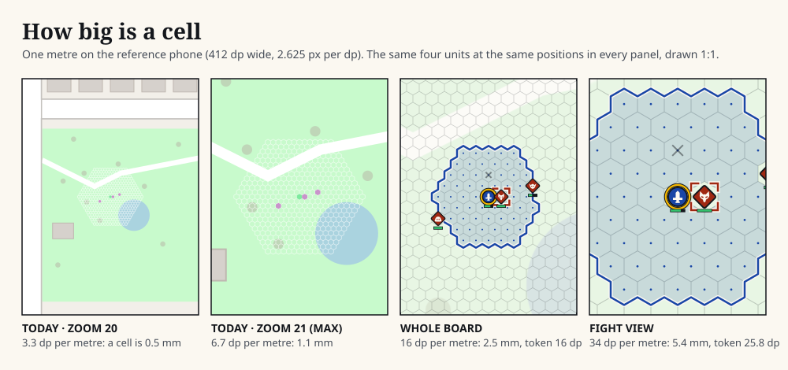
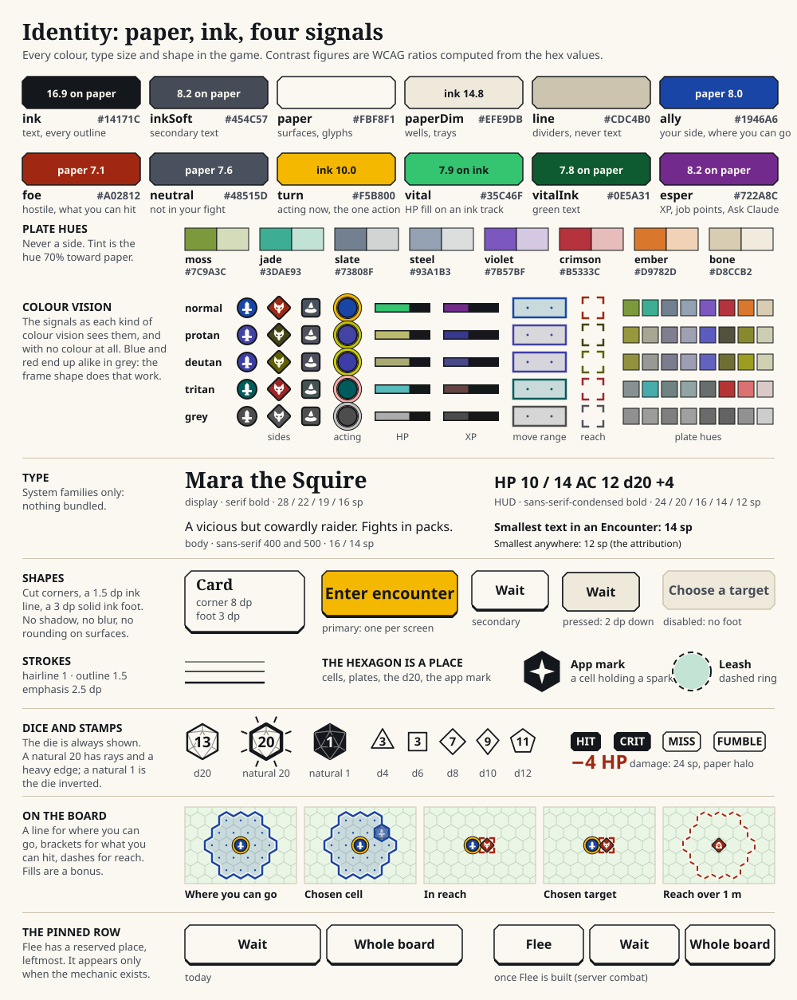
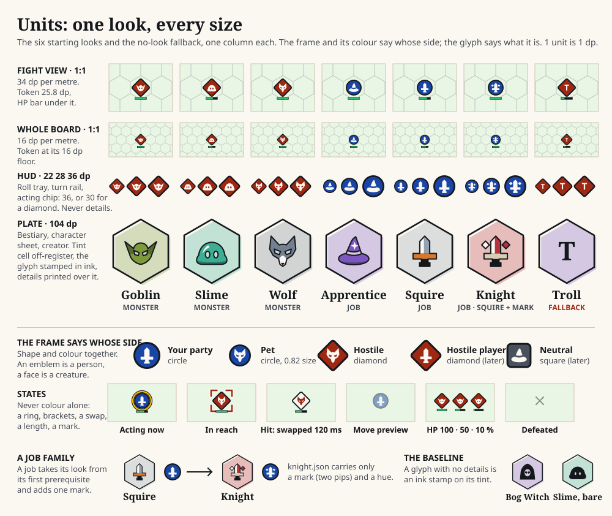
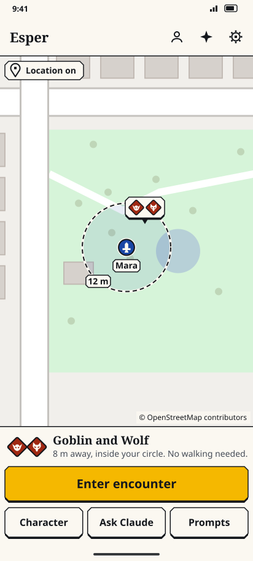
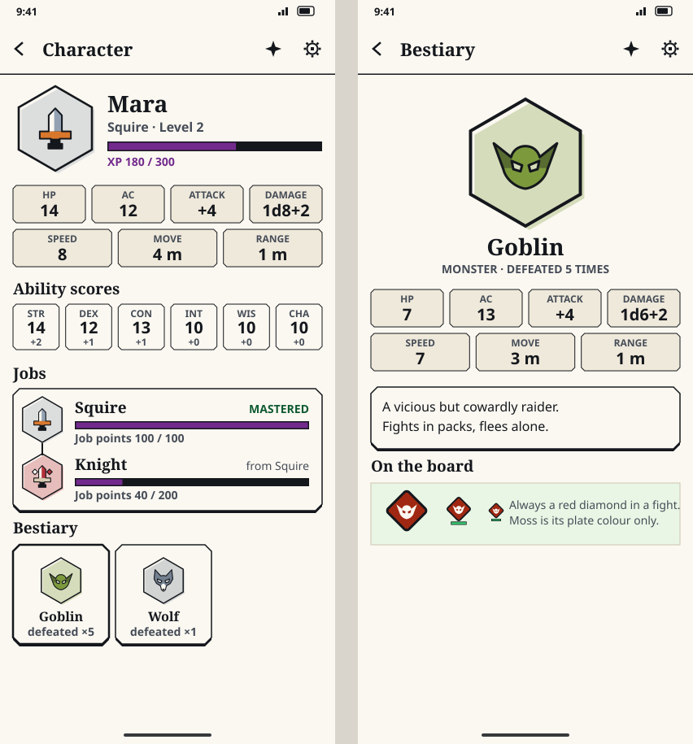
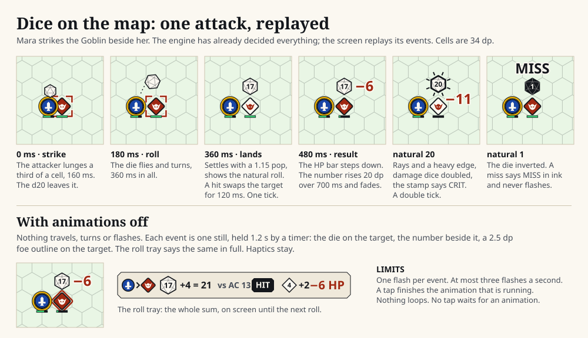
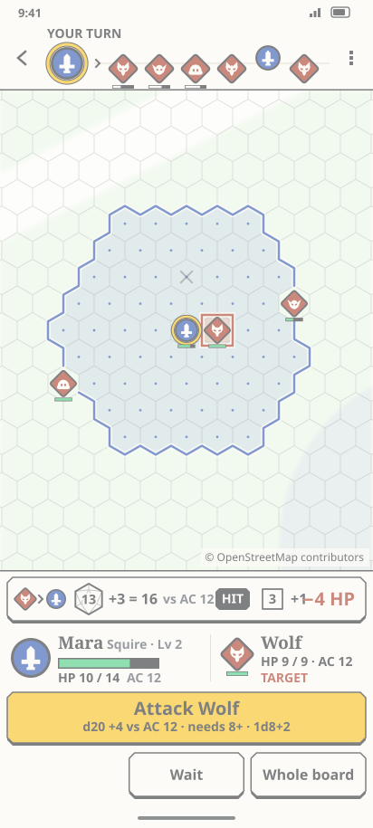
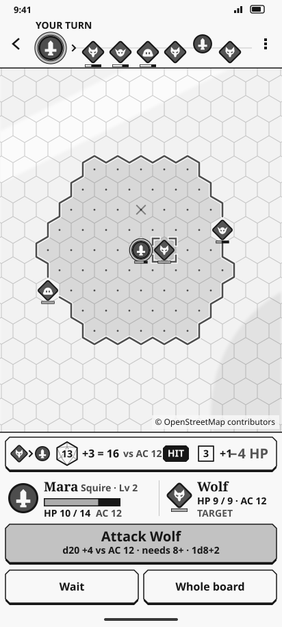

# Esper visuals: Field Mat

How Esper looks, and how a Claude Code run builds and checks it. This document
is the contract for anything drawn on screen: change it here first. The hard
rules a run must not break are also listed in
[`GAME_DESIGN.md`](GAME_DESIGN.md#visuals), because every dispatched run reads
that file.

It is built in the order of [§9](#9-rollout); the Systems table of
`GAME_DESIGN.md` says how far. What was not verified when it was written is
listed in [§11](#11-unverified-and-risks).

A run reads the part it needs:

| The run | Reads |
|---|---|
| adds or changes a unit | [§8](#8-adding-a-look), then Tier 1 of [§7](#7-verification-loop) |
| changes the theme (a colour, a size) or a screen | that part of [§4](#4-the-look), the fixtures of [§5](#5-fixtures), then Tier 2 of §7 |
| builds a rollout step | its row in §9, the parts that row names, and [§10](#10-changes-elsewhere) |

Where `Spec.kt` (§6) holds a number, it is the source, and this text comes
second. A pull request that changes a number changes it in `Spec.kt` and in
the sentence of §4 that states it. Where the text gives no number, the run
picks one, puts it in `Spec.kt` and names it in the pull request.

The pictures below are mockups for people, drawn 1 unit to 1 dp by a
throwaway generator: not output of the app, and nothing regenerates or
verifies them. A run does not read sizes from their source. They show the six
starting units and are frozen: no content pull request edits them, and each is
superseded by the committed picture of its screen (§7) once that lands.

Reference phone for every size below: 412 x 915 dp, 2.625 px per dp
(1080 px wide, 420 dpi), so 1 dp is 0.159 mm. Every layout is portrait:
rollout step 6 locks `MainActivity` to it.

| Picture | Shows |
|---|---|
| [`visuals/scale.svg`](visuals/scale.svg) | A cell today and in the two proposed views, 1:1 |
| [`visuals/fight-view.svg`](visuals/fight-view.svg) | The Encounter screen in the fight view, true scale |
| [`visuals/whole-board.svg`](visuals/whole-board.svg) | The same moment with the whole board on screen |
| [`visuals/fight-view-sun.svg`](visuals/fight-view-sun.svg), [`visuals/fight-view-grey.svg`](visuals/fight-view-grey.svg) | The fight view under a 45% white veil, and with no colour |
| [`visuals/units.svg`](visuals/units.svg) | The six starting looks at every size, frames, states, the no-look fallback |
| [`visuals/identity.svg`](visuals/identity.svg) | Palette, contrast, colour-vision rows, type, shapes, dice, the board's vocabulary, the Encounter header in both states |
| [`visuals/dice.svg`](visuals/dice.svg) | One attack frame by frame, and its still for animations off |
| [`visuals/map.svg`](visuals/map.svg) | The walking map with the Encounter card |
| [`visuals/sheet.svg`](visuals/sheet.svg) | The character sheet and a bestiary entry |
| [`visuals/add-a-look.svg`](visuals/add-a-look.svg) | The focus render for a unit being added (§8) |

---

## 1. Intent

Esper has no art direction today: stock Material purple, raw OpenStreetMap
tiles, and units drawn as tinted cells 3.3 dp (half a millimetre) wide when a
fight opens.



The visuals exist to make three things readable in a one-second glance,
outdoors, in one hand: where I am on the real map, whose turn it is and what I
can do, and what the dice just decided. The feeling is a tabletop game unrolled
on your own street: a paper battle mat over the map, ink lines, tokens you could
cut out with scissors, dice you can see.

One rule makes it buildable: **text in, pixels out.** Every visual is a path, a
named colour or a number that Claude writes as text, and that a renderer turns
into a PNG Claude can read before it opens the pull request. Anything that loop
cannot render is not in the design.

## 2. Goals, non-goals, anti-goals

**Goals**

- A unit reads as "mine or hostile" and "what it is" at its true size, in
  sunlight, without relying on colour.
- One identity that fifty player-dispatched runs cannot drift away from, because
  it lives in one theme folder, one data field and tests.
- A new monster or job gets its look by adding data to its one JSON file, and is
  playable with no look at all.
- A run with no emulator sees what it built: looks in seconds with `cargo`,
  screens in minutes with a JVM screenshot test.
- No binary art in the repo. The only PNGs are test outputs of fixed fixtures.

**Non-goals**

- Character animation, walk cycles, particles, 3D, sound.
- A dark scheme. Colour names are roles, so one can follow.
- Choosing or styling the self-hosted tile source (roadmap item). This says only
  how the map is treated before and after.
- Any rule change. The mat draws what the rules decide.
- Art for territories, structures, Rituals, guilds. The shape language is meant
  to stretch to them; heraldry for guilds is kept in reserve.

**Anti-goals** (failure even if it works)

- A look that needs a human artist, an image model, a paid service or a font
  licence to extend.
- Art that reads enlarged in a mockup and turns to mush at 16 dp.
- A pretty battle scene that hides the real map (Pillar 1).
- Effects that vanish in sunlight: soft shadows, glows, thin type, see-through
  tints carrying meaning.
- Colour spent on which monster a unit is instead of whose side it is on.

## 3. Approaches considered

Three directions were designed independently, each was built blind by a fresh
run from its document alone, and three judges scored them (150 points).

| Direction | In short | Score |
|---|---|---|
| **A. Field Mat** (the base) | Paper mat over the map. A unit is a token: frame and colour say the side, a one-path glyph from the unit's own JSON says what it is. Plates with faces at bestiary size. Looks checked with `cargo`, screens with JVM screenshots. | 116 |
| **C. Blazon** | Units as coats of arms composed from four words and a shared library of charges. Nothing is drawn per monster. | 111 |
| **B. Daylight Battle Mat** | Like A, with HP shown as the token draining of colour, real map geometry inked over the tiles, a bottom navigation bar. | 103 |

Levi chose A on 2026-11-18. It won because it is the clearest board at the size a fight is played, the only
one whose loop covers both a unit's look and whole screens, and the one that
keeps the D&D third of the game: creatures with faces, dice on screen. C lost on
the one-second glance: colour said which monster, so hostiles could wear the
player's colours, and many monsters shared one silhouette. B lost on HP as fill
(hurt units fade) and on dropping the Prompts screen.

Taken from B: the camera as its own early pull request; the move range as one
outlined region; target brackets; the 16 dp token floor; the deeper side
colours; the predicted next-to-act strip; the sun-veil render; even-odd glyphs;
stateless `...Content(state)` screens; "an Encounter never waits on a tile";
"No walking needed". Taken from C: dice on the map with a still for animations
off; the fallback from the id; the focus render; colour-vision
rows; the replay queue and the board as layers; the rule that content never
touches a shared picture; the Visuals section in `GAME_DESIGN.md`.

Dropped early: creatures drawn in Kotlin (a monster would be code), shader
looks (cannot be rendered in CI, wash out in sun), a third-party icon set
(mixed authors, per-asset attribution), sprite grids (144 cells per unit, side
carried only by a base colour).

---

## 4. The look

### 4.1 Identity

Mood: a field table. Pale paper, near-black ink, four signals, hard edges.



**Palette.** These names are the only colours in the app.

| Name | Hex | Use | Contrast |
|---|---|---|---|
| `ink` | `#14171C` | text, every outline | 16.9 on `paper`, 14.8 on `paperDim` |
| `inkSoft` | `#454C57` | secondary text | 8.2 on `paper`, 7.2 on `paperDim` |
| `paper` | `#FBF8F1` | screen ground, cards, glyphs on tokens | |
| `paperDim` | `#EFE9DB` | wells: fields, stat tiles, the track of an XP or job-point bar | |
| `line` | `#CDC4B0` | dividers only, never text | 1.6 on `paper` |
| `ally` | `#1946A6` | your side, where you can go | `paper` on it 8.0 |
| `foe` | `#A02812` | hostile, what you can hit, errors | `paper` on it 7.1 |
| `neutral` | `#48515D` | units in nobody's fight (later) | `paper` on it 7.6 |
| `turn` | `#F5B800` | acting now, and the one primary action of a screen. Nothing else | `ink` on it 10.0 |
| `vital` | `#35C46F` | HP fill, always on an `ink` track | 7.9 on `ink` |
| `vitalInk` | `#0E5A31` | green text ("Mastered") | 7.8 on `paper` |
| `esper` | `#722A8C` | things that grow: XP, job points, Ask Claude | 8.2 on `paper`, 7.2 on `paperDim` |

Plate hues, used only on plates and never for a side: `moss` `#7C9A3C`, `jade`
`#3DAE93`, `slate` `#73808F`, `steel` `#93A1B3`, `violet` `#7B57BF`, `crimson`
`#B5333C`, `ember` `#D9782D`, `bone` `#D8CCB2`. Derived, in code, never
written as hex: `tint(hue)` = hue mixed 70% toward `paper`; `shade(hue)` = hue
mixed 35% toward `ink`; `accent(hue)` = `ember`, or `bone` when the hue is
`ember` or `crimson`. Mixing is per channel on the 0 to 255 sRGB values, in
integers, the division rounding down: `tint = (hue * 30 + paper * 70 + 50) /
100`, `shade = (hue * 65 + ink * 35 + 50) / 100`. An exact half therefore
rounds up (`bone` has two). `tint(moss)` is `#D5DCBB`, `shade(moss)`
`#586C31`, `tint(violet)` `#D5C8E2`; all sixteen are in §6. Write the
arithmetic; Compose's `lerp(Color, Color, Float)` mixes in Oklab and gives
other colours. Plate colour is decoration and never carries meaning: the
`ember` accent is 1.02:1 on `moss` and under 1.3:1 on `jade`, `slate` and
`steel`, so there it shows by hue alone, and `tint(bone)` is 1.12:1 on
`paper`, so that cell is held by the plate's `ink` frame.

Colour rules:

- **On the board, colour says whose side, never which monster.** `ally` and
  `foe` have the same brightness (1.14:1 against each other, the same grey), so
  the frame shape carries the side and colour confirms it.
- **Gold (`turn`) means acting now, and the one primary action.** Not low HP,
  not a natural 20, not a pin on the map. It is always edged in `ink`.
- Coloured text (`ally`, `foe`, `vitalInk`, `esper`) goes on `paper` only. On
  `paperDim` text is `ink` or `inkSoft`.
- One light scheme. Sunlight is the hard case.

**Contrast floors.** These are a test (`ThemeContrastTest`, §7), on plain
colours and again with both colours under the sun veil (45% white over each).
"Mat" means `paper` at 50% over each Fixture Town ground the board covers
(grass, pond, path, tree); the lowest is the pond.

| Pair | Floor | Measured minimum | Floor under the veil | Measured |
|---|---|---|---|---|
| `ink` on `paper` / `paperDim` | 14 | 14.84 | 3.5 | 3.61 |
| `inkSoft` on `paper` / `paperDim` | 7 | 7.16 | 2.4 | 2.46 |
| `ally`, `foe`, `vitalInk`, `esper` as text on `paper` | 7 | 7.05 | 2.6 | 2.70 |
| `paper` glyph on `ally` / `foe` / `neutral` | 7 | 7.05 | 2.5 | 2.58 |
| `esper` bar fill on its `paperDim` track | 7 | 7.15 | 2.5 | 2.61 |
| `ink` on `turn` | 9 | 10.04 | 2.8 | 2.89 |
| `vital` on `ink` | 7 | 7.94 | 2.5 | 2.55 |
| token fill (`ally`, `foe`) on the mat | 5.5 | 5.76 | 2.4 | 2.46 |
| token fill and range lines (`ally`, `foe`) on the move wash | 4.4 | 4.50 | 2.1 | 2.16 |

Contrast is the WCAG ratio. The move wash alone is 1.3:1 against the mat: it
is a bonus, and the outline and dots carry the range. `neutral` has no row on
the mat: a neutral unit is in nobody's fight, so it is drawn on the walking
map only, on its `paper` ring.

The floors are for map grounds, not for a tile's labels or dark lines. Under
the mat, black is a mid grey (`#7E7C79`), where the `foe` fill is 1.8:1 and
`ally` 2.0:1; there a token is held by its `ink` outline (4.3:1) and its
`paper` glyph. If Levi's look at step 2 finds enlarged labels making dark
patches that cover most of a cell, board tokens get the walking map's `paper`
ring (§4.5).

**Type.** System families only: nothing bundled, nothing licensed.

| Role | Family | Weight | Sizes (sp) | Used for |
|---|---|---|---|---|
| display | `serif` (Noto Serif on Android) | 700 | 28, 22, 19, 16 | names, screen titles, results |
| body | `sans-serif` (Roboto) | 400, 500 | 16, 14 | sentences |
| HUD | `sans-serif-condensed` | 700, tabular figures (`tnum`) | 24, 20, 16, 14, 12 | numbers, buttons, labels, stamps. 24 is the damage number on the map, 12 a stat tile's label |
| note | `sans-serif` | 500 | 12 | the attribution, footnotes |

Smallest text inside an Encounter: 14 sp, except the attribution (12 sp).
Smallest anywhere: 12 sp. The number on a die is part of the die: it is drawn
in dp, never under 14 dp, and does not follow the font scale. A monogram
(§4.5) is a glyph, not text: it is sized with its token and has no floor.
Material 3 slots: `headlineMedium` display 28/34, `titleLarge` display 22/28,
`titleMedium` display 19/24, `titleSmall` HUD 16/20, `bodyLarge` and
`bodyMedium` body 16/22, `bodySmall` body 14/20, `labelLarge` HUD 16/20,
`labelMedium` HUD 14/18, `labelSmall` note 12/16.

**Shape language.**

- A hexagon is a place: cells, plates, the d20, the app mark (a pointy-top ink
  hexagon with a four-point spark cut out of it).
- The frame of a token says whose side: circle, diamond, rounded square (§4.5).
- A dashed ink ring is the leash, on the map and on the mat.
- A solid line is where you can go. Corner brackets are what you can hit.
  Dashes are a reach.
- Surfaces have cut corners (`CutCornerShape`: cards 8 dp, buttons, chips and
  fields 6 dp, tags and stamps 4 dp), a 1.5 dp `ink` outline and a 3 dp solid
  `ink` foot below instead of a shadow. Pressed: the surface moves down 2 dp
  and turns `paperDim`. Disabled: `paperDim`, `line` outline, `inkSoft` text,
  no foot. Tokens, plates, wells and tags have no foot.
- Strokes: hairline 1 dp, outline 1.5 dp, emphasis 2.5 dp. Emphasis lines on
  the map sit on a 5.5 dp `paper` halo.
- No elevation, no blur, no gradient, no transparency over text.

**Icons** are Material icons from the set the app already depends on
(`material-icons-extended`), tinted `ink`: `ArrowBack`, `Person`,
`AutoAwesome` and `Settings` in the top bar, as today; `LocationOn` or
`LocationOff` on the map's status chip; `Check` on a chosen card;
`CheckCircle`, `ErrorOutline` or `Schedule` on an Ask Claude run card. The
mockups draw stand-ins for them. The app draws only the two marks of the
Encounter header (§4.4) itself.

**Material 3 scheme** (for anything not yet using the Esper components):
`primary` `ink`, `onPrimary` `paper`, `secondary` `ally`, `tertiary` `esper`,
`error` `foe`, `on*` of those `paper`; `background`, `surface` and every
`surfaceContainer*` `paper`; `surfaceVariant` `paperDim`; `onBackground` and
`onSurface` `ink`; `onSurfaceVariant` `inkSoft`; `outline` `ink`;
`outlineVariant` `line`; `surfaceTint` `paper`; `primaryContainer`,
`secondaryContainer`, `tertiaryContainer`, `errorContainer` and `surfaceDim`
`paperDim`, the `on*` of those containers `ink`; `inverseSurface` and `scrim`
`ink`; `inverseOnSurface`, `inversePrimary` and `surfaceBright` `paper`.

### 4.2 The map

The map is the mat, so it is quietened, never hidden.

**Today, on raster tiles.** Five settings, the first four on both `MapView`s:

1. Tiles scaled to the density (built: both `MapView`s). One tile pixel
   becomes one dp, so tile labels are readable and camera numbers are dp.
2. `overlayManager.tilesOverlay.setColorFilter(ColorMatrixColorFilter(ColorMatrix().apply { setSaturation(0.6f) }))`.
   Roads and labels calm down, water stays blue, grass stays green.
3. `tilesOverlay.loadingBackgroundColor` and `loadingLineColor` set to `paper`,
   so a missing tile is paper, not a grey checkerboard.
4. In an Encounter: `paper` at 50% inside the leash ring, `ink` at 13% outside
   it. Past zoom 19 the tiles are enlarged about 20 times without smoothing:
   blocks about 8 dp across, no blur; the wash makes it "paper over the map".
5. No stock zoom buttons on either map (built). osmdroid shows its plus and
   minus buttons on a touch unless told not to, and they get in the way of
   play. In an Encounter the pinch and the
   Whole board button do their work; the walking map is zoomed by pinch alone
   until it has side buttons of its own (#43).

**An Encounter never waits on a tile.** osmdroid downloads nothing above the
source's zoom 19 and only enlarges tiles already in the phone's cache. With
tiles slow, missing or blank, the paper ground, the board and the HUD draw
anyway, because the board is an overlay and needs only the anchor and the scale.

The attribution `© OpenStreetMap contributors` stays at the bottom right of
both maps: note style (12 sp), `ink` on `paper` at 78%, 4 dp inset.

**Later, on our own vector tiles.** The style is ours and uses this palette's
temperature: land `#F3EEE2`, park `#D3E0B8`, water `#A9CBD8`, building
`#E2D8C6`, road `#FFFFFF` cased `#CABFA9`, path `#FDFAF2` cased `#B4A88E`,
labels `inkSoft`. No colour filter, and the wash drops to 30%. Nothing in the
game layer changes: the board needs two facts from the map, where the anchor is
on screen and how many pixels a metre is.

**Survey ink (optional, not now).** The app already
receives roads, paths, water and buildings within 40 m for the safety check
(`GET /v1/hazards`) and throws them away. Drawing those shapes in `inkSoft`
over the coarse raster would show real geometry at one metre per cell before
vector tiles exist. It means keeping that response in memory for the length of
an Encounter, so "Why the app asks for location" needs a sentence first.

### 4.3 Camera

Camera rules are in **dp per metre**, not zoom levels: pixels per metre at a
zoom level change with latitude. With tiles scaled to the density,
`CameraMath.zoomFor` turns a scale into a zoom from the latitude
(`app/.../ui/game/CameraMath.kt`), and `Spec.kt` holds the numbers below.

| View | dp per metre | A 1 m cell is | Zoom at 0° / 40° / 60° | For |
|---|---|---|---|---|
| Walking | 6 | 1.0 mm | 19.84 / 19.46 / 18.84 | finding the Encounter. The 24 m leash ring is 144 dp, 35% of the width |
| Whole board | 16 on the reference phone | 2.5 mm | 21.26 / 20.87 / 20.26 | looking |
| Fight view | 34, less if the fight does not fit | 5.4 mm | 22.34 / 21.96 / 21.34 | choosing and acting |

- **Walking.** `zoom = zoomFor(6 dp per metre)` at the leash centre. 6 is the
  largest round scale whose tile zoom (the integer part) stays at 19 or lower at
  every latitude, which is the highest zoom the tile source serves. The map
  screen sets `maxZoomLevel = 19.99`, so a pinch never asks for tiles that
  cannot be downloaded. It is the zoom
  `MapScreen` eases to on the first leash centre, where it uses 19.0 today.
- **Fight view** (how an Encounter opens). Take the box around every living
  unit's cell centre and every cell the acting unit can reach, grown by 1.0 m on
  each side. Centre on the box. Scale is
  `min(34, mapWidthDp / boxWidthM, mapHeightDp / boxHeightM)`, never below the
  whole-board scale. A fresh fight (monsters 4 cells out, Move 4) is a 10 m box
  and gets the full 34.
- **Whole board.** Centre on the anchor. Scale is
  `(min(mapWidthDp, mapHeightDp) - 8) / (2 * (boardRadiusCells + 0.6))`:
  the 12.6 m leash ring with 4 dp to spare, 16.03 on the reference phone.
- The **Whole board / Fight view** button in the pinned row switches mode. The
  mode sticks until switched. In fight mode the camera eases to the fight frame
  (300 ms) at the start of each player-controlled turn; in whole-board mode it
  stays put. A pinch moves the camera freely between the whole-board scale and
  40 dp per metre (`minZoomLevel`, `maxZoomLevel` computed from the anchor's
  latitude) and does not change the mode.
- **A token is never smaller than 16 dp**, at any zoom.


### 4.4 The board


**Layers, bottom to top.** `s` is the scale in dp per metre; a cell is `s`
across its flats.

| # | Layer | Drawn as |
|---|---|---|
| 1 | Ground | `paper`, then the tiles with the colour filter |
| 2 | Off-board scrim | `ink` at 13% over everything outside the leash ring |
| 3 | Mat wash | `paper` at 50% inside the leash ring |
| 4 | Grid | every cell edge once, one path: `ink` at 22%, 1 dp when `s >= 24`, else 0.75 dp; not drawn when `s < 12` |
| 5 | Board edge | outline of the union of all cells: `ink`, 2 dp, round caps |
| 6 | Leash ring | circle of radius `boardRadiusCells + 0.6` m: `paper` 4 dp, then `ink` 2 dp dashed 7 on 5 off. A `12 m` tag (HUD 14 sp on a `paper` tag of 40 x 20 dp, cut 4, 1.5 dp outline) on the ring's north point when that point is on screen |
| 7 | Reach, under-line | the `paper` line of a reach outline (§"Ranges" below) |
| 8 | Move range | §"Ranges" |
| 9 | Reach, dashes | the `foe` dashes of the same outline, after the move range: on an edge the two outlines share, the dashes lie on the solid line and both show |
| 10 | Chosen cell, chosen target | their fills, §"Ranges" |
| 11 | Defeated marks | an `ink` cross at 45%, arms 0.18 `s`, 2 dp |
| 12 | Brackets | open around every unit the acting unit can hit, closed into a square around the chosen target |
| 13 | Move preview | the acting unit's whole token, outline included, at 50% opacity on the chosen cell |
| 14 | Tokens | sorted north to south, then west to east; the acting unit's gold ring under its token |
| 15 | HP bars | all bars after all tokens, so a neighbour never hides one |
| 16 | Inspected pointer | above the inspected unit's token, after the bars, so nothing hides it |
| 17 | Feedback | dice, numbers (§4.7) |

**Cells.** Pointy-top, 1 m across flats, exactly the engine's `HexMetrics`:
centre of `(q, r)` is `east = q + r/2`, `north = r * 0.8660`; corner `i` is at
angle `60 * i - 30` degrees, `0.5774` m from the centre. The edge from corner
`i` to corner `i + 1` faces the neighbour
`[(1,0), (0,1), (-1,1), (-1,0), (0,-1), (1,-1)][i]`.

**Outline of a set of cells** (board edge, move range, reach): for each cell in
the set and each edge `i`, draw the edge if that neighbour is not in the set.
For the move range, also skip an edge whose neighbour holds a unit, so a unit
in or at the range never gets a ring of its own. Every edge is its own line
segment; nothing needs to be chained into a loop. The reachable cells are the
rules' legal moves less the acting unit's own cell, which both `legalMoves`
implementations include.

**Ranges.**

| State | Fill | Line and pattern |
|---|---|---|
| Where the acting unit can move | `ally` at 16% on the reachable cells | one outline around reachable cells plus the unit's own cell: `ally` 2.5 dp on a `paper` 5.5 dp halo, round caps; an `ally` dot in every reachable cell, diameter `clamp(0.085 s, 2, 3.2)` dp |
| Chosen cell | `ally` at 30% | the cell's outline, `ally` 2.5 dp on the halo; the move preview token |
| Unit in reach | none | four corner brackets on a square of side `max(s, 1.3 T)` centred on the unit: arms 0.27 of the side, `foe` 2.5 dp on the halo, square caps |
| Chosen target | `foe` at 30% on its cell | its brackets close: all four sides of the same square, same line and halo. Every other unit in reach keeps open brackets |
| Inspected unit | none | an `ink` pointer above its token: a triangle 10 dp wide and 7 dp high, point down, the point `0.62 T + 3` dp above the token's centre, with a 1.5 dp `paper` edge; and its reach, next row |
| Reach of an attack | none | outline of the cells of the board within `attackRangeCells` of the unit (hex distance), its own cell included: `foe` 2 dp dashed 6 on 4 off, butt caps, on a solid `paper` 4 dp line. The dashes restart on every edge. Drawn for the acting unit when its `attackRangeCells > 1`, and for the inspected unit whatever its range |

The fill under the chosen target is a bonus: at 1.3:1 against the move wash it
carries nothing by itself. Committing an action clears the selection and
everything this table draws, and none of it is drawn while events replay.

**Tokens on the board.** Size `T = max(16, 0.76 s)`: 25.8 dp in the fight
view, 16 dp on the whole board. The token is centred on its cell. At the 16 dp
floor a token is as wide as its cell or wider, so the tips of neighbouring
diamonds overlap: by 2.6 dp on the reference phone, and by 4.6 dp on a phone
360 dp wide, where the whole board is 13.97 dp per metre. The draw order makes
that stable. Geometry is in §4.5.

**HP** is a bar under the token: an `ink` track with a `vital` fill, square
ends. Length is the signal. Exact numbers are in the unit card. Width 0.75 `T`,
height `max(4, 0.16 T)`, top edge `0.56 T + 1` dp below the token's centre, fill
inset 0.75 dp, fill width `(width - 1.5) * hp / maxHp` and at least 1.5 dp while
the unit lives. The bar may overhang the lower edges of its cell. A token
drawn with an HP bar anywhere else (the unit card's target) uses the same
formula.

**Acting now.** A gold ring: the token's frame path scaled 1.26 about its
centre, stroked `turn` at `max(2, 0.09 T)` dp over `ink` 2 dp wider, so 1 dp of
`ink` shows each side. Only the unit whose turn it is wears it, ally or
hostile.

**Choosing.** A tap on the map selects; the gold button commits. Candidates are
the reachable cells, the units in reach and every other unit. The tap picks the
candidate whose centre is nearest, if it is within 1.0 m; otherwise it clears
the selection. A reachable cell becomes the chosen cell, a unit in reach the
chosen target, any other unit is inspected: the unit card shows it in place of
the acting unit, and the map marks it with the pointer and its reach.

**The header and the turn rail** (72 dp, `paper`, 1.5 dp `ink` line below). On
the Encounter route this replaces the scaffold's top bar; the semantic pane
title stays "Encounter". Today's `TopAppBar` pads itself below the status bar;
this header must do it (`statusBarsPadding()`), and the bottom panel must stay
above the navigation bar (`navigationBarsPadding()`): the app is drawn edge to
edge, on Android 14 too, because `MainActivity` calls `enableEdgeToEdge` with
`SystemBarStyle.light` for both bars before `setContent`. Its `NavHost` adds
`.consumeWindowInsets(padding)` after `.padding(padding)`, or the scaffold's
inset padding is applied twice. Every screen drawn outside the scaffold
(sign-in, the character creator, the "Can't load your character" gate, and
Settings and Ask Claude when opened from sign-in) pads its root with
`safeDrawingPadding()`. Positions below are from the header's own top
left corner, at font scale 1.0. At a larger scale the header grows by what the
label's size gains over 14 dp, and all under the label moves down as much.

- Back, a 48 dp box at the left: an `ink` chevron pointing left, 8 dp wide
  and 14 dp high, 2.5 dp, square caps, centred at (24, 36). It calls the back
  dispatcher, as
  the top bar's arrow does in `MainActivity`, and never `popBackStack()`: the
  Encounter's `BackHandler` is what settles a finished Encounter.
- Overflow menu, a 48 dp box at the right: three 4 dp `ink` squares 6 dp
  apart, one above the other, centred in the box at y = 36. It holds
  Character, Ask Claude and Settings, the three actions the top bar holds
  today.
- **Acting now:** the acting unit's token with its gold ring, centred at
  x = 74 on the rail line (y = 42). The token is 36 dp, or 30 dp when its frame
  is a diamond, so the ring is at most 47.2 dp high in any frame and clears
  the label above and the rule below.
- **The label:** HUD 14 sp, upper case, one line: `YOUR TURN`, or `WOLF ACTS`
  with the unit's name. Left edge at x = 52, baseline at y = 14. A long name
  runs on above the strip, whose chips start at y = 22, and is cut with an
  ellipsis 4 dp before the overflow button.
- **The rail line:** 1 dp, `line`, from x = 104 to the overflow button
  (x = 364 on the reference phone), with an `ink` chevron (4 x 8 dp, 2 dp,
  square caps) pointing right, its open side at x = 106 and its point at
  x = 110.
- **Next to act:** the coming turns in order as 28 dp tokens, first at
  x = 136, one every 40 dp, as many as fit before the overflow button and at
  most 6. A fast unit appears more often. A party token's centre is 6 dp above
  the rail line, a hostile's 6 dp below it, so position also says the side.
- Under the first appearance in the strip of every unit but the acting one:
  its real gauge, a 24 x 4 dp `ink` bar centred under the chip, its top 24 dp
  below the rail line, with a `paper` fill of `gauge / 100` inset 0.75 dp.
- The strip is a prediction, computed by running the ATB rule forward on a
  copy: subtract 100 from the acting unit; repeat: if any living unit has
  gauge >= 100, the one with the lowest id (plain string order, as the engine
  compares them) acts and loses 100, else every living unit gains its `speed`.
- The strip, the commit button's `needs N+` (below) and the reach outline
  (cells within `attackRangeCells` by hex distance) are arithmetic on the
  rules' state, written in the app. That is a second copy of three rules,
  which ADR-0002 exists to avoid, so it is temporary: when combat moves to the
  server (`SERVER.md` §14 step 2) the server sends the coming order, the
  number needed and each unit's reach with its state, and the app only draws
  them.

Both states of the header are drawn at true size at the foot of the identity
sheet (§4.1).

**The bottom panel** (`paper`, 1.5 dp `ink` line above, 8 dp padding and gaps).
Every height below is a minimum: a surface grows with its text and never
clips it.

- **Roll tray**, 48 dp, drawn as a secondary button (`paper`, cut 6, the
  outline and the foot) because it is one. Two groups on one line. The roll:
  attacker token 22 dp, a chevron, target token 22 dp, the d20 at 34 dp with
  the natural roll, `+3 = 16` (HUD 16), `vs AC 12` (HUD 14, `inkSoft`). The
  result: a stamp (HUD 14 sp on a cut-4 tag: `HIT` and `CRIT` `paper` on
  `ink`, `MISS` and `FUMBLE` `ink` on `paper` with a 1.5 dp outline), then on
  a hit the damage
  die at 31 dp showing the dice total (`damage - modifier`), `+1`, and `−4 HP`
  (HUD 20, `foe`, right-aligned). When the two groups do not fit on one line
  (a large font scale, a long sum) the result wraps under the roll and the
  tray grows to two lines. It shows the last attack until the next one;
  before the first it says `No rolls yet` (HUD 14, `inkSoft`). A rejected
  action replaces the roll with its sentence (body 14) until the next event.
- **Encounter log.** A tap on the roll tray opens a card over the panel that
  holds what the screen lists today, restyled: every unit (token 28 dp, name,
  `HP 9 / 9`, its gauge as a bar, `acting` or `down` where it applies) and the
  last 8 events as the sentences the app writes today, with two changes. An
  attack's sentence gains its roll after a colon, so a roll the tray no longer
  shows is still on screen: "Wolf hit Mara for 4: d20 13 +3 = 16 vs AC 12
  (HP 10).", "Wolf missed Mara: d20 5 +3 = 8 vs AC 12." And the last sentence
  becomes `Encounter ended: victory.` or `Encounter ended: defeat.` A `Close`
  button, or Back, returns to the panel. The card covers the panel and grows
  upward over the map as its content needs, to half the map's height at most;
  past that its list scrolls, with `Close` pinned at its foot.
- **Unit card**, 60 dp, a region of the panel with no outline and no foot.
  Left: the acting (or inspected) unit: token 44 dp, name (display 19),
  `Squire · Lv 2` (HUD 14, `inkSoft`), an HP bar 112 x 12 dp, `HP 10 / 14`,
  `AC 12`. The card splits 56 : 44 by weight, with a `line` divider between
  the halves (x = 232 on the reference phone). Right of it, the chosen target:
  token 32 dp with its HP bar, name, `HP 9 / 9 · AC 12`, `TARGET` (HUD 14,
  `foe`). On a narrow screen `· AC 12` wraps to its own line.
- **Commit button**, 56 dp, full width, the only gold on the panel. It says
  what it will do (HUD 20) and what the dice need (HUD 14):

  | Selection | Label | Second line |
  |---|---|---|
  | none | `Choose a cell or a target` (disabled) | |
  | a cell | `Move here` | `3 m · ends your turn` (hex distance) |
  | a target | `Attack Wolf` | `d20 +4 vs AC 12 · needs 8+ · 1d8+2` |
  | not your turn | `Wolf acts` (disabled) | |

  `needs N+` is `clamp(AC - attackBonus, 2, 20)`: a natural 1 always misses and
  a natural 20 always hits. The screen shows it and never decides with it.
- **Pinned row**, three 48 dp slots that split the width. From the left:
  **Flee**'s slot, then `Wait`, then `Whole board` / `Fight view`. Flee's slot
  is empty until the mechanic exists (it is built in Rust with server combat,
  ADR-0002), so no button moves under a thumb when it arrives: Flee forfeits
  the Encounter's XP and loot. Unlike `Wait`, Flee is enabled on every unit's
  turn and while events replay: the rules let a character Flee at any moment.
- With TalkBack on, a second row appears above the pinned row: `Next target`
  and `Next cell` (§4.8).
- The commit button and the rows are pinned. The tray and the card scroll
  above them if a large font scale makes the panel taller than half the
  screen.

**The result.** Victory or defeat is a card over the panel, sized like the
Encounter log with `Back to map` pinned: `Victory` or `Defeat` (display 28),
then on a victory only, as today, `XP gained 50 · Job points 2` and the
defeated monsters as 28 dp tokens with names; a gold `Back to map`.

### 4.5 Units



A unit is a **token**: a frame, a fill, a glyph. One `look` per job and per
monster, as data in its own content file.

**Frames by allegiance.** Shape and colour together.

| Allegiance | Frame | Fill | Who |
|---|---|---|---|
| ally | circle | `ally` | your character, your party, your pet (at `max(16, 0.82 T)`), your NPC companion |
| hostile | diamond | `foe` | everything fighting you: monsters today, hostile players later |
| neutral | rounded square | `neutral` | units in nobody's fight (later: other players on the walking map) |

A second cue comes free: jobs wear an emblem (a hat, a sword), monsters show a
face or a body seen from the front. An emblem is a person, a face is a
creature.

**Token geometry.** `T` is the token size in dp; everything is centred on the
token's centre. Strokes are centred on the frame path.

| | Circle | Diamond | Rounded square |
|---|---|---|---|
| Frame path | radius `0.5 T - w/2` | square of side `0.82 T`, corner radius `0.09 T`, rotated 45° | square of side `0.86 T`, corner radius `0.14 T` |
| Glyph box (side; upright in every frame) | `0.66 T` | `0.60 T` | `0.62 T` |
| Extent | `T` | about `1.16 T` tip to tip | `0.86 T + w` |

- Outline: `ink`, width `w = clamp(0.075 T, 1.25, 3)` dp.
- Glyph: the look's path scaled from its 24-unit box to the glyph box, filled
  `paper`, **even-odd**, so eyes and slits are holes showing the side colour.
- Tokens never draw `details`, never have a foot, and have no halo on the mat.
  On the walking map, where there is no wash, the frame path is first stroked
  `paper`, `w + 3` dp wide, so 1.5 dp of paper shows around the outline.
- A token drawn alone (the bestiary's "On the board", the `tokens` and
  `shipped_units` pictures, the focus render) stands on `#E9F6E5`, the mat
  over Fixture Town grass.
- Hit flash: fill and glyph colours swap (`paper` frame, side-coloured glyph).

| Where | `T` (dp) |
|---|---|
| Board, fight view | 25.8 (`0.76 * 34`) |
| Board, whole board | 16 (the floor) |
| Roll tray | 22 |
| Turn rail, predicted; map card; result card; Encounter marker | 28, 28, 28, 22 |
| Turn rail, acting | 36, or 30 for a diamond |
| Unit card: acting unit, target | 44, 32 |
| Walking map: your character | 28 |

**The look, as data.** Optional on jobs and monsters. `schemaVersion` stays 1:
both validators reject any other value, the Kotlin one is frozen, and an
optional field the app's loader ignores needs no new version.
The field table, the path grammar and the resolving rules are in
[`content/schema/look.schema.md`](../content/schema/look.schema.md).

**No look yet.** The unit still draws and plays. Token: its monogram, the first
letter or digit of `displayName` in upper case (`?` when it has none), HUD,
`paper`, size 0.85 of the glyph box, baseline 0.30 of the glyph box below the
centre. Plate: the monogram in display, `ink`, size `0.40 P`, baseline
`0.14 P` below the centre, on the tint of its resolved hue. A stats-only file
looks unfinished, not broken.

**Plates.** The same glyph, large, in the bestiary, the character sheet and the
creator. `P` is the plate's height: 56, 104 or 156 dp.

1. Tint cell: a pointy-top hexagon of circumradius `P/2`, filled `tint(hue)`,
   drawn `P/32` right and `P/32` down of the centre. Off-register on purpose.
2. The figure, in a box of side `0.52 P` centred on the plate:
   - the glyph filled `ink`, even-odd: an ink stamp;
   - each detail, in order, filled with its tone, even-odd, and **clipped to
     the glyph** (the clip is even-odd too);
   - the glyph stroked `ink`, 0.9 box units wide, round joins.
3. Frame: the same hexagon on the centre, no fill, `ink` stroke
   `max(1.5, P/40)` dp.

A glyph with no details is an ink stamp on its tint, with its holes showing
the tint: it looks intended, and it is the baseline every unit gets. Details
are colour printed over the stamp. Because they are clipped and the outline is
struck again on top, a detail never has to follow the glyph's edge: a full-box
rectangle in tone `hue` colours the whole creature. Plates have no ground
shadow and no hatch.

**The six starting looks** are in their content files. Knight starts with a
hue alone and draws its monogram; its glyph is the first one drawn by §8.

Their numbers (segments, subpaths, coverage at 16 px, survival of the
erosion, nearest other looks) are what the looks sheet prints (§7).

### 4.6 Screens

Every screen splits into a part that holds state and a stateless
`...Content(state, callbacks)` part. The stateless part is what a test renders.
Both map screens take the map as a slot (`map: @Composable () -> Unit`): the
app passes the osmdroid view, a test passes Fixture Town. A screen is padded
16 dp, with gaps of 8 or 12 dp.

Navigation gains one route, the bestiary entry. Nothing player-facing is
removed: Prompts stays on the map card, the top bar keeps Character, Ask
Claude and Settings, and the Encounter's list of combatants and its event log
move into the Encounter log behind the roll tray (§4.4). The one text that
goes is the map screen's headline (below).

**Top bar** (every route but the Encounter): 64 dp, `paper`, 1.5 dp `ink` line
below, the title in display 22, the icons of §4.1.

**Map** (first screen).



- The map fills the space between the top bar and the card.
- Leash ring: radius `radiusMetres`, `ally` at 10% inside, the dashed ink ring
  on its `paper` line. The `12 m` tag sits on the ring at the point opposite
  the Encounter (north with none).
- Your character: its job's token at 28 dp at the leash centre, with a name tag
  below (HUD 14 on a `paper` tag). This is a picture, not a position rule: the
  avatar has no cell outside an Encounter. It moves only when the circle
  recentres, never with each location reading. When the avatar gets a place of
  its own inside the radius (Movement: placed by touch), the token is drawn
  there instead.
- The Encounter: a 64 x 34 dp `paper` card with a foot holding up to two of its
  monsters as 22 dp hostile tokens (`+N` for more), with an `ink` pointer down
  to the anchor. When the anchor is south of the leash centre the card goes
  under the anchor with the pointer up, so it does not lie over your
  character. Your character and its name tag are drawn after the card.
- A status chip, top left, 8 dp in: `LocationOn` and `Location on`, or
  `LocationOff` and `Location off: the circle follows the map`. Sync and
  content errors are a `foe`-outlined card under it with the sentence the app
  shows today.
- **The card:** the panel under the map (`paper`, 1.5 dp `ink` line above, no
  outline, no foot): the monsters' tokens at 28 dp; their names (display 19),
  "Goblin and Wolf"; then one line (body 14, `inkSoft`):
  `8 m away, inside your circle. No walking needed.`, or outside the circle
  `19 m away. No walking needed: enter from here.` A gold `Enter encounter`
  (56 dp). A row of three: `Character`, `Ask Claude`, `Prompts`.
- With no Encounter: `No Encounter nearby yet`, or the notice the app has
  ("Encounters aren't available in this area yet."), and `Enter encounter`
  disabled. With no leash centre yet: `Waiting for a location fix, or pan the
  map to where you want to play.`
- The headline "First view: local map" and the two sentences under it are
  dropped from this screen; the Ask Claude screen already says them.

**Encounter**: §4.4. With no fight in progress: "No Encounter is in progress."
and a gold `Back to map`.

**Character creator.** Title (display 22), the name field (a `paperDim` well,
1.5 dp outline, cut 6), then one card per starting job: its plate at 56 dp, its
name (display 19), its description (body 14), a stat line (HUD 14, `inkSoft`):
`d10 · AC 12 · STR · 1d8 · Move 4`. The chosen card has a 2.5 dp outline and a
tick, and stays a radio button for TalkBack. A gold `Begin`.

**Character sheet and bestiary.**



- Header: the current job's plate at 104 dp, the name (display 28),
  `Squire · Level 2` (HUD 16), an XP bar (12 dp: an `esper` fill on a
  `paperDim` track with a 1.5 dp `ink` outline), `XP 180 / 300` in `esper`. At
  the highest level: a full bar and `XP 2400 · max level`.
- Stat tiles (`paperDim` wells, 46 dp or more, cut 4): label HUD 12
  `inkSoft`, value HUD 20. Row of four: HP, AC, Attack, Damage. Row of three:
  Speed, Move, Range. Move and Range are shown in metres: a cell is one metre.
- Ability scores: six tiles, score HUD 20, modifier HUD 12.
- Jobs: a row for the current job, then one for every other job the
  character has job points in or has unlocked: plate 56 dp, name, a job-point
  bar (10 dp, drawn like the XP bar), `Job points 40 / 200`. A job is joined to
  its first prerequisite by a 2 dp `ink` line; a mastered job says `MASTERED`
  in `vitalInk`.
- Bestiary: a three-column grid of cards for monsters already met, as today:
  plate 56 dp, name (display 16), `defeated ×5`. A tap opens the entry: plate
  156 dp, name (display 28), the stat tiles, the bestiary text on a card, and
  "On the board": the monster as a hostile token at 44, 25.8 and 16 dp, with
  the caption (body 14, `inkSoft`) `A red diamond in any Encounter. Moss is
  its plate colour only.`, naming the unit's own hue.

**Sign-in.** The app mark at 72 dp, `Esper` (display 28), the location
sentences on a card, the `How location is used` link, a gold `Create account`,
a secondary `Sign in with passkey`, and the two text links. Each warning the
screen has today is a `foe`-outlined card with its sentence in `foe`.

**Ask Claude.** Same surfaces with `esper` as the accent: the focused field's
outline and the status line. A gold `Send to Claude`; `Show context` is
secondary. The context preview is `monospace` 14 sp in a `paperDim` well. Run
cards carry an icon and a word for the status, never colour alone.

**Settings, Prompts, the loading and "Can't load your character" gates.**
Themed only: the components above, one gold button each (`Save`,
`Copy all prompts`, `Retry`). The loading spinner is the system indicator in
`ink`, the only thing in the app that loops.

**Launcher icon.** An adaptive icon as VectorDrawable XML: `paper` background;
foreground on the 108 dp canvas, `ink`, `fillType="evenOdd"`,
`pathData="M79.98,69 L79.98,39 L54,24 L28.02,39 L28.02,69 L54,84 Z M54,36 L58,50 L72,54 L58,58 L54,72 L50,58 L36,54 L50,50 Z"`.
`themes.xml` sets the window background to `paper`.

### 4.7 Motion

The rules have already decided everything; the screen replays their events
from a queue.



| Event | Animated | With animations off |
|---|---|---|
| Turn ready, player-controlled | camera eases to the fight frame, 300 ms; the gold ring grows from 1.0 to 1.26 over 420 ms; one haptic tick | camera jumps, ring appears; the tick stays |
| Turn ready, anyone else | the rail updates; no wait | same |
| Moved | the token slides in a straight line, 110 ms per cell of hex distance, 450 ms at most, linear | the token jumps; a 50% ghost stays on the cell it left for 600 ms |
| Attacked | 0 ms: the attacker lunges a third of a cell toward the target and back (160 ms) and the d20 (34 dp) leaves it. It flies an arc and turns once, landing at 360 ms with its centre `T/2 + 24` dp above the target's centre and a pop to 1.15 (60 ms), showing the natural roll. On a hit: the target swaps colours for 120 ms, its HP bar steps down, one tick (two for a natural 20). The damage (`−6`, HUD 24 sp, `foe`, 4 dp `paper` halo) appears beside the die, starting 28 dp right of the die's centre with its baseline 8 dp below it, rises 20 dp over 700 ms and fades in its last 200 ms. A miss shows `MISS` in `ink` centred above the die and nothing flashes. A die that would cross the top edge of the map lands the same distance below the target instead; a number that would cross the right edge ends 28 dp left of the die's centre instead. The die goes at 1060 ms. The next event may start at 700 ms | one still, held 1.2 s by a timer: the die and the number where they land, a 2.5 dp `foe` outline around the target (its frame scaled 1.26). Nothing travels, turns or flashes |
| Defeated | the token fades over 300 ms; the defeated mark appears | the token goes; the mark appears |
| Waited | nothing on the map; the rail moves on | same |
| Ended | the result card | same |

- **Dice.** A die is its shape and its number: d4 triangle, d6 square, d8
  diamond, d10 kite (points at `(0, -R)`, `(0.86R, -0.1R)`, `(0, R)`,
  `(-0.86R, -0.1R)`), d12 and any other a pentagon, d20 a pointy-top hexagon,
  with `R` half the size. Edge `max(1.5, size/18)` dp. The d20's facets are a
  triangle of radius `0.6 R` and nine lines to the hexagon's corners, at 45%
  of the number's colour, `max(0.75, size/36)` dp. The number is HUD,
  `0.42 size` on the d20 and `0.46 size` on any other die (14.3 dp on both
  dice of the tray), its baseline `0.16 size` below the centre.
- A natural 20 is the die with an edge of `max(2.5, size/10)` dp (3.4 dp) and
  eight `ink` rays from `1.22 R` to `1.5 R`, 2 dp, and the stamp says `CRIT`.
  A natural 1 is the die inverted (`ink` face, `paper` number) and the stamp
  says `FUMBLE`. Neither is gold.
- **Limits.** One flash per event. At most three flashes a second: the queue
  holds an event back to keep landings 334 ms apart. Nothing loops.
- **Replay never blocks.** A tap on the map while events replay finishes all
  of them at once: the board jumps to the state the queue ends in, the tray
  shows the last roll and the log holds every sentence. That tap selects
  nothing; the next one does. A press on any button also finishes the queue
  first, then does what the button says in the state it ends in.
- "Animations off" is the system setting: read
  `Settings.Global.ANIMATOR_DURATION_SCALE`; 0 means off. There is no in-app
  switch.
- Haptics: `HapticFeedbackConstants.CLOCK_TICK` for a tick. No new permission.

### 4.8 Accessibility

- **Sunlight.** One light scheme; the floors of §4.1; a sun-veil render of the
  fight view in every visual pull request, and of the whole board and the
  walking map as artifacts (§7).

  

- **Colour vision.** Nothing is said by colour alone. Where hue separates two
  things, each has a second cue.

  | Pair | Second cue |
  |---|---|
  | `ally` / `foe` | frame shape; rail position |
  | `ally` / `neutral` | frame shape |
  | `foe` / `neutral` | frame shape |
  | `ally` / `esper` | never side by side; bars are labelled XP or Job points |
  | `foe` / `vitalInk` as text | always a word: `TARGET` or an error's sentence, `MASTERED` |
  | move range / reach | solid line with dots / brackets or dashes |
  | unit in reach / chosen target | open brackets / a closed square |
  | acting / inspected | a gold ring / an ink pointer and a dashed reach |
  | HP | length and a number |
  | hit / miss | a word on a stamp |
  | plate hues | the glyph and the name; hue never identifies a unit |

  

- **Text.** Sizes are sp and follow the system font scale. A height given for
  a surface that holds text (a tray, a card, a button, a stat tile) is a
  minimum: the surface grows and the text is never clipped. At scale 1.3 the
  roll tray's result wraps to a second line, the panel grows, and the commit
  button and pinned row stay put (pictures `combat_font130` and
  `sheet_font130`).
- **Touch.** Every button and control is 48 dp or more. A cell is smaller
  (34 dp in the fight view), which is why a tap on the map only selects,
  snapping to the nearest candidate within 1 m, and never commits. A pinch
  gives bigger cells to anyone who needs them.
- **TalkBack.** The map view is hidden from accessibility and replaced by one
  summary node ("Board. Your turn. Wolf, hostile, 1 metre east, 9 of 9 HP.
  ..."). The rail, card and buttons carry full descriptions; the roll tray
  reads the last roll as its sentence and says it opens the log. Every
  replayed event is announced once, as a polite live region, with the sentence
  the log holds, so a hostile turn is heard as it is seen. With touch
  exploration on (`AccessibilityManager.isTouchExplorationEnabled`), the panel
  gains `Next target` and `Next cell`:
  - `Next target` cycles the units in reach, nearest first, then by id.
  - `Next cell` cycles the reachable cells, ordered by distance to the nearest
    living hostile, then distance from the unit, then `q`, then `r`.
  - Each choice is announced: "Cell 3 of 41. 2 metres north-east of you,
    1 metre from Wolf." and the commit button commits it.

---

## 5. Fixtures

**Fixture Town.** The only ground in any test, artifact or committed picture.
Metres east and north of the Encounter anchor, drawn in this order. Colours
are standard OSM colours after the tile filter. An invented place.

| Shape | Geometry | Colour |
|---|---|---|
| land | everything | `#F1EFEB` |
| grass | rectangle x -26 to 40, y -40 to 26 | `#D6F4D9` |
| pond | circle, centre (9, -7), radius 6 | `#B7D0D7` |
| path | polyline (-26, 14), (-6, 4), (4, 9), (40, 16), 2 m wide | `#FFFFFF` |
| pavilion | rectangle x -22 to -14, y -16 to -10, 0.3 m edge `#BFB7B0` | `#D6D1CC` |
| road, north | band y 30 to 37 across everything, on a casing y 29.5 to 37.5 `#C5C2BE` | `#FFFFFF` |
| road, west | band x -33.5 to -26.5, on a casing x -34 to -26 | `#FFFFFF` |
| houses | 9 x 8 at x = -24, -12, 0, 12, 24, 36, y 40 to 48; 8 x 9 at x -46 to -38, y from -20, -8, 4, 16 | `#D6D1CC` |
| trees | circles of radius 1 at (-4, -9), (3, 12.5), (-10, 9), (13, 4), (-9, -2), (-18, 6), (20, -18), (-20, -26), (26, 20), (-14, 22) | `#BFD6B8` |

Tests draw it sharp and with no labels. The mockups blur it; real enlarged
tiles are blocky (§4.2).

**Fixture content.** No picture a test compares shows shipped content. Every
snapshot test but `shipped_units` (§7) builds its state and its `Looks` from
these job and monster texts, written in test source, and never reads
`content/`:

| Id | Kind | Name | Look |
|---|---|---|---|
| `fx_guard` | starting job | Guard | glyph `M9 2 L15 2 L15 9 L22 9 L22 15 L15 15 L15 22 L9 22 L9 15 L2 15 L2 9 L9 9 Z`, hue `steel`, details `hue` `M0 0 L24 0 L24 24 L0 24 Z`, `paper` `M0 0 L12 0 L12 24 L0 24 Z`, `accent` `M0 9 L24 9 L24 15 L0 15 Z` |
| `fx_warden` | job, prerequisite `fx_guard` | Warden | hue `jade` and no glyph: the monogram |
| `fx_scout` | starting job | Scout | none: the monogram, hue `ember` from its id |
| `fx_ring` | monster | Ring | glyph `M12 2 C17.52 2 22 6.48 22 12 C22 17.52 17.52 22 12 22 C6.48 22 2 17.52 2 12 C2 6.48 6.48 2 12 2 Z M12 7 C14.76 7 17 9.24 17 12 C17 14.76 14.76 17 12 17 C9.24 17 7 14.76 7 12 C7 9.24 9.24 7 12 7 Z`, hue `ember` |
| `fx_arrow` | monster | Arrow | glyph `M12 2 L22 21 L12 15.5 L2 21 Z`, hue `moss` |
| `fx_nolook` | monster | Nolook | none: the monogram, hue `moss` from its id |

Fields a picture shows: Guard is `1d10`, AC 12, `str`, `1d8`, Move 4, "Holds
the line. A test job."; Scout is `1d8`, AC 13, `dex`, `1d6`, Move 5, "Goes
ahead. A test job with no look."; Ring attacks at `+3` for `1d6+1`, Move 5,
range 1, bestiary text "A test shape. It rolls at whatever is nearest.";
Arrow has `attackRangeCells` 3, so one fixture unit has a reach to draw. Any
other field takes any valid value. Guard's full-box details are what shows a
plate that stops clipping details to its glyph.

**The fixture fight.** Board radius 12.

| Unit | Id | Side | From | HP | AC | Speed | Gauge | Cell |
|---|---|---|---|---|---|---|---|---|
| Ash | `player` | ally | `fx_guard` | 10 / 14 | 12 | 8 | 100 | (0, 0) |
| Ring | `fx_ring#0` | hostile | `fx_ring` | 9 / 9 | 12 | 14 | 38 | (1, 0) |
| Arrow | `fx_arrow#1` | hostile | `fx_arrow` | 3 / 7 | 13 | 7 | 61 | (3, 1) |
| Nolook | `fx_nolook#2` | hostile | `fx_nolook` | 4 / 4 | 8 | 3 | 72 | (4, 0) |

Ash is acting, with Move 4 and `+4`, `1d8+2`; Ring is the chosen target; a
defeated mark at (-1, 2); last roll Ring on Ash, d20 13, `+3 = 16` vs AC 12,
hit, d6 3 `+1`, 4 HP. It is the scene of the fight mockups with test shapes in
place of creatures, and Nolook moved under Arrow so that an HP bar crosses a
token. The predicted strip for it is Ring, Arrow, Nolook, Ring, Ash, Ring (no
two units are ever ready together, so ids do not decide it).
`combat_attack_strip` and `combat_attack_still` are the moment before: Ring
acting, Ash at 14 / 14, that roll being replayed. `combat_states` is the same
fight four times, side by side: the cell (-1, -1) chosen, with its ghost and
`Move here`; Arrow inspected, with the pointer and its reach of 3; the
Encounter log open; and the `Victory` card.

**The fixture character and map.** Ash, a Guard at level 2 with XP 180 / 300;
job points Guard 100 / 100 and Warden 40 / 200; bestiary Ring ×5 and Arrow ×1.
Its name in `combat_font130` and `combat_whole_w360` is the 24 characters a
name may have, `Ash of the Ninth Lantern`. The `bestiary_entry` picture is
Ring's. On the `map` picture the leash centre is at (-5, -6) and the Encounter
at the anchor holds Ring and Arrow, 8 m away. On the `ask_claude` picture the
context preview is open; its `map zoom:` line holds a zoom and no position.

---

## 6. Build recipe

**Where each thing lives**

| Thing | Form | Place |
|---|---|---|
| Colours | Kotlin constants, the only colour literals in the app | `app/.../ui/theme/EsperColors.kt` |
| Type, shapes, Material mapping | a Material 3 theme | `app/.../ui/theme/EsperTheme.kt` |
| Every number of §4 | `object Spec` | `app/.../ui/theme/Spec.kt` |
| Cards, buttons, chips, tiles, bars | composables | `app/.../ui/theme/Surfaces.kt` |
| The path grammar | pure Kotlin, no Android imports | `app/.../ui/look/GlyphPath.kt` |
| Reading and resolving looks | pure Kotlin | `app/.../ui/look/Looks.kt` |
| Tokens, plates, dice | `DrawScope` functions | `app/.../ui/look/Draw.kt` |
| The camera arithmetic of §4.3 | pure Kotlin | `app/.../ui/game/CameraMath.kt` |
| The board | layers in metres and one draw function | `app/.../ui/game/BoardLayers.kt` |
| The replay queue | plain Kotlin | `app/.../ui/game/CombatReplay.kt` |
| Rail, tray, card, buttons | composables | `app/.../ui/game/CombatHud.kt` |
| A unit's look | the `look` object | inside `content/monsters/<id>.json` and `content/jobs/<id>.json` |
| The look types and structural rules | Rust | `server/rules/src/content.rs` |
| The rasteriser, the pixel checks, the id hash and the colour mixing | Rust, dev-dependency only | `server/rules/tests/look_checks/mod.rs`, shared: `mod look_checks;` in `server/rules/tests/looks.rs`, and `#[path = "../tests/look_checks/mod.rs"] mod look_checks;` in the example. Its first line is `#![allow(dead_code)]`: each of the two uses only part of it, and CI's clippy fails on the warning |
| The sheet and the focus render | Rust example | `server/rules/examples/looks_sheet.rs` |
| Grammar, hash and colour-mixing cases both sides must agree on | text fixtures | `content/fixtures/look/grammar.tsv`, `hue.tsv`, `mix.tsv` |
| Test fixtures, snapshot helper | Kotlin | `app/src/test/java/com/esper/app/visual/` |
| Reference pictures of fixture screens | PNG written by tests | `app/src/test/snapshots/` |
| Launcher icon | VectorDrawable XML | `app/src/main/res/drawable/ic_launcher_foreground.xml`, `mipmap-anydpi-v26/ic_launcher.xml` |

The three fixture files' formats are in
[`content/schema/look.schema.md`](../content/schema/look.schema.md).

**What each consumer of `look` needs**

- **Kotlin engine loader:** nothing. It ignores unknown keys, it is frozen
  (ADR-0002), and `ShippedContentTest` keeps passing. Do not add `look` to
  `JobDefinition` or `MonsterDefinition`.
- **App:** `Looks.kt` reads `id`, `displayName` and `look`
  from the same asset texts `ContentRepository` already reads, with
  `kotlinx.serialization.json` (`parseToJsonElement`; on the classpath through
  `:engine`'s `api` dependency, which the app must declare itself when the
  engine is deleted). It resolves each unit as `look.schema.md` says. Any
  failure, a parse error or a path the grammar rejects, yields no glyph for
  that unit, which draws the monogram. So does an id the app has no file for,
  which will happen once the server can know a newer monster than an
  older APK: the monogram comes from the name the scene carries and the hue
  from the id hash. It never throws.
- **Rust strict loader:** `Look` in `server/rules/src/content.rs`, and
  structural checks in `validate()`: the grammar and the field table of
  `look.schema.md`, and nothing more.
  Every rule is decided from the one file, so two pull requests that each pass
  can never stop the server together. No rasteriser: the server refuses to
  start on a malformed look, it does not judge a drawing.
- **CI:** §7.
- **Docs:** `content/schema/*.md` (§10).

**Shape of the rendering code**

```kotlin
// ui/look/GlyphPath.kt   pure: the same accept/reject as the Rust parser
sealed interface Cmd   // Move(x, y), Line(x, y), Cubic(x1, y1, x2, y2, x, y), Close
fun parseGlyph(d: String, cutCorners: Boolean): List<Cmd>?   // null = rejected

// ui/look/Looks.kt
enum class UnitKind { JOB, MONSTER }   // an id is unique only within its kind
enum class Hue { MOSS, JADE, SLATE, STEEL, VIOLET, CRIMSON, EMBER, BONE }   // the order the id hash indexes
enum class Tone { HUE, SHADE, PAPER, INK, ACCENT }
data class ResolvedLook(val glyph: List<Cmd>?, val hue: Hue, val details: List<Pair<Tone, List<Cmd>>>, val monogram: Char)
class Looks(jobTexts: Map<String, String>, monsterTexts: Map<String, String>) {
    fun of(kind: UnitKind, id: String, name: String): ResolvedLook   // never throws; an unknown id gets the fallback
}

// ui/look/Draw.kt   used by the board, the HUD, the sheets and the map
enum class Side { ALLY, HOSTILE, NEUTRAL }
enum class DieState { PLAIN, NATURAL_20, NATURAL_1 }
fun DrawScope.drawToken(center: Offset, sizePx: Float, side: Side, look: ResolvedLook,
                        hp: Float? = null, acting: Boolean = false, swapped: Boolean = false, alpha: Float = 1f)
fun DrawScope.drawPlate(center: Offset, sizePx: Float, look: ResolvedLook)
fun DrawScope.drawDie(center: Offset, sizePx: Float, sides: Int, value: Int?, state: DieState)

// ui/game/BoardLayers.kt   knows nothing about osmdroid or the engine
data class BoardCamera(val anchorPx: Offset, val pxPerMetre: Float)
data class SceneUnit(val id: String, val name: String, val kind: UnitKind, val sourceId: String, val side: Side,
                     val q: Int, val r: Int, val hp: Int, val maxHp: Int, val gauge: Double, val speed: Int,
                     val attackRangeCells: Int)
sealed interface Feedback   // a die, a number or a flash of §4.7, with the milliseconds since it started
data class BoardScene(val radiusCells: Int, val units: List<SceneUnit>, val actingId: String?,
                      val reachable: Set<Pair<Int, Int>>, val inReach: Set<String>, val chosenCell: Pair<Int, Int>?,
                      val chosenTargetId: String?, val inspectedId: String?, val defeated: List<Pair<Int, Int>>,
                      val feedback: List<Feedback>)
sealed interface Layer      // one row of §4.4's table: its paths, tokens or feedback
fun boardLayers(scene: BoardScene, dpPerMetre: Float): List<Layer>   // §4.4's table, in metres east/north of the anchor
fun DrawScope.drawBoard(layers: List<Layer>, camera: BoardCamera, looks: Looks)
```

- `HexGridOverlay` stays an osmdroid `Overlay`, so the board stays glued to
  the map during a pinch and Pillar 1's wording stays true. Its `draw()`
  becomes: wrap the native canvas in a `CanvasDrawScope`, build `BoardCamera`
  from the projection (the anchor from `projection.toPixels`; the scale from
  `projection.metersToPixels(1f, anchorLatitude, projection.zoomLevel)`, never
  from two projected points: `toPixels` returns whole pixels), call
  `drawBoard`. It stops projecting 2,814 corners a frame.
- Text inside these functions (a monogram, a die's number, the leash tag, the
  damage number) is drawn with `drawIntoCanvas { it.nativeCanvas.drawText(...) }`
  and an `android.graphics.Paint`: `Typeface.create("sans-serif-condensed",
  Typeface.BOLD)` for HUD, `Typeface.create(Typeface.SERIF, Typeface.BOLD)` for
  a plate's monogram. Compose's `drawText` needs a `TextMeasurer`, and the
  board is drawn from an osmdroid overlay, outside composition, where there is
  none. A size in sp becomes pixels through `toPx()`, which `DrawScope` has.
- Screenshot tests call the same `drawBoard` with a hand-made camera over
  Fixture Town. When the tile engine changes, only the lines that build the
  camera change.
- `BoardScene` is plain data. Today it is mapped from the local engine's
  `CombatUnit`s; when combat moves to the server (`SERVER.md` §14 step 2) it is
  mapped from server state and nothing below it changes.
- **Replay.** `CombatReplay` holds the scene the player sees and a queue of
  its own `ReplayEvent`s: one case for each engine event, and two the engine
  never emits, `TurnReady(unitId)` for the unit `advanceToNextActor()`
  returned and `Waited(unitId)` for a Wait. (The frozen engine declares a
  `CombatEvent.TurnReady`, emits it nowhere, and has no `Waited`; nothing is
  added to it.) After every engine call the screen appends them. The scene
  on screen is the scene before the call with the replayed events applied, so
  HP bars and positions change when their event plays, not when the engine
  returns. Later the same queue is fed from the socket. What an event looks
  like is a pure function of the scene, the event and the milliseconds since
  it started; only the screen holds a clock. A test picture of an attack at
  0, 360 or 480 ms is therefore static content, with no test clock.

**Dependencies**

| Dependency | Version | Scope | Licence | Why |
|---|---|---|---|---|
| `io.github.takahirom.roborazzi:roborazzi` and `:roborazzi-compose` | `1.47.0` | `testImplementation` in `:app` | Apache-2.0 | Renders real Compose screens to PNG on the JVM. 1.47.0 is the last release built against Kotlin 1.9 (its POM asks for kotlin-stdlib 1.9.22; 1.48.0 asks for 2.0.21), so the Kotlin 1.9.25 and Compose compiler 1.5.15 pairing is untouched. Brings `androidx.test:core` through espresso-core 3.5.1. |
| `org.robolectric:robolectric` | `4.14.1` | `testImplementation` in `:app` | MIT | Android graphics without an emulator. The version Roborazzi 1.47.0's own build pins (with Compose UI 1.7.6; this app's BOM gives 1.7.5). Tests run at SDK 34, where every signed-in player is. |

Checked against Maven Central and Roborazzi's repository at tag
1.47.0 on 2026-11-18: both exist at these versions, with these licences
and the Kotlin, Robolectric and Compose versions stated. Not added:
the Roborazzi Gradle plugin (a few lines forward what it would, below), fonts,
image loaders, animation libraries, Paparazzi.

`app/build.gradle.kts` gains:

```kotlin
android {
    testOptions {
        unitTests {
            isIncludeAndroidResources = true
            all { test ->
                // Roborazzi reads JVM system properties; only its Gradle plugin forwards -P values.
                listOf("roborazzi.test.record", "roborazzi.test.verify").forEach { key ->
                    (project.findProperty(key) as String?)?.let { test.systemProperty(key, it) }
                }
                test.systemProperty("roborazzi.record.resizeScale", "0.5")
                test.systemProperty("robolectric.pixelCopyRenderMode", "hardware")
                test.systemProperty("robolectric.graphicsMode", "NATIVE")   // in the default, LEGACY, Roborazzi writes a box diagram
                test.maxHeapSize = "2g"   // a test worker gets 512 MB by default
                // Gradle shows neither a test's output nor a failure's message by default.
                // A run needs both: the "SNAP wrote" lines and the "Screenshots are off" message.
                test.testLogging {
                    showStandardStreams = true
                    exceptionFormat = org.gradle.api.tasks.testing.logging.TestExceptionFormat.FULL
                }
                // Files the tests read by path at run time. Declared, or a pull request that changes
                // only a PNG or a fixture is FROM-CACHE and verifies nothing (gradle.properties turns
                // the cache on). fileTree, not inputs.dir: a folder that does not exist yet is allowed.
                test.inputs.files(fileTree("src/test/snapshots")).withPropertyName("snapshots")
                    .withPathSensitivity(PathSensitivity.RELATIVE)
                test.inputs.files(fileTree("../content")).withPropertyName("content")
                    .withPathSensitivity(PathSensitivity.RELATIVE)
                // Recording always runs, so its pictures are always written.
                if (project.findProperty("roborazzi.test.record") == "true") test.outputs.upToDateWhen { false }
            }
        }
    }
}
```

The lines inside `all { }`, the graphics mode apart, were run on a plain
`Test` task with Gradle 8.7 and JDK 17, not under the Android plugin: with no
snapshots folder the task runs, a changed PNG or fixture runs it again, and
the `SNAP wrote` line and a failure's whole message reach the console. The
tests that read `content/` (`shipped_units`, `GlyphGrammarTest`,
`ThemeContrastTest`) read it by path, `../content/` from `app/`.

---

## 7. Verification loop

A run renders what it built, opens the PNG with the Read tool, compares it with
what this document says, fixes, and repeats. It says in the pull request which
pictures it looked at.

### Tier 1: looks, with `cargo` only (seconds)

From `server/`, once rollout step 1 is on `main` (§8's gate says how to tell):

```bash
cargo run --locked -p rules --example looks_sheet -- ../content target/looks
cargo run --locked -p rules --example looks_sheet -- ../content target/looks --focus monsters/bog_witch.json
```

- The first writes `target/looks/sheet.png`: every shipped unit that has a
  glyph as an ink stamp at 96 px, its 16 px raster enlarged 6 times with hard
  pixels, and its token in the three frames, on `paper`; the spacing is the
  example's own. It prints one line per unit: segments, subpaths, coverage,
  survival, bounding box, nearest three looks. Exit code 1 if a glyph fails a
  check of its own.
- `--focus <file>` takes a unit's file, as a path under the content
  directory, and writes `target/looks/<kind>-<id>.png`
  (`monsters-bog_witch.png`): four columns, that unit and the three shipped
  looks it is closest to, across jobs and monsters alike. Each column is the
  unit's **plate** at 156 px, drawn exactly as §4.5 "Plates" (the tint, the
  stamp, the details clipped to the glyph with a `tiny_skia::Mask`, the
  outline struck again), then its 16 px raster enlarged, its token in the
  three frames at 44 px, and its token at 26 and 16 px on the mat colour
  (§4.5), with no grid and no HP bar, in its own frame: a circle for a job, a
  diamond for a monster. This is the one picture that shows a look's hue and
  details without Gradle, and the picture to look at when adding a look. The
  command prints `FOCUS <file>` and the unit's numbers, runs every check
  below on it, and exits 1 if one fails.
- tiny-skia draws no text. Names and numbers are printed in the order the
  picture shows them, left to right. A unit with no glyph (no `look`, or a
  look with only a hue) has nothing to draw or check: the sheet leaves it out,
  and both commands print `no glyph: the app draws its monogram, hue <name>`
  for it. `--focus` on such a file prints `FOCUS <file>` and that line, writes
  no picture and exits 0.
- The example mirrors the frame ratios of `Spec.kt` and the plate recipe of
  §4.5. It checks the glyph and previews the plate; Tier 2 is the app's own
  drawing.

**The checks, exactly.** Rasterise the glyph into 16 x 16 px with the 24-unit
box filling the raster, anti-aliased, even-odd. A pixel is ink if its alpha is
128 or more.

| Check | Rule | Message |
|---|---|---|
| coverage | ink pixels / 256 between 0.22 and 0.62 | `too little ink at 16 px: thicken it` / `too much ink at 16 px: cut holes or slim it` |
| thin parts | of the ink pixels, at least 35% have all four edge neighbours (up, down, left, right) also ink; off-raster counts as not ink | `too thin: under 35% of the ink survives a one-pixel erosion. A pixel is 1.5 units: make the body 6 units or more across` |
| size | the ink's bounding box is at least 10 px wide and 10 px tall | `too small in its box: span at least 10 of the 16 px both ways` |
| alike | at most 0.75 against every other shipped unit. The score is the higher of two intersections over union of ink pixels: of the two 16 px rasters as drawn, and of the two glyphs aligned. To align one, rasterise it at 96 px, where its ink is `n` pixels whose centres average `c`, and draw it into 32 px with `c` at the centre, scaled about it by `sqrt(2304 / n)`, so that its ink covers a quarter of the raster; compare the two aligned rasters, and again with one mirrored left to right. A drawing that is moved, resized or flipped keeps its aligned score | `bog_witch is 79% alike to apprentice (limit 75%). Change the outline, not the details: give it a different top, or cut a face into it.` |

**Where each check runs.** None runs on content in a `cargo test`: the deploy
workflow runs those, and a drawing must not hold the server back. Coverage,
thin parts and size run in the sheet and the focus render. Alike needs a
second file, so it runs in the focus render only, on the files a pull request
changes: otherwise two pull requests that each pass could turn `main` red
together. It compares with shipped units, never with fixtures or with the
examples in this document.

The check code has a test of its own in `tests/looks.rs`, on fixed text:

- `fx_arrow` against its copy at 80%, moved 2 units,
  `M14 6 L22 21.2 L14 16.8 L6 21.2 Z`: alike over 0.75 (51% as drawn, 100%
  aligned).
- `M5 2 L9 2 L9 4 L20 8 L9 12 L9 22 L5 22 Z` against its mirror,
  `M19 2 L15 2 L15 4 L4 8 L15 12 L15 22 L19 22 Z`: over 0.75 (20% as drawn,
  100% aligned).
- `fx_arrow` against `fx_ring`: under 0.75 (35%).
- A cross of two bars 3 units wide,
  `M10.5 3 L13.5 3 L13.5 10.5 L21 10.5 L21 13.5 L13.5 13.5 L13.5 21 L10.5 21 L10.5 13.5 L3 13.5 L3 10.5 L10.5 10.5 Z`,
  fails thin parts (9% of its ink survives).

The numbers are the pinned rasteriser's: tiny-skia 0.12.0 samples each pixel
4 x 4. Another rasteriser lands a pixel or two away on edges that fall on half
a pixel, so only the cargo command's verdict counts and a run never
re-implements the checks.

### Tier 2: screens, with Gradle on the runner (minutes)

Robolectric tests render stateless screen content with fixed state. One helper
is the only way to take a picture, and it fails with neither property set,
where Roborazzi alone would return without drawing and report success:

```kotlin
// app/src/test/java/com/esper/app/visual/Snap.kt
@OptIn(ExperimentalRoborazziApi::class)
fun snap(name: String, committed: Boolean = true, content: @Composable () -> Unit) {
    val recording = System.getProperty("roborazzi.test.record") == "true"
    val verifying = System.getProperty("roborazzi.test.verify") == "true"
    check(recording || verifying) {
        "Screenshots are off. Run: gradle :app:testDebugUnitTest -Proborazzi.test.record=true (or .verify=true)"
    }
    val file = File(if (committed) "src/test/snapshots/$name.png" else "build/outputs/roborazzi/$name.png")
    val writing = recording || !committed           // artifacts are written in every mode and never compared
    if (writing) file.delete()                      // so "exists" below means "written just now"
    val options = if (writing) RoborazziOptions(taskType = RoborazziTaskType.Record) else RoborazziOptions()
    captureRoboImage(file.path, options) { EsperTheme { Surface { content() } } }   // the window is transparent
    if (writing) {
        check(file.exists()) { "No picture was written: ${file.path}" }
        println("SNAP wrote app/${file.path}")
    }
}
```

- Test classes: `@RunWith(RobolectricTestRunner::class)`,
  `@Config(sdk = [34], qualifiers = "w412dp-h915dp-420dpi")`.
- Unit tests run with `app/` as the working directory, so the paths above are
  `app/src/test/snapshots/` and `app/build/outputs/roborazzi/`.
- A picture of several screens side by side is a `Row` of them, and its test
  widens the screen, or the picture is cut to the first one:
  `@Config(qualifiers = "w1236dp-h915dp-420dpi")` for the three of
  `combat_attack_strip`, `w1648dp` for the four of `combat_states`.
- A picture at font scale 1.3 wraps its content in
  `CompositionLocalProvider(LocalDensity provides Density(LocalDensity.current.density, fontScale = 1.3f))`.
- **Record and look:** `gradle :app:testDebugUnitTest -Proborazzi.test.record=true`,
  then open the changed PNGs. **How a run proves a picture was written:** the
  build prints one `SNAP wrote ...` line per picture (the `testLogging` lines
  of §6 are what let it through), and the helper deletes the old file first
  and fails if no new one appears. `git status` also lists a PNG whose
  picture changed; one that came out the same is not listed, and its
  `SNAP wrote` line is the proof. A run that sees no `SNAP wrote` line did not
  render.
- **Verify:** `gradle :app:testDebugUnitTest -Proborazzi.test.verify=true`
  fails when a screen no longer matches its committed PNG, or has none, and
  writes the comparison under `app/build/outputs/roborazzi/`. It still writes
  the pictures that are never committed, which is how CI has them to upload.

**Committed pictures** (fixtures only, half scale, about 541 x 1201 px each):
`signin`, `creator`, `map`, `combat_fight`, `combat_whole`, `combat_sun` (a
45% white layer over the content), `combat_grey` (the content through a
zero-saturation layer), `combat_font130`, `combat_attack_strip` (Ring's attack
on Ash at 0, 360 and 480 ms, three screens side by side, so the header shows a
hostile acting), `combat_attack_still` (the same attack with animations off),
`sheet`, `bestiary_entry`, `ask_claude`, `settings`, `tokens` (the fixture
units at every size, frame and state, and their plates).

**Never committed** (written to `app/build/outputs/roborazzi/` in every mode,
never compared, uploaded by CI):

- `shipped_units`: every shipped unit's tokens and plate drawn by the app's
  own code. It is the one picture drawn from `content/`. A content pull request
  changes this artifact and no committed file. One row per unit (its plate at
  56 dp and its tokens), units sorted by kind and id, twelve to a picture:
  `shipped_units_1`, `shipped_units_2` and so on (`units.chunked(12)`), so no
  unit falls off the screen.
- `combat_whole_sun` and `map_sun`: the fixtures under the sun veil.
- `combat_whole_w360`: the whole board on a 360 dp wide screen
  (`@Config(qualifiers = "w360dp-h800dp-420dpi")` on that test), where tokens
  overlap most and the unit card is narrowest.
- `combat_states`: four screens side by side that no other picture holds
  (§5): the chosen cell, an inspected unit with its reach, the Encounter log,
  the result card.
- `sheet_font130`: the character sheet at font scale 1.3, where the stat
  tiles have to grow.

### What CI enforces

- `server` job: the strict loader and the one-file look rules (`cargo test`).
  `tests/looks.rs` reads `content/fixtures/look/`: grammar cases with their
  expected accept or reject and counts, hue hashes, and the sixteen derived
  colours; and it holds the check code to the fixed cases above. A step runs the looks sheet; on pull requests a step runs the focus
  render for every unit file the pull request changes; a step uploads
  `server/target/looks/`.
- `build` job: the unit-test step passes `-Proborazzi.test.verify=true`; a
  step uploads `app/build/outputs/roborazzi/` always.
- `GlyphGrammarTest` (plain JVM): the Kotlin parser against the same
  `grammar.tsv` and `hue.tsv`; and `parseGlyph` returns non-null for every
  `glyph` (`cutCorners` true) and every details `d` (false) in the shipped
  files, so a look the server accepted is never a silent monogram in the app.
- `ThemeContrastTest` (plain JVM): every row of the floors table, and `tint`
  and `shade` against the sixteen values of `mix.tsv`.
- `VisualGuardsTest` (plain JVM, reads `src/main`). Colours: outside
  `ui/theme/EsperColors.kt`, no `Color(0x`, `Color.argb`, `Color.rgb` or named
  `Color.` constant except `Transparent` and `Unspecified`, and no line that
  names a colour (contains `olor`) and holds a `0x` literal of 6 or 8 hex
  digits, which is how `fillColor = 0x220000FF` is caught and the hash
  constants of `Looks.kt` are not. The launcher colours live in
  `res/values/colors.xml`, the one exception. Rasters: no `.png`, `.jpg`,
  `.jpeg`, `.webp`, `.gif` or `.bmp` under `app/src/main/res`. Fonts: no
  `.ttf` or `.otf` under `app/src/main`, and no `res/font` folder.

**On a pull request opened by a dispatched run, CI does not start by itself.**
GitHub creates the runs of anything opened with the workflow's own
`GITHUB_TOKEN` waiting for approval: someone with write access selects
"Approve workflows to run" on the pull request, and does so before merging.
`main` has no required check, so nothing else stops a merge with the looks
steps and the screenshot verify never run. A required status check on `main`
would make it a gate; that setting is Levi's.

### What the loop cannot see

How osmdroid really draws tiles enlarged this far, real sunlight, haptics, and
the phone's own fonts (Robolectric uses its bundled fonts, so pictures check
layout and colour, not letter shapes). These are checks for Levi on a phone.

### Prerequisite: the workflow files

**A dispatched run cannot change a file under `.github/workflows/`.** It
commits with the workflow's own `GITHUB_TOKEN`, which GitHub never lets write
a workflow file. Every workflow change of this design is therefore one pull
request, rollout step 0, made by Levi or by a Claude session that pushes with
his credentials, as earlier workflow changes were. It is written to be
harmless before the code it calls exists, so no later step touches a workflow
file.

**[`claude-dispatch.yml`](../.github/workflows/claude-dispatch.yml).** No
dispatched run has started Claude in this repository yet: the two ever
dispatched (2026-11-17 and 2026-11-18) stopped within seconds, because the
repository has neither `ANTHROPIC_API_KEY` nor `CLAUDE_CODE_OAUTH_TOKEN`. So
no run here has edited a file, committed or opened a pull request, and what
one would do is read from the action's source at `v1` (commit `e5812cd`), not
seen. Seven changes, the first not a file:

1. A repository secret, `ANTHROPIC_API_KEY` or `CLAUDE_CODE_OAUTH_TOKEN`
   (README, "Setting up the Claude dispatch"). Levi's to add, and added last:
   until change 2 is on `main`, a run that can start commits to `main`.
2. A branch of its own for every run. With `use_commit_signing: true` the
   action's commit tool takes only files and a message and commits to one
   branch: `CLAUDE_BRANCH` if set, otherwise the ref the workflow was
   dispatched on, which the app sets to the base branch, `main`. `main` has no
   branch protection, so that is past the pull-request gate `GAME_DESIGN.md`
   ("Who is allowed to vibe-code") says to keep. So the job gets
   `env: CLAUDE_BRANCH: ask/${{ github.run_id }}-${{ github.run_attempt }}`,
   which the action reads; the action's `base_branch` input is set to the
   checkout step's expression; and a step before "Run Claude Code" runs
   `git push origin "HEAD:refs/heads/$CLAUDE_BRANCH"`: the commit tool then
   commits on top of what the run read. Left to create the branch, it cuts it
   from the base branch's tip at commit time and writes its files whole over
   anything merged during the run. The attempt number is in the name because
   "Re-run jobs" keeps the run id, and a push to a branch the first try
   already committed to is rejected.
3. No position in a public log. GitHub prints a step's `env:` block in the
   run's log, the repository is public, and an app build older than the one
   that sends `mapZoom` still sends `mapPosition`, the map centre to about a
   metre. So "Normalise dispatch inputs" loses `WD_CONTEXT` and `RD_CONTEXT`
   from its `env:` and reads the context from the event file instead:
   `CONTEXT="$(jq -r '.inputs.app_context // .client_payload.app_context // "{}"' "$GITHUB_EVENT_PATH" | jq -c 'del(.mapPosition)' 2>/dev/null || echo '{}')"`.
   The prompt stays in `env:`.
4. Before "Run Claude Code": `actions/setup-java@v4` (temurin 17);
   `gradle/actions/setup-gradle@v4` with `gradle-version: "8.7"` and
   `cache-read-only: true`; `rustup toolchain install` run in `server/`. All as
   `ci.yml` does. The runner image already has the Android SDK.
5. `claude_args`: `--permission-mode auto`, `--max-turns 150` (40 today) and
   `--allowedTools "Bash(gradle:*),Bash(cargo:*)"`. `timeout-minutes: 75`. A
   visual change is edit, render (a cold Gradle and Robolectric run is several
   minutes), look, fix, at least twice. The action already starts a prompt run
   in auto mode, where file edits run freely and its safety review decides
   every other call. That, not the list, lets a run edit, commit and open a
   pull request: the list restricts nothing, and auto mode may ignore rules
   this broad. With auto mode off, a run can edit and commit nothing.
6. In the prompt, replace the `./gradlew :app:assembleRelease` line (no
   wrapper jar is committed) with `gradle :app:assembleRelease`. Replace the
   "Commit your work to a new branch" line with: "Your branch is
   `${{ env.CLAUDE_BRANCH }}`. It exists already. Commit with the commit tool,
   which writes to it, and open the pull request from that branch against the
   base branch. Title it with a short summary of the request." The run is
   told nowhere else what its branch is called. And add: "If the change
   touches anything on screen or a `look`, follow the verification loop in
   `docs/VISUALS.md`: render, open the pictures, and say in the pull request
   which ones you looked at. Commit to your branch after each part that
   compiles, and open the pull request once the first commit exists."
7. After the Claude step, `if: always()`: `actions/upload-artifact@v4` for
   `server/target/looks/` and `app/build/outputs/roborazzi/`, so every run's
   pictures can be opened from the run page.

**`ci.yml`, `build` job.** The unit-test step becomes the first step below and
the second follows it. Until step 3 adds the harness nothing reads the
property, and the upload finds no files and only warns.

```yaml
      - name: App unit tests
        run: gradle :app:testDebugUnitTest -Proborazzi.test.verify=true --console=plain

      - name: Upload screen pictures
        if: always()
        uses: actions/upload-artifact@v4
        with:
          name: esper-screens-${{ github.sha }}
          path: app/build/outputs/roborazzi/
          retention-days: 14
```

**`ci.yml`, `server` job**, after "Test". The steps are skipped, and shown as
skipped, until step 1 adds the example.

```yaml
      - name: Looks sheet
        if: hashFiles('server/rules/examples/looks_sheet.rs') != ''
        run: cargo run --locked -p rules --example looks_sheet -- ../content target/looks

      # The check that needs two files (alike) runs here, on the unit files a
      # pull request changes, and never as a test.
      - name: Looks of the changed units
        if: github.event_name == 'pull_request' && hashFiles('server/rules/examples/looks_sheet.rs') != ''
        run: |
          set -euo pipefail
          git fetch --depth=1 origin "+refs/heads/$GITHUB_BASE_REF:refs/remotes/origin/$GITHUB_BASE_REF"
          git diff -z --name-only --diff-filter=d "origin/$GITHUB_BASE_REF" HEAD -- ../content/jobs ../content/monsters |
            while IFS= read -r -d '' f; do
              cargo run --locked -p rules --example looks_sheet -- ../content target/looks --focus "${f#content/}" </dev/null
            done

      - name: Upload looks
        if: always() && hashFiles('server/rules/examples/looks_sheet.rs') != ''
        uses: actions/upload-artifact@v4
        with:
          name: esper-looks-${{ github.sha }}
          path: server/target/looks/
          retention-days: 14
```

CI checks out a pull request as its merge commit at depth 1, which has no
merge base with the base branch, so the step fetches the base tip and compares
the two trees (two dots). Names are read NUL-separated, so one with a space or
a non-ASCII letter is checked like any other. The tool prints a `FOCUS <file>`
line for each unit it checked, so a step that checked nothing shows in its
log.

---

## 8. Adding a look

A new monster or job is one JSON file, and its look is part of that file. No
other file changes: not its parent's file, not a table in `content/schema/`,
not a committed picture.

**This section applies once rollout step 1 is on `main`** (1b, if it lands
in two parts): when `server/rules/examples/looks_sheet.rs` exists. Until then
the focus command does not exist. A run
asked for a new unit before that adds the file with no `look` and says in the
pull request that the look is still to come. From step 1 on, the
field table, the grammar and the resolving rules are in
`content/schema/look.schema.md`.

The other fields are in `content/schema/monster.schema.md` and
`job.schema.md`. This document sets no game numbers. Start from the shipped
unit closest in role and say in the pull request which one that was. When
none fits (no shipped monster is a bruiser, no shipped job attacks from a
distance), a monster starts from the shipped monster whose `xpReward` is
nearest the one you mean to give it, and a job from its first prerequisite,
or from `squire` with none. Read a request's words against the starting
monsters, which run `maxHp` 4 to 9, `armorClass` 8 to 13 and `speed` 3 to 14:
a word means that end of its range (the slime's `speed` 3 is "slow", its
`maxHp` 4 "fragile"). Change what the request names and what follows from it:
a monster made tougher, deadlier or weaker than the one it started from gets
its `xpReward` and `jobPointsReward` moved the same way. `bestiaryText` is one
or two plain sentences on how it fights. List in the pull request every number
you chose, rewards included, so Levi can change them.

1. **Add the file with no `look`.** It is playable at once, and draws as its
   monogram from rollout step 6. A job names its parent in its own
   `prerequisites`, and that is all a job needs to unlock: do not edit the
   parent's file or its `unlocks` list. Its look is its own, like any unit's.
2. **Draw the glyph.** Front view, one feature exaggerated. Say in words what
   the feature is before drawing (the wolf's ears, the hat's brim) and give it
   about a third of the figure's height or width.
   - A monster is a face or a body. A job is an emblem, an object its people
     carry.
   - Cut eyes and slits as holes (extra subpaths), at least 2.4 units wide and
     2.4 tall. Two eye holes read as a face at 16 px; one slot does not.
   - Give the outline at least one curve or diagonal. A figure of right angles
     alone reads as a machine.
   - One check pixel is 1.5 units, and a pixel survives the erosion only with
     ink on all four sides: a part 3 units across leaves nothing, one of 4.5
     under a third, one of 6 about half. So make the body 6 units or more
     across, 9 if it carries thin limbs. 2.4 units is the floor for a limb, a
     gap, an eye or a tip, never for the figure. The thin-parts check is what
     refuses a drawing.
   - A 45° edge through a point whose x and y are both multiples of 1.5 cuts
     pixels exactly in half, and a symmetric drawing comes out lopsided at
     16 px: move the edge half a unit. Step 5's enlarged raster shows it.
   - Fill the box: centred, spanning at least 15 units each way (the check is
     10 of the 16 px). Stay out of the four cut corners, within 40 segments
     and 6 subpaths (`look.schema.md`).
   - Aim for 33% to 45% ink at 16 px, where the starting looks sit. The check
     allows up to 62%, but past 50% a token reads heavy beside the others.
   - Outline first. Two looks are told apart by their outline at 16 px, not by
     their details.
   - Draw your own. Do not copy a creature from another game. The bog witch
     below is an example and may be shipped as it stands if one is asked for.
3. **Pick a hue**, the one nearest the thing's own colour: `moss` for wood
   and the wild, `jade` for water, `slate` for stone and fur, `steel` for
   metal, `violet` for magic, `crimson` for blood, `ember` for fire, `bone`
   for the dead. Hues need not be unique: colour never identifies a unit.
4. **Optionally add details** for the plate, usually two to four. Start with
   `{ "tone": "hue", "d": "M0 0 L24 0 L24 24 L0 24 Z" }` to colour the whole
   figure, then add rough patches: `shade` for an underside or the far side,
   `paper` for a highlight, teeth or hair, `ink` for a nose or pupils, `accent`
   for the one thing that should stand out (a hilt, a gem). They are clipped
   to the glyph, so they need not follow its edge. Make a patch 2.5 units or
   more across: that is 3 dp on the smallest plate. `accent` shows by hue
   alone on `moss`, `jade`, `slate` and `steel` (§4.1); what must show without
   colour is `paper` or `ink`.
5. **Render and look:** `--focus` with the file (§7). Open the PNG: it shows
   the plate with its hue and details, and the tokens down to 16 px in the
   unit's own frame. Say what its smallest token, the one at 16 px, shows to
   someone not told its name. If the honest answer is not the creature,
   change the outline. The token has to say its kind, not its material:
   stone, fire and metal are the hue's work on the plate. Fix until it reads
   and the command exits 0. Moving, resizing or flipping a drawing keeps its
   aligned score: redraw it.
6. Run `cargo test --locked -p rules` in `server/` and, while `engine/`
   exists, `gradle :engine:test --configure-on-demand`. Open the pull request;
   say which pictures you looked at. No committed picture changes. From
   rollout step 8, CI attaches `shipped_units`, the same unit drawn by the
   app.

**Worked example: a bog witch.** A caster with a four-cell reach.


The first try was a pointed hat with a wide brim. The focus command refused it:

```
looks: bog_witch is 79% alike to apprentice (limit 75%). Change the outline, not the details: give it a different top, or cut a face into it.
```

The second try is a hood with a face cut out of it and two eyes left standing
in the hole: three levels of even-odd. Coverage 43.8%, survival 44.6%, nearest
looks slime 57%, apprentice 50%, goblin 47%. It has no details, so its plate is
the baseline stamp. `content/monsters/bog_witch.json`, the whole change:

```json
{
  "schemaVersion": 1,
  "id": "bog_witch",
  "displayName": "Bog Witch",
  "maxHp": 5,
  "armorClass": 11,
  "attackBonus": 4,
  "damage": "1d6",
  "speed": 4,
  "moveRangeCells": 2,
  "attackRangeCells": 4,
  "xpReward": 60,
  "jobPointsReward": 3,
  "bestiaryText": "Waits in the reeds and hexes from four paces. Slow to turn, slower to chase.",
  "look": {
    "glyph": "M12 1.5 C17.5 3 21 8.5 21 14.5 L21.8 22 L2.2 22 L3 14.5 C3 8.5 6.5 3 12 1.5 Z M12 8 C14.6 8 16.4 10.2 16.4 13 C16.4 16 14.6 18.6 12 18.6 C9.4 18.6 7.6 16 7.6 13 C7.6 10.2 9.4 8 12 8 Z M9.6 11.6 L11.4 12.4 L10.6 14 L9 13.2 Z M14.4 11.6 L15 13.2 L13.4 14 L12.6 12.4 Z",
    "hue": "violet"
  }
}
```

Its reach of 4 shows on the board as the dashed `foe` outline of §4.4 when it
acts or is inspected. Nothing else is needed. (The mockup adds names, numbers,
a grid, HP bars and the refused first try, and leaves out the 16 px rasters;
the cargo picture has four columns and no text.)

---

## 9. Rollout

Small pull requests, in order. Each ships alone. Step 0 is workflow files and
then a secret, so it is made by Levi or by a Claude session with his
credentials (§7); once its acceptance has passed, every later step can be a
dispatched run. Steps 1 and 2 do not depend on each other and may land in
either order. Nothing from step 6 on starts before Levi has seen step 2 on
his phone. A step that changes how an earlier committed picture draws records
it again and says so in the pull request: a verify failure on a picture the
step was meant to change is recorded, never "fixed" in code.

The pull request that lands a step deletes from this document what it turned
into code: its code block or listing (the six looks and their table, the Rust
types, the Kotlin outline of the files it creates, the dependency table and
Gradle block, the workflow YAML), its entries in §10 and its notes in §11.
The sentences that say why stay, or move into a comment in the file. Step 0
is workflow files only, so its deletions ride with step 0b.

| # | Pull request | Contains | Accepted when |
|---|---|---|---|
| 0 | **Workflows** | One pull request with every workflow change of §7: changes 2 to 7 to `claude-dispatch.yml` and the two `ci.yml` hunks. Workflow files only. Then, and only once it has merged, the secret (§7, change 1). | CI is green on it. Then, with the secret added, a run dispatched with a context that holds an invented `mapPosition` (for example `"0.0, 0.0"`, never a real one) and asked to add one small PNG under a scratch path and open a pull request does so: the commit is on its `ask/` branch, `main` is unchanged, the pull request exists with that branch as its head, the run's log shows no `mapPosition`, and it reports `gradle -v` and `cargo -V`. Its upload step ran. Note whether CI on that pull request waited for approval (§7), then close it unmerged. |
| 0b | **A unit is one file** | The two lists of expected ids (`server/rules/src/content/tests.rs`, `ShippedContentTest.kt`) go from "equals these ids" to "contains the six starting ids". README's "current map centre and zoom" becomes "current map zoom", which is what the app sends. | A scratch monster file with no `look` passes both suites with no other file touched. |
| 1 | **Looks in Rust** | Rust `Look` and its one-file rules, with one rejected case per rule of §4.5's field table in `server/rules/src/content/tests.rs`, in that file's style (each limit plus one, an unknown hue, an unknown tone, an unknown key in `look`); `content/fixtures/look/`; `tests/look_checks/`, `tests/looks.rs` (the fixture files and the fixed cases of §7, never content); the `looks_sheet` example with `--focus`; the schema docs of §10; `look` in the six content files. The app ignores the field. It may land as two pull requests: 1a is everything but the `looks_sheet` example, 1b the example and README's command. CI's looks steps stay skipped until 1b, and §8 applies from 1b. | `cargo test`, `cargo fmt --check` and `cargo clippy --all-targets --locked -- -D warnings` (CI runs all three) and `gradle :engine:test` pass. CI's looks steps run instead of being skipped, and the sheet shows the five units that have a glyph with the numbers of §4.5's table. `--focus jobs/knight.json` prints `no glyph: the app draws its monogram, hue crimson` and exits 0. |
| 2 | **The camera** | `setTilesScaledToDpi(true)` on both map views; the arithmetic of §4.3 as pure functions, with the numbers of §4.2 and §4.3 as the start of `Spec.kt`; the Encounter opens in the fight view with the pinch range raised; `Whole board` / `Fight view` as a plain button beside `Wait`; osmdroid's zoom buttons hidden on both maps; the corrected Combat sentences (§10). No new look. The walking map still opens at zoom 19.0, so from this step it draws 2.6 times larger and coarser; step 10 gives it its own camera. | `CameraMathTest` (plain JVM) holds §4.3: 34 dp per metre is zoom 22.34, 21.96 and 21.34 at 0°, 40° and 60°; the whole board is 16.03 dp per metre on a 412 dp map. For the fight view, with the box already grown and the map 412 x 500 dp: 10 m wide and 10 m tall gets 34, 20 m wide gets 20.6, 30 m wide gets the whole-board 16.03, and 10 m wide and 20 m tall gets 25. Then Levi opens an Encounter on his phone and reports in words: a cell is about 5 mm, the enlarged tiles are drawn, the button shows the whole board, whether an enlarged label makes dark patches that cover most of a cell (§4.1), and whether the grid still reads over the blocks (§4.2). No screenshot of the real map is posted to the repository: it would show where he is. **If osmdroid does not draw tiles enlarged this far, stop and ask Levi.** The fallback is a fight view capped at the closest scale that still draws the map, with tokens keeping their sizes. |
| 3 | **The harness, on one screen** | Roborazzi, Robolectric, the Gradle lines, `snap()` without its `EsperTheme` wrapper, `SignInScreen` split into `SignInContent`, the first committed picture, the raster guard. | CI is green; the pull request shows `signin.png`; the record command prints `SNAP wrote app/src/test/snapshots/signin.png`; a plain `gradle :app:testDebugUnitTest` fails and prints the "Screenshots are off" message. With one colour changed in `SignInContent` and nothing recorded, the verify command fails and names `signin.png`; the change is undone. Recorded again on another runner with no code change, `git status` lists no PNG; if it does, no picture is committed: all become artifacts, and CI compares them against `main`. |
| 4 | **The theme** | `EsperColors`, `EsperTheme`, the rest of `Spec`, `Surfaces`; `ThemeContrastTest`; the colour and font guards; the launcher icon; `enableEdgeToEdge` (§4.4); `EsperTheme` in `snap()`; sign-in and settings restyled. The twelve colour literals left in `MapScreen.kt`, `CombatScreen.kt` and `HexGridOverlay.kt` become the theme colour of the same role at the alpha each has today (`ally` for the player's side, where it can go and the leash circle's fill; `foe` for hostiles and what it can hit; `turn` for the acting unit; `ink` for the grid, the circle's line and the attribution's text; `paper` behind the attribution), with no other change to those files. Pictures `signin`, `settings`. | All guards pass. The run counts one gold button in each picture. |
| 5 | **The theme on every screen** | Every other screen split into `...Content` and restyled with no layout change beyond §4.6: creator, character sheet, Ask Claude, Prompts, the gates, the map screen's card. The map card is re-themed only and keeps every line it has today; step 10 moves them to the status chip and the error card and builds the card of §4.6. Pictures `creator`, `sheet`, `ask_claude`, and the artifact `sheet_font130`. `creator` and `sheet` have no plates yet; step 8 records them again. | The guards still pass. One gold button in each picture. No text is cut in `sheet_font130`. |
| 6 | **The mat** | Tile filter and paper loading colour; `BoardScene`, `boardLayers`, `drawBoard`, and the types of §6 they draw with (`UnitKind`, `Hue`, `Cmd`, `ResolvedLook`, and a `Looks` whose `of` returns the monogram alone until step 8); tokens with monograms, HP bars, the gold ring, and every other row of §4.4's layer table but the feedback; `MainActivity` locked to portrait in the manifest. Taps still act at once. Pictures `combat_fight`, `combat_whole`, `combat_sun`, `combat_grey`, `tokens`, and the two whole-board artifacts. | The pictures match §4.4: 25.8 dp tokens whose frame says the side, 16 dp tokens on the whole board. |
| 7 | **The Encounter HUD** | The header and turn rail, roll tray, Encounter log, unit card, commit button, pinned row; a tap selects a cell, a target or a unit to inspect, and the button commits; TalkBack buttons, summary and announcements; `combat_font130` and the artifact `combat_states`. Records again: `combat_fight`, `combat_whole`, `combat_sun`, `combat_grey`. | `combat_states` shows the four states of §5. Plain JVM tests hold `needs N+` with its clamps at 2 and 20, the predicted strip of the fixture fight, and the `Next target` and `Next cell` orders. The log lists every unit and the last 8 events. Nothing is missing from the overflow menu. |
| 8 | **Looks in the app** | `GlyphPath`, the whole of `Looks`, `GlyphGrammarTest`; glyphs on tokens; plates on the sheet, bestiary and creator; the bestiary entry; `bestiary_entry`; `shipped_units`. Records again, glyphs and plates replacing monograms: `creator`, `sheet`, `tokens` and the five `combat_` pictures committed so far. | `GlyphGrammarTest` passes on the fixtures of step 1 and on every shipped look. The `shipped_units` artifact shows every shipped unit, those with a glyph as on the cargo sheet. A fixture with no `look` still draws. |
| 9 | **Replay and dice** | `CombatReplay`, the motion table, the stills, haptics; `combat_attack_strip`, `combat_attack_still`. | The two pictures match §4.7 and show a hostile acting in the header. A plain test holds that a map tap empties the queue. Another plays one real engine turn (advance, one action), finishes the queue, and holds that the scene's units (cell, HP, gauge, alive) and acting id equal those mapped from the engine's state: the engine's events carry no gauge. |
| 10 | **The map screen** | The walking camera, markers, status chip, the Encounter card. Pictures `map`, `map_sun`. | The picture matches §4.6; "No walking needed." is on the card. |

**Not in the first version**, and not designed here:

- A job wearing its parent's glyph with a mark added. With three jobs, the
  character sheet's line joins a job to its parent; this waits for several job
  lines and players asking to see the family on the board.
- The Flee button (with server combat).
- How an Absent character, the vote on what it does and the AI Driver show in
  an Encounter.
- Survey ink (Levi: not now), and the vector map style (with the tile
  work).
- Our own zoom buttons along the side of the walking map (#43).
- Pets, companions and other players (frames are already defined).

---

## 10. Changes elsewhere

Each lands with the pull request that makes it true.

**`docs/GAME_DESIGN.md`**

- *Systems* table. The row `Visual identity`, added with this document as
  "designed, not built" and updated as steps land; the notes of `Map / world`
  and `Grid overlay on real map` gain the camera and the mat.
- *Why the app asks for location*. Only if survey ink is approved, and before
  it is built: "During an Encounter the app keeps the map shapes it fetched for
  the safety check in memory to draw paths, water and buildings on the board,
  and drops them when the Encounter ends."
- *Who is allowed to vibe-code*: a paragraph on what a dispatched run may
  execute once step 0 lands, added with this document.
- *Visuals*: added with this document. Step 10 deletes its sentences on which
  step a rule binds from.

**`app/src/main/AndroidManifest.xml`**: `android:icon="@mipmap/ic_launcher"`
on `<application>` (step 4); `android:screenOrientation="portrait"` on
`MainActivity` (step 6).

**`GLOSSARY.md`**: the terms Look, Glyph, Token, Frame, Plate, Mat, Fight view
and Whole board, added with this document.

**`docs/adr/`**: [ADR-0004](adr/0004-a-units-look-is-path-text-in-its-own-content-file.md),
why a look is path text in the unit's own file and colour says the side, added
with this document.

**`docs/SERVER.md`**, with server combat (§14 step 2): the combat state the server sends
gains the coming turn order, each unit's reach as cells and, for the acting
unit, the number each target needs, so the app stops computing them (§4.4).

**`README.md`**: "Build locally" gains the screen record command (step 3).
**`CLAUDE.md`**: a pointer to this file, added with this document.

**`.github/workflows/`**: `claude-dispatch.yml` and `ci.yml`, in step 0 only.

---

## 11. Unverified and risks

**Not verified**

- Nothing was compiled for Android or run on a device. Every Kotlin signature
  here is a specification, not tested code, and the Gradle lines of §6 ran
  only on a plain `Test` task, outside the Android plugin. Compose and Android
  API names (`CutCornerShape`, `CanvasDrawScope`, a device font family for
  `sans-serif-condensed`, a colour-filter layer for the grey picture,
  `statusBarsPadding`, `enableEdgeToEdge`, `Density(density, fontScale)`, the
  Material icon names) are from memory of Compose 1.7.
- **osmdroid drawing tiles enlarged to zoom 22.** Read from the osmdroid 6.1.20
  source (tile zoom is the floor of the zoom; nothing is downloaded above the
  source's 19; lower-zoom tiles from the cache are enlarged, unsmoothed), not
  seen on a phone. Step 2 exists to see it before anything is built on it.
- Roborazzi 1.47.0 with Robolectric 4.14.1 on this build: versions, licences
  and Kotlin requirements were read from the published POMs, and the three
  system property names, the silent early return and the `taskType` option
  (marked experimental) from Roborazzi's source at that tag. Not compiled, not
  run. `pixelCopyRenderMode` is from Roborazzi's README, `graphicsMode` from
  Robolectric's source; the qualifier strings are guesses at the two phones.
- The workflow YAML of §7 was not run on GitHub, and the `jq` line of
  change 3 was not run at all. Its `git` commands were run in a scratch
  repository shaped like CI's checkout (a merge commit at depth 1): the
  three-dot diff fails there, the two-dot diff lists the changed unit files,
  odd names included, and a failing command stops the step; a second push to
  a branch that has moved on is rejected.
- **Anything a dispatched run does.** No dispatched run has started Claude in
  this repository (§7). What §7 says of the action is read from its source at
  `v1` (`e5812cd`), not run: `src/modes/agent/index.ts` and `docs/usage.md`
  for the branch and auto mode, `src/mcp/github-file-ops-server.ts` for the
  commit tool, which sends a binary file as a base64 blob. Whether a run
  commits with that tool, and how it opens the pull request, has not been
  seen: step 0's acceptance is the first time.
- That CI waits for approval on a pull request a dispatched run opens is from
  GitHub's documentation, which says the behaviour is still rolling out.
- The colour-vision rows of the identity sheet are a picture, simulated with
  matrices quoted from memory. Nothing in the build uses them.
- Real sunlight, real device fonts, haptics, and how 5.4 mm cells feel under a
  thumb.
- The 150-turn and 75-minute limits and the 2 GB test heap are estimates.

**Risks**

- **Uneven drawing.** Every monster gets a drawn glyph, so player-added ones
  will vary. Held by: the baseline stamp that looks intended with no details,
  the per-unit checks, the focus render, clipping (details cannot spill), and
  Levi merging every pull request.
- **Crowding at 16 px.** Unrelated glyphs already score up to 64% alike. With
  hundreds of looks the 75% limit will bite and may need to move. It is checked
  for changed files on pull requests only, so it can never turn `main` red.
- **Two renderers.** The cargo pictures draw frames and plates with Rust code
  that mirrors `Spec.kt` and §4.5. A drift misleads a preview, not the game:
  the glyph grammar and the colour mixing are shared by fixture, and
  `shipped_units` is drawn by the app's own code.
- **Committed pictures churn and collide.** A change to the theme rewrites
  about fifteen PNGs (about 2 MB). Two open pull requests that redraw the same
  screen both rewrite its PNG, and a binary file cannot be merged by hand: the
  second needs a new run to record it again. A theme change does that to every
  open visual pull request. CI runs on pull requests and not on `main`, so two
  green pull requests can also leave `main` stale with no conflict (one
  records every picture again, the other adds a picture recorded before it):
  after a pull request that records pictures merges, CI is re-run on every
  other open visual pull request before it merges. A run whose verify fails on
  a picture its change does not draw says so in the pull request and does not
  record that picture. They are fixtures only, so content never touches them
  and adding a unit stays free of this.
- **A dispatched run executes what it wrote.** In auto mode a run builds and
  runs its own code on the runner whenever the action's review passes the
  command, with or without the `gradle` and `cargo` rules. The same job holds
  a token that can write to the repository, the Anthropic key or Claude token,
  and `id-token: write`, and child processes inherit them (the action scrubs
  them only when `allowed_non_write_users` is set); the request text it acts
  on is untrusted, as the workflow's own prompt says. The turn limit is also a
  spend limit, and 150 is nearly four times today's 40. That is acceptable
  while every dispatcher is someone Levi gave repository access to, and is one
  more thing to settle before open enrolment (`GAME_DESIGN.md`, "Who is
  allowed to vibe-code").
- **A merged look restarts the server.** Unit files are baked into its image
  and the deploy workflow fires on any change under `content/`, so a redrawn
  ear restarts the one replica, dropping sign-ins in flight and the positions
  held in memory. Levi accepts this for now and batches look merges; a
  look-only change that skips the restart is #44.
- **Robolectric is not a phone.** Its text metrics differ; a layout that fits
  in a picture can clip on a device. Font-scale and long-name cases need a look
  on a phone.
- **The fight view hides part of the board.** A monster outside the frame is
  off screen until the camera reframes at the player's turn. The rail still
  lists it, and the whole board is one tap away.
- **Tap, then commit, is one more tap per action** than today.
- The enlarged raster is coarse under a fight until vector tiles exist. Pillar 1
  shows mostly on the walking map and the whole board until then.
